# Mermaid diagrams

A fenced code block tagged `mermaid` is drawn as a diagram. This is the reference
for what mdcat draws itself, what it hands to `mmdc`, and what it leaves as source.
It follows the order in which the features were built, from the basics to the
advanced, which is also the order of the fixtures `tests/mermaid-1-basic.md` to
`tests/mermaid-12-fit.md` (see [tests/README.md](../tests/README.md)). Render this
file with `mdcat` to see every example drawn; the design is in
[ADR 0004](adr/0004-builtin-mermaid-kitty.md) and
[the implementation plan](plan-mermaid-flowcharts.md).

- [How a diagram is rendered](#how-a-diagram-is-rendered)
- [1. Basics](#1-basics)
- [2. Diagrams that are not drawn here](#2-diagrams-that-are-not-drawn-here)
- [3. Branches and merges](#3-branches-and-merges)
- [4. Tracks and bridges](#4-tracks-and-bridges)
- [5. Ordering the boxes](#5-ordering-the-boxes)
- [6. Syntax](#6-syntax)
- [7. Link styles](#7-link-styles)
- [8. Edge labels](#8-edge-labels)
- [9. Label text](#9-label-text)
- [10. Node shapes](#10-node-shapes)
- [11. Cycles, self-loops and parallel edges](#11-cycles-self-loops-and-parallel-edges)
- [12. Subgraphs](#12-subgraphs)
- [13. Fitting the width](#13-fitting-the-width)
- [Limits](#limits)

## How a diagram is rendered

There are three renderers, tried in this order (`--mermaid auto`, the default):

1. **Built-in.** On a terminal with the Kitty graphics protocol, mdcat draws the
   flowcharts it understands itself, without launching anything. The shapes and
   arrows are one transparent PNG that mdcat rasterizes; the labels are ordinary
   text in the character cells over it. The text keeps the terminal's font and
   colours, can be selected and copied, and is found by `gmore`'s search.
2. **`mmdc`.** Any other diagram, or a flowchart the built-in renderer declines,
   is rendered as a real image by the
   [mermaid CLI](https://github.com/mermaid-js/mermaid-cli) when it is installed
   and the terminal supports graphics (Kitty or sixel).
3. **Source.** Otherwise the block is shown as an ordinary code panel, so the
   document is never worse off than plain text.

Choose a renderer with `--mermaid auto|builtin|mmdc|source` or `MDCAT_MERMAID`; the
flag wins over the variable.

| Mode      | Built-in | `mmdc` | Source |
| --------- | :------: | :----: | :----: |
| `auto`    | first    | second | last   |
| `builtin` | yes      | never  | when declined |
| `mmdc`    | no       | yes    | when `mmdc` can't draw it |
| `source`  | no       | no     | always |

`MDCAT_MERMAID_DEBUG=1` prints a line on stderr whenever the built-in renderer
declines a diagram, giving the file, the line of the code block, and the reason:

```
mdcat: README.md:212: mermaid: fallback: subgraph layout: edge
```

A diagram taller than the terminal is not shrunk: `gmore` scrolls through it like
any other content, revealing a row at a time.

## 1. Basics

A diagram starts with `graph` or `flowchart` and a direction, followed by
statements. `a --> b` declares two boxes, labelled with their ids, and an arrow.
`a[Text]` gives a box a label. A box that appears again keeps its label, and the
last explicit text wins. Boxes are placed in ranks: a box goes one rank after the
boxes that point at it.

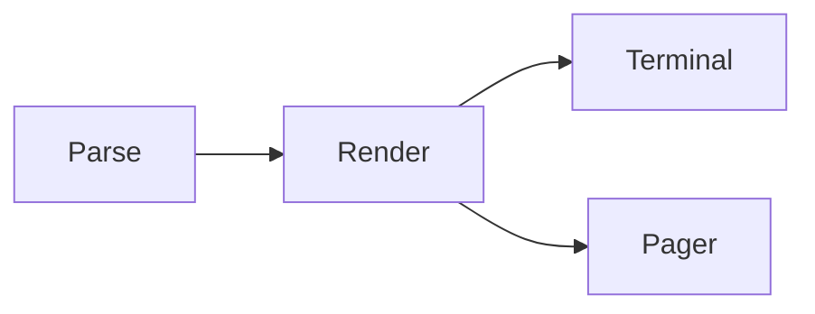

The picture's width and height follow from the labels. Each box is its label plus
two columns of padding on each side and a row above and below; ranks are a few
cells apart. A diagram too wide for the terminal is [fitted](#13-fitting-the-width).

## 2. Diagrams that are not drawn here

The built-in renderer draws flowcharts, and declines anything it does not draw
exactly. A declined diagram is never drawn wrongly; it goes to `mmdc` or to source.
The reasons, as `MDCAT_MERMAID_DEBUG=1` words them:

| Reason | Example |
| ------ | ------- |
| `not a flowchart` | `sequenceDiagram`, `pie`, `gantt`, `classDiagram`, … |
| `unsupported syntax: …` | `direction` inside a graph, `end` as an id, a link with mismatched ends such as `A o--> B`, an unclosed shape or quote |
| `subgraph layout: depth` | subgraphs nested more than three levels deep |
| `subgraph layout: title` | a subgraph title for which no place was found clear of the edges that enter the box (rare: the box is made wider first) |
| `subgraph layout: sides` | two subgraphs whose members interleave on the ranks, so their boxes cannot both have straight sides |
| `subgraph layout: edge` | an edge would run through a box it has no end in, along a border, or out of a box that holds both its ends |
| `subgraph layout: node`, `…: label`, `…: boxes`, `…: border` | a box with a footprint or edge label that is not its member's inside it, or with a member or label outside it, two boxes that touch (or an inner one that is not strictly inside the outer), or a border over a box or a label (checks that catch a layout bug) |
| `unsupported syntax: direction in subgraph` | a `direction` statement inside a `subgraph` |
| `unsupported syntax: link to subgraph S` | an edge that starts or ends at a subgraph's id (`A --> S`) |
| `unsupported syntax: subgraph S named as a node` | a subgraph's id used as a node with no link (`S`, `S:::cls`) |
| `unsupported syntax: style on subgraph S` | `style` or `class` naming a subgraph's id |
| `unsupported syntax: empty subgraph S` | a subgraph with no node and no subgraph in it, or whose nodes an earlier-closing subgraph already holds (`mmdc` draws it as a plain box) |
| `unsupported syntax: …` | also an `end` with no open `subgraph`, a `subgraph` never closed (the line that opened it is named), two subgraphs with one id, and a title that is empty (`id[]`) or has text after it |
| `unsupported direction` | `graph XY` |
| `unsupported shape: NAME` | `A@{ shape: doc }` and the other shapes that are not [drawn](#10-node-shapes) |
| `unsupported label: …` | a label that is not valid where it stands, such as `"say "hi""`, `a[""]`, or a blank edge label |
| `unsupported entity: …` | `#nosuchentity;` |
| `html in label` | an HTML tag other than `<br>`, such as `<b>` or `a<b`; a `<` before a space, digit or `=` is plain text |
| `label too wide: N > 40` | an edge label with a single word over 40 columns (any other long label is wrapped at 24) |
| `back edges: N > M`, `crossings: N > M` | too tangled to read, see [Limits](#limits) |
| `too many nodes`, `too many ranks`, `too many ports` | more than 60 boxes or ranks, or an edge fan too wide to give every edge a port |

Most of these go on to `mmdc`. The two tangle limits do not: a diagram that
`mmdc` would only draw as a hairball is shown as source, and `mmdc` is not asked.

## 3. Branches and merges

Where several edges leave one box they share its port and split off a common bus;
where several arrive they merge into one arrowhead. A dot marks each split or
merge, and bends are rounded. Extra dashes make a link longer: `a --> b` puts `b`
one rank after `a`, `a ---> b` two, and `a ----> b` three. A box with no incoming
edge is not forced into the first rank: it is pulled down next to what it points at,
so a late source does not leave a long edge behind it.

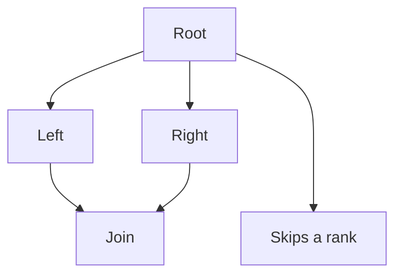

Ports sit symmetrically on every box, arriving or leaving: an odd number of ports
uses the middle one, an even number leaves it empty, so no edge sits straight ahead
and seems to take priority. A decision (`{…}`) is also the exception to sharing:
each outcome leaves through a port of its own, never a bus. Below, `Ok?` has two
outcomes and `Which?` has three.

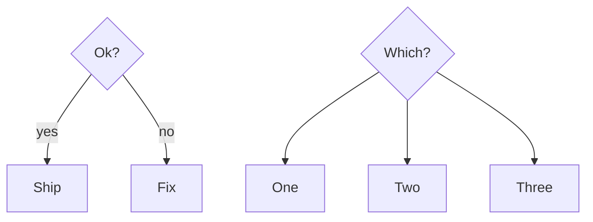

Separate parts of one diagram, with no edge between them, are drawn side by side
(top down) or one below the other (left to right).

## 4. Tracks and bridges

When edges interleave, each bus gets a **track** of its own between two ranks, and
the gap between the ranks grows by one row (or column) for each track. Where an edge
must cross another, it passes over it on a **bridge**: the stroke breaks, and no
dot is drawn. A dot always means a join, and a bridge never does.

Edges share strokes only in a split from one box or a merge into one box, so a
drawing never suggests a link that isn't there. Below, `Lexer` and `Document` each
merge their own sources, and `Source` and `Config` each leave through two ports, one
per merge, instead of joining buses that would lead from one source up into
another:

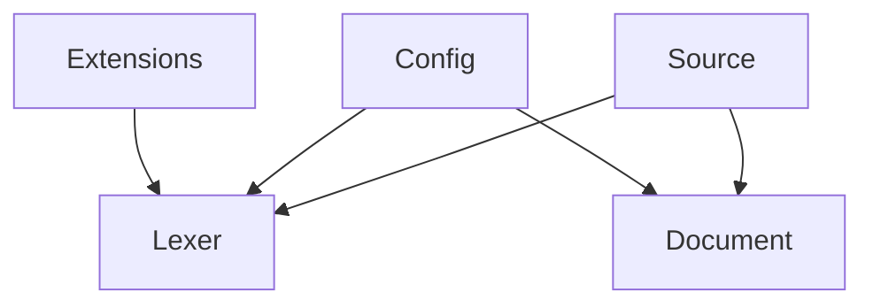

Complete bipartite graphs such as K₃,₃ (nine edges, eight crossings) are about the
most the width of an 80-column terminal allows; see [Limits](#limits).

## 5. Ordering the boxes

The order in which boxes are declared is a starting point, not a layout. The
renderer sweeps each rank to reorder its boxes so that few edges cross, then places
them across the rank so that long edges run straight through the ranks they pass
and a box sits next to its neighbours. Below, declared in order `C` would come
before `D` and `B`'s edge would cross `A`'s; `D` is put first, so `C` sits between
`A` and `B` and nothing crosses:

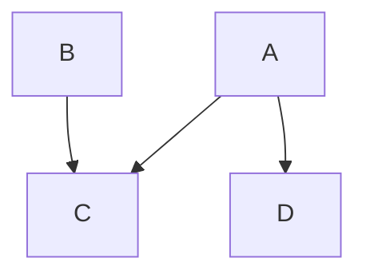

The sweeps minimize crossings; they do not promise the minimum. Whatever remains is
drawn with bridges and counts against the [limit](#limits).

## 6. Syntax

**Directions.** `TB` and `TD` (top down, the default), `BT`, `LR` and `RL`; the
aliases `v` for `TB`, `^` for `BT`, `>` for `LR` and `<` for `RL`; and no
direction at all, which is top down. `flowchart-elk` reads as `flowchart`.
Arrowheads point the true way, and labels are never mirrored.

**Statements.** Separate them with newlines or `;`. A chain, `a --> b --> c`, makes
`a --> b` and `b --> c`. `&` makes every combination: `a --> b & c` and
`a & b --> c & d` (four edges).

**Comments and directives.** `%% a comment`, on its own line or at the end of one,
and `%%{ init: … }%%` directives, over several lines or not, are read and ignored.

**Front matter.** A `title:` is drawn in bold, centred above the diagram. Other
keys, such as `config: theme:`, have no visual effect. The exception is
`config: markdownAutoWrap: false`, see [Label text](#9-label-text).

**Node colours.** `style ids …`, `classDef names …`, `class ids name` and `A:::name`
set a node's `fill` (the box), `stroke` (its outline) and `color` (its label text), as
`#rgb` or `#rrggbb`. A class is applied in the order it was given, then the node's own
`style`, so that wins. Other properties, such as `stroke-width` or `font-family`, are
read and dropped, as are colours in any other form. Edges keep the theme's colour.

**Read but without visual effect.** `linkStyle`, `click`, edge ids (`e1@-->`) and their properties (`e1@{ animate: true }`),
`accTitle` and `accDescr` (also over several lines) are all understood and
dropped.

**Ids** may hold non-ASCII letters, `.` and `-`.

```mermaid
---
title: Right to left, with a chain and a fan-out
---
graph RL
    a[Source] --> b[Build] --> c[Test] %% a chain
    c --> d[Ship] & e[Report]
    style d fill:#bbf
```

Colours from `style`, `classDef` and `class`:

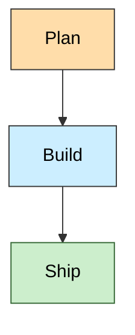

## 7. Link styles

| Syntax | Drawn as |
| ------ | -------- |
| `-->` | arrowhead |
| `---` | open, no head |
| `-.->`, `-.-` | dotted, with and without a head |
| `==>`, `===` | thick, with and without a head |
| `--o`, `--x` | ends in a circle or a cross |
| `<-->`, `o--o`, `x--x` | markers at both ends |
| `~~~` | nothing, but the boxes are still ranked as if joined |

Length works for every style: one more character is one more rank, so `--->`,
`-..->`, `===>` and `----` (open) span two ranks, and `---->` three. A long
link keeps its dashes or thickness along the whole way. `~~~~` is an invisible link
of two ranks.

Edges of different styles never share a bus: a port holds edges of one style only.
Below, `Build` leaves through one port for its dotted link and another for its
plain one. Invisible links get no port and no stroke at all.

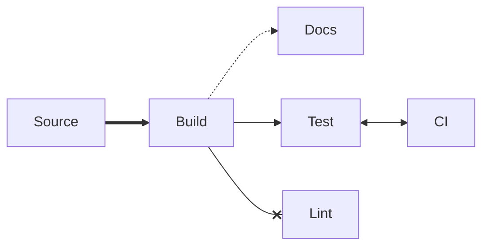

Dashes restart on every straight stretch of a dotted edge, so a bend never ends in
half a dash, and a dotted edge crosses another on a bridge like any other.

## 8. Edge labels

Edges can carry text: `a -->|yes| b`, `a -- yes --> b`, `a -. yes .-> b`,
`a == yes ==> b`, and the same on open, circle, cross and two-ended links. The
label is ordinary, selectable text that sits on its edge, halfway between the
boxes, and the edge stops just short of it on either side.

The label is a node of its own in the layout. As soon as any edge in a diagram is
labelled, every rank is twice as far apart, so a label always has a rank to sit in,
and a label on a longer link sits in the middle one. Labels do not affect how edges
share ports: edges with different labels, or none, still split from one box and
merge into one on a single bus.

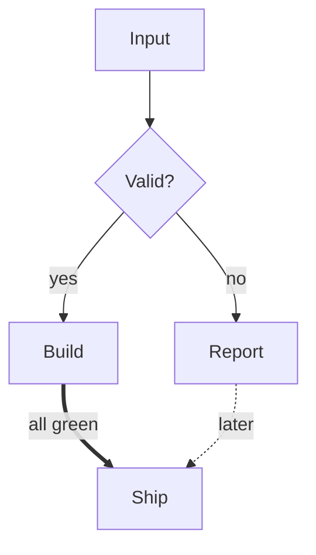

The text in the middle of a link is everything up to the link's own end, so it may
hold parentheses, brackets, braces and pipes without quotes: `a -- foo() --> b`,
`a -- [5] --> b`, `a -- x|y --> b`. The space after `--`, `-.` or `==` may be left
out when what follows cannot continue a link, as in `a --[7] --> b`, `a -.[x].-> b`
and `a ==[y]==> b`. A `|text|` label after `-->` is stricter, as in Mermaid: it may
not hold brackets or parentheses (Mermaid reports a parse error there, as it does for
`a --x--> b`). Text that touches the end of its link (`a -- foo--> b`) is declined,
since Mermaid reads the `o` as a marker and drops it.

A label over 24 columns wide is wrapped after spaces, so that no line is wider than 24
(a `<br>` is a break of its own, and each line is wrapped in turn). A single word is
never split, so an identifier such as `parsed_find_command::parse()` makes its label
as wide as it is. An edge label is declined only when a word is over 40 columns, as are
a label with an HTML tag other than `<br>` and a label on an invisible link
(see [section 2](#2-diagrams-that-are-not-drawn-here)).

## 9. Label text

Labels follow Mermaid's rules for text.

- **Quoted labels**, `a["x (y) [z]"]`, may hold brackets, parentheses, pipes and
  even `-->`, which are literal text instead of syntax. The quotes are not shown.
  A quote inside quotes is not allowed. Text after the closing quote on the same
  line is accepted, as in `mmdc`.
- **Entity codes**: numeric codes (`#35;`, `#9829;`) and about fifty names (`#quot;`,
  `#amp;`, `#lt;`, `#hearts;`, `#rarr;`, `#copy;`, …) stand for their characters. An
  unknown name is declined.
- **Line breaks**: `<br>`, `<br/>` or `<br />` starts a new line. A node with a
  label of *n* lines is *n* + 2 rows tall, and each line is centred. Other HTML is
  declined. A `<` starts a tag only when a letter, `/` or `!` follows it, so
  `a["c < 5"]`, `b >= 0` and `1 <= 2` are plain text, while `a<b` is a tag (Mermaid
  drops its text) and is declined.
- **Markdown strings**, ``a["`**bold** and *italic*`"]``, are the one kind of label
  that interprets Markdown: bold, italic, `` `code` `` and a newline as a hard
  break. They wrap at 24 columns, as does a plain label with spaces (after a space,
  never in the middle of a word). A plain label such as `a*b*c` is drawn exactly as
  written, and so is an entity such as `#35;` inside a Markdown string. Front matter
  `config: markdownAutoWrap: false` turns the wrapping off.
- **Blank labels**: a quoted label of spaces only, `a(" ")`, is an empty label, and the
  node is an empty box of the smallest size (Mermaid draws it the same way). A quoted
  string of no characters at all, `a[""]`, is a parse error in Mermaid and is declined.
  Mermaid users hide such a node, to hold its place in the layout, with `style a
  height:0px;`: that node is a *spacer*, whose room is kept (edges go round it, ranks
  count it) but which is not drawn. A `height:0` style on a node that has a label does not make it a
  spacer. Edge labels and subgraph titles are not affected: a blank edge label is
  declined, and a blank title means none.
- **Wide characters** are measured by display width: CJK and emoji take two
  columns, and a box is as wide as the text needs.

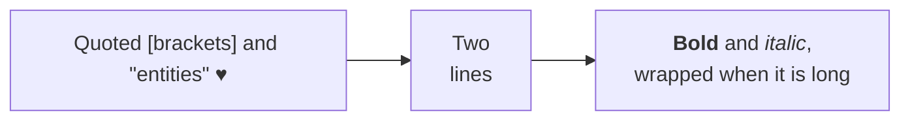

## 10. Node shapes

| Syntax | Shape |
| ------ | ----- |
| `[text]` | box |
| `(text)` | rounded box |
| `([text])` | stadium |
| `((text))` | circle |
| `(((text)))` | double circle |
| `[[text]]` | subroutine |
| `[(text)]` | cylinder |
| `{text}` | rhombus |
| `{{text}}` | hexagon |
| `[/text/]`, `[\text\]` | parallelograms |
| `[/text\]`, `[\text/]` | trapezoids |
| `>text]` | flag, with a notch in its left side |
| `@{ shape: div-rect }` | divided process: a box with a line across it, a row below its top |
| `@{ shape: lin-rect }` | lined process: a box with a line just inside its left side |
| `@{ shape: lin-cyl }` | lined cylinder: a cylinder with a second arc a row under its lid |
| `@{ shape: h-cyl }` | horizontal cylinder: on its side, a half ellipse at the left end and a full one at the right |

Mermaid's newer form names a shape instead of drawing it, `a@{ shape: db, label:
"Store" }`, and every short name or alias of the shapes above works: `rect`,
`rounded`, `stadium`, `circle`, `dbl-circ`, `fr-rect`, `cyl`, `diam`, `hex`,
`lean-r`, `lean-l`, `trap-b`, `trap-t`, `odd`, `div-rect`, `lin-rect`, `lin-cyl`,
`h-cyl`, `decision`, `database`, `disk`, `shaded-process`, `das`, and more. The last
four shapes in the table have no bracket form; they are written only this way.
Other keys in the block, such as `icon:`, are ignored. A name for a shape that isn't
drawn here sends the diagram to the fallback; the ones that Mermaid has and this
renderer lacks include `doc`, `lin-doc`, `docs`, `processes` (`procs`), `extract` and
`tag-rect`.

The curves and slants are drawn exactly, so an arrowhead touches the outline where
the edge meets it, even off the middle of a side. Each shape takes the room its
outline needs to clear the label: a stadium, subroutine and hexagon are two columns
wider than a box; a cylinder is a row taller, its label sits under the lid, and it
is at least as wide as an 8-column label so that the lid is equally deep whatever
the label; a rhombus is four rows taller than its label and about twice as wide; a
circle is widened until the label's box fits inside; and the slanted shapes are two
columns wider, with sides slanted by one column; a divided process is a row taller,
with its label under the line, a lined process two columns wider, and a lined
cylinder two rows taller than a box, its label under both arcs; a horizontal
cylinder is four columns wider than a box, with caps a column deep, so that the label
clears the inner arc of the full cap on the right (which stays on the right in `RL`).
Each draws what `mmdc` draws, and its extra line is interior: edges still meet the
outer outline, a `stroke` colour from `style` also colours the extra line, and a
`fill` fills the whole shape. Quoted and Markdown labels work in every shape.

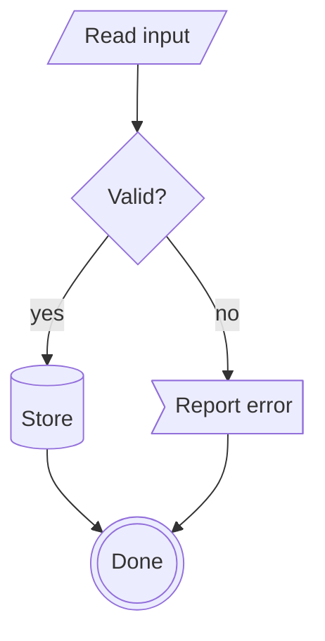

## 11. Cycles, self-loops and parallel edges

A graph may have cycles. The edge that closes a cycle, found by a depth-first search, is a **back edge**: it is drawn against the flow, with an
arrowhead at its real target. It leaves and arrives through ports of its own, a cell
beside the middle, so it never merges with the edges running the other way, and a box
with many ports grows to hold them. Back edges work in all four directions, with
labels and in every style, and a long cycle is drawn the long way round.

A box may point at itself. The **self-loop** is drawn beside the box, to its right
(below it, in a left-to-right diagram), and its label sits beyond it. Of several
self-loops on one box only the last is drawn, as in `mmdc`.

Two edges may join the same pair of boxes: each gets ports of its own and they run
side by side, whether they point the same way or opposite ways. `A <--> B` is one
edge with two heads; `A --> B` and `B --> A` are two.

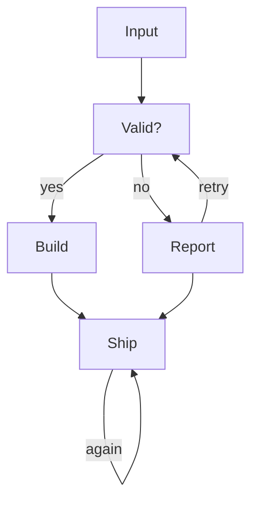

Here `retry` is the back edge, drawn from `Report` up to `Valid?`; `Ship` points at
itself; and `Valid?` and `Report` are joined in both directions.

## 12. Subgraphs

A `subgraph … end` is drawn as a box around the boxes named inside it, in a graph of any
direction (`TD`, `TB`, `BT`, `LR` or `RL`), nested up to three levels deep. The box is a plain outline in the theme's
colour, under the boxes and edges and with no fill. Mermaid's membership rules apply: a box
belongs to the subgraph that names it, even if it was first named outside, and to the one
that closes first if two name it.

The layout keeps each subgraph's boxes together. On every rank from its first member's to
its last it holds a left and a right border, so the sides are straight, and an edge or box
that is not a member never lands inside it, even on a rank that holds none of its members.
An edge into or out of the subgraph crosses the border at a right angle; an edge between
two boxes outside it goes round; an edge between two members stays inside. A subgraph's box
is one blank column (top-down) or one blank row (left to right) from its members, and the
borders across the flow get rows (columns, left to right) of their own in the gaps between
ranks.

The title (`subgraph id [Title]`, `id["Title"]`, a bare id, a quoted id, or text with
spaces; Markdown, `<br>` and entities as in a node's label) is written in bold under the
top border, centred, in rows of its own between the border and the first rank. A blank
title (`subgraph s[" "]`) is not drawn. The box is at least as wide as the title plus a
blank column and the border on each side: if its members make it narrower it is widened,
and the boxes beside it move out of the way. A title is never drawn over an edge. An edge
that enters the box from above runs down through the title's row, so the title then moves
along the row to the nearest place beside the edge, with a blank column on either side;
where there is no such place the box grows on the side that the title goes, by just as much
as that takes. A title wider than 24 columns is wrapped like a node label: a Markdown title
at once, a plain one only if the diagram has to be [fitted](#13-fitting-the-width).

The title is text, so it is always horizontal and always under the top border *as drawn*.
That takes a little thought in the other directions. Left to right (and right to left) the
flow runs along the box's width, so the title's rows are across the flow: they join the
space between the box's top border and its first member, which is one blank row more per
line of title, and the box's width is stretched, by columns inside it before the first
member and after the last, if the title is wider than the box is. The edges that cross the
title there are the ones that jog between two ranks inside the box and leave through its
top border, and the title moves beside them, or the box grows, as top-down. Bottom-up, the
top of the box is where its flow ends, so the title's rows lie between the last rank and
the top border and it is the edges that leave the box which it has to keep clear of. Right to
left is left to right mirrored, the title not mirrored with it.

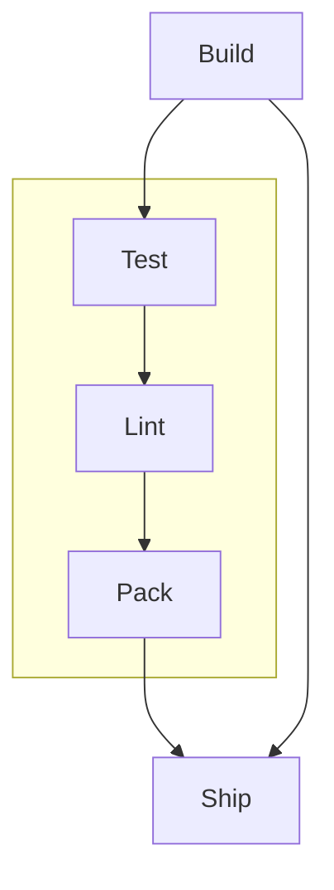

A titled subgraph; the title sits beside the edge that enters the box:

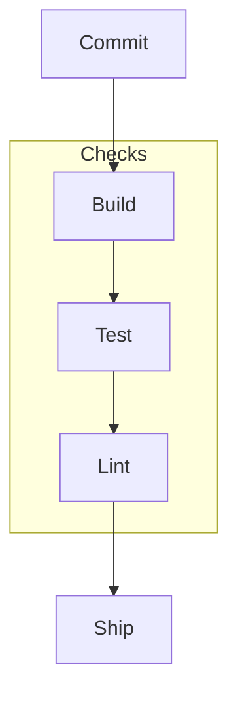

The same left to right, with the title centred under the top border:

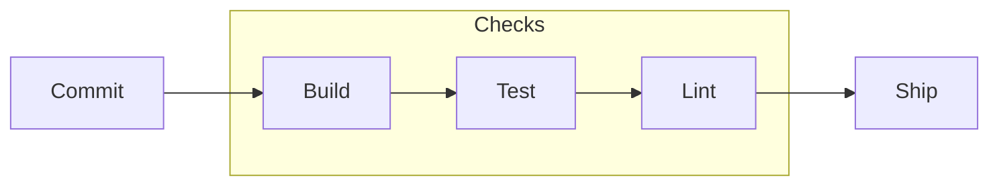

Left to right, a track along which an edge jogs between two ranks is a blank column from a
box's side border. In every direction no edge is level with a border, near its end (a stub on
the column of a side border, or a port or junction on the row of a top or bottom border, would
seem to run into it): such a box is moved a cell across the flow until none is, or the diagram
is declined as `subgraph layout: edge`.

A diagram whose subgraphs cannot be drawn without an edge running through a box, or whose
boxes would cross, is declined (`subgraph layout: …`, see [the table](#2-diagrams-that-are-not-drawn-here)):
a subgraph with members on far apart ranks and other boxes between them is the usual cause.

### Nested subgraphs

A subgraph written inside another is drawn as a box inside its box, up to three levels deep;
a fourth level is declined as `subgraph layout: depth`. A node belongs to the innermost
subgraph that names it, and the outer box holds the inner one and the nodes named directly
in it. An outer subgraph may hold only inner subgraphs and no node of its own, as in
MongoDB's plan-enumeration diagram. The outer box encloses the inner one with a blank
column (top-down; a blank row, left to right) between each border and the next, so two
nested borders are never closer than that, and never share a cell.

The rules above hold at every level: the sides of every box are straight, only a box's
members lie in it (those of a box inside it too), and an edge crosses each border it meets
at a right angle and never runs along one. An edge from outside both boxes into the inner
one crosses the outer border and then the inner one; an edge between two members of the
outer box that passes the inner box goes round it.

Along the flow, when a box and the one inside it start (or end) on the same rank, their
top (bottom) borders take rows of their own in the gap before the rank, the outer one first
(for ends, the inner one first), with the outer box's title rows and a blank row between them:
a title is never run into the border of the box inside it. Each takes columns of its own the
same way left to right. A box that starts later, or ends earlier, than the one around it has
its borders in the gap where it starts or ends, inside the outer box.

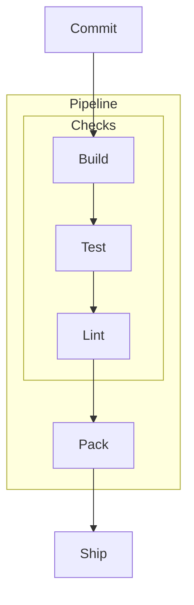

The same left to right, with a third level:

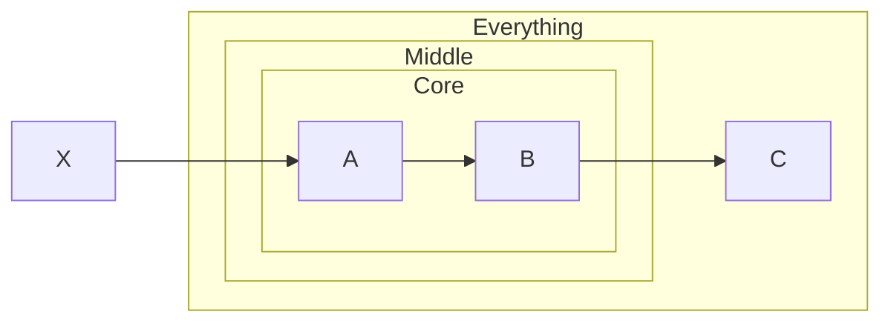

## 13. Fitting the width

A diagram wider than the terminal is fitted before anything else, never by changing
its direction. The renderer tries, in turn, and draws the first that fits:

1. the natural spacing;
2. tighter spacing: a column less between siblings or ranks, and one column of
   padding around a label instead of two;
3. labels with spaces wrapped on word boundaries at 24, then 16, then 12 columns.

A single word is never split. If nothing fits, the narrowest attempt is drawn
anyway, wider than the terminal, rather than given up on: widen the window, or
scroll sideways in a pager that doesn't wrap lines. This chain is 98 columns wide at
its natural size, and draws in about 75 when the terminal is 80 wide:

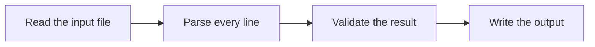

## Limits

| Limit | Value | Reason shown |
| ----- | ----- | ------------ |
| boxes | 60 | `too many nodes` |
| ranks | 60 (long links add some) | `too many ranks` |
| edge label word | 40 columns | `label too wide` |
| back edges | one per ten columns of the terminal's width | `back edges: N > M` |
| crossings (bridges) | one per ten columns of the terminal's width | `crossings: N > M` |

For the last two, a terminal narrower than 72 columns counts as 72 wide, so an
80-column terminal allows 8 of each. Beyond that, a diagram is too tangled to
read: it is shown as source, and `mmdc` is not asked to redraw it.

Subgraphs have limits of their own, each declined with the reason shown:

| Limit | Reason shown |
| ----- | ------------ |
| nesting deeper than three levels | `subgraph layout: depth` |
| a box whose members lie on ranks far apart with other nodes between them, so that an edge would have to cross it (the box cannot be drawn with straight sides and no edge through it) | `subgraph layout: edge` |
| two subgraphs whose members interleave on the ranks | `subgraph layout: sides` |
| `direction` inside a subgraph, and an edge to or from a subgraph's id | `unsupported syntax: …` |

Two MongoDB diagrams stop at `subgraph layout: edge` once their missing shapes are
swapped for boxes: `src/mongo/db/matcher/README.md:341` (two subgraphs) and
`src/mongo/db/exec/runtime_planners/classic_runtime_planner/README.md:157` (a box of
three decisions). The layout does not reorder anything to get out of such a case.

Not drawn at all: `direction` inside a graph, and the other diagram types
(sequence, pie, class, state, Gantt, …). Colours, curves and other styling are read
but have no effect, except the node colours described in [Syntax](#6-syntax). A flowchart that is declined goes to `mmdc` when it is
available.
