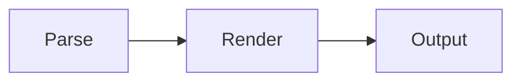

# Implementation plan — built-in Mermaid flowcharts (Kitty graphics + text labels)

Goal: draw the common subset of Mermaid **flowcharts** (`graph` / `flowchart`)
inside mdcat itself, without launching `mmdc` and its headless Chrome:

- **Shapes and arrows** are one Kitty-protocol image that mdcat rasterizes itself.
- **Labels** are ordinary text in the character cells over that image. They stay
  crisp in the terminal's own font, take the theme's colours, are searchable in
  `gmore`, and can be copied and pasted.

Everything outside that subset, and every terminal without the Kitty graphics
protocol, keeps today's behaviour: an `mmdc` image on a graphics terminal, else
the source as a code panel.

> **Fixture names.** The steps below name the fixtures as they were written. They
> have since been numbered in the order they were added: `tests/mermaid-basic.md`
> is now `tests/mermaid-1-basic.md`, then `2-fallback`, `3-dag`, `4-routing`,
> `5-crossings`, `6-syntax`, `7-links`, `8-edge-labels`, `9-label-text`,
> `10-shapes`, `11-cycles` and `12-fit`. For the user-facing description of what is
> drawn, see [MERMAID.md](MERMAID.md).

It is **not** a goal to resemble Mermaid's rendering. Layouts may differ the way
Mermaid's own layouts differ from each other: v12 lays flowcharts out with ELK by
default, and `layout: dagre` selects the classic Dagre layout. It **is** a goal
never to emit a diagram that is illegible or misrepresents the graph: when in
doubt, fall back.

Syntax reference: <https://mermaid.js.org/syntax/flowchart.html>.

## How to run a step

Each step is sized for **one Sonnet 5.5 session at high effort**. Use this prompt:

> Implement Step N of `docs/plan-mermaid-flowcharts.md`. Read `CLAUDE.md`, the
> plan's *Guiding decisions* and *Model contract*, and Step N. Do only Step N.

A step lists what it may assume from earlier steps, the source symbols to start
from, its scope (including what is explicitly *out*), its tests, and its README
touch. The steps form a dependency chain:

| Step | Title | Needs |
| ---- | ----- | ----- |
| 0 | Probe: text over a Kitty image (user-run) | — |
| 1 | Render the README's two diagrams | — (0's results refine it) |
| 2 | Previewer | 1 |
| 3 | Override flag, fallback reasons, fallback fixture | 1 |
| 4 | Restructure into model / parse / layout / draw | 2, 3 |
| 5 | Trees, merges, multi-rank edges | 4 |
| 6 | Multi-track routing, crossings, bridges | 5 |
| 7 | Layout quality | 6 |
| 8 | Non-rendering syntax and all directions | 4 (any time after) |
| 9 | Link types and lengths | 5 |
| 10 | Edge labels | 6, 9 |
| 11 | Label text and Markdown strings | 10 |
| 12 | Shapes I: curves and the diamond | 11 |
| 13 | Shapes II: slanted shapes and `@{ shape }` | 12 |
| 14 | Cycles (back edges) | 7, 10 |
| 15 | Self-loops and parallel edges | 14 |
| 16 | Fit-to-width, calibration, docs | all |

### Definition of done (every step)

- `make format`, then `make check` is green, with the pinned clang-format.
- New or changed goldens were **read and judged**, not just regenerated. If a
  step changes a golden from an earlier step, the final report says which golden
  and why.
- Each new fixture has a row in `tests/README.md`. The README touch listed in the
  step is done.
- The work is committed as **one** commit with a single-line message of at most 80
  characters and no trailers, per `CLAUDE.md`. Nothing is pushed.
- The final report ends with what the user should eyeball in a Kitty terminal,
  using `./mdcat tests/<fixture>.md`, both directly and while scrolling in
  `gmore`.

## Why not box-drawing text (the rejected first attempt)

The first Step 1 prototype drew everything with Unicode box-drawing characters.
On real terminals it failed on the essentials:

- **No arrowhead meets a box border.** `▼` floats a whole row above the box, and
  `►` stops half a cell short. A three-cell head such as `╲│╱` reads as a fork,
  not an arrow.
- Junction glyphs (`┬`, `├`, `┼`) can't tell a fan-out apart from a crossing.
- Diamonds, circles, cylinders, and dotted or thick lines have no faithful glyphs.

These are drawing problems, and a raster solves them all. Text is still the
right medium for labels, so the design splits the two layers. The prototype's
parser and chain layout carry over into Step 1; its glyph drawing is discarded.

## Guiding decisions

### Fallback chain and override

For each ```` ```mermaid ```` block, mdcat tries in order:

1. **builtin** (this plan). It runs only when the graphics backend is **Kitty**
   and image output is on, which is the same test other images use:
   `terminalSupportsGraphics() && graphicsBackend() == GraphicsBackend::Kitty`.
   It needs neither `timg` nor `mmdc`.
2. **image**: the existing `renderMermaidBlock` (`mmdc` → PNG → `timg`). It
   covers diagrams the builtin declines and all sixel terminals. It is already
   gated on `mmdcAvailable()`, which is false when graphics are off.
3. **source**: `emitCodeBlock(body, lang, out)`, as today.

The default mode is `auto` (1 → 2 → 3). Step 1 hard-wires this chain. Step 3 adds
an override that mirrors `--img` / `MDCAT_GRAPHICS`:

| Mode | Chain | Use |
| ---- | ----- | --- |
| `auto` (default) | builtin → image → source | |
| `builtin` | builtin → source | never spawns `mmdc` (tests use this) |
| `image` | image → source | the pre-plan behaviour |
| `source` | source | always show the Mermaid source |

- **Spelling:** `--mermaid <mode>` / `--mermaid=<mode>`, or the environment
  variable `MDCAT_MERMAID=<mode>`. The flag wins over the variable.
- **Invalid value:** an error (exit 2 plus usage), exactly like `--img=bogus`.
- **No Kitty:** `builtin` degrades to source.
- **Debugging:** with `MDCAT_MERMAID_DEBUG=1`, every builtin rejection prints one
  line to stderr: `mdcat: <file>:<line>: mermaid: fallback: <reason>` (`<stdin>` for piped input; `<line>` is the diagram's opening fence, or that of the enclosing block inside a list or quote). Reasons are short,
  stable strings so tests can assert them, for example:
  - `not kitty`, `not a flowchart`, `subgraph`, `overlap`
  - `unsupported shape: doc`
  - `too wide: 97 > 80`, `crossings: 24 > 8`

### Mermaid semantics we follow (not invent)

- **Grammar** is Mermaid's flowchart syntax. If we parse something, it must mean
  what it means in Mermaid; anything we don't understand → fallback, never a
  guess.
- **Markdown formatting** applies inside Mermaid *markdown strings* on node and
  edge labels: ``A["`**bold** and *it*`"]``.
  - Mermaid documents `**bold**` and `*italics*`. A literal newline is a line
    break.
  - Markdown strings auto-wrap unless front matter sets `markdownAutoWrap: false`.
  - Plain labels are literal in Mermaid (`A[a*b*c]` shows the asterisks), so they
    stay literal here, and break lines only at `<br>`.
- **Link length:** each extra `-` makes a link span one more rank: `-->` = 1,
  `--->` = 2, `---->` = 3. Dotted links add `.` (`-.->`, `-..->`), thick links
  add `=` (`==>`, `===>`).
  - With a label in the middle of the link, the extra characters go on the
    right: `B -- No ----> E`.
  - Lengths are *minimums*. The layout may stretch an edge but never shortens it.
- **Styling** is dropped silently: `style`, `classDef`, `class`, `linkStyle`,
  `:::cls`, `click`, colours, animation, and `%%{init}%%` config.
- **Subgraphs** are not supported yet → fallback.

### Two layers: a cell grid of text over one Kitty image

Layout happens on the **character-cell grid**. The drawer then produces three
outputs:

- **Text layer:** `rows` strings, each exactly `cols` columns wide. Labels sit at
  their cells (as styled text from Step 11); every other cell is a space.
- **Graphics layer:** an RGBA raster of `cols × cellW` by `rows × cellH` pixels.
  - Strokes (outlines, edges, arrowheads, end markers) are opaque in the stroke
    colour. Everything else is **fully transparent**.
  - Label cells are always transparent and free of strokes, with a margin around
    them.
- **Occupancy grid:** for each cell, whether it holds a node, a label, an edge,
  or nothing. Validation and tests use it.

**Coordinates** are in **half-cell units** (hu), so that ½-cell positions are
integers:

- Cell `(c, r)` spans `x ∈ [2c, 2c+2]` and `y ∈ [2r, 2r+2]`, with its centre at
  `(2c+1, 2r+1)`.
- Pixels are `px = hu·cellW/2` and `py = hu·cellH/2`, using integer floor.

Three rules tie the strokes to the grid:

- Lines run along cell centres.
- An outline is inset ½ cell from its node's footprint.
- An arrowhead's tip touches the target outline exactly. This is the property
  box-drawing could not provide.

Raster parameters, all derived from the cell size so the diagram looks the same
at any DPI:

| Parameter | Value |
| --------- | ----- |
| Cell size | `cellMetrics()`, in real pixels per cell; `MDCAT_CELL_W/H` override it |
| Stroke width `s` | `max(1, round(cellW / 9))` |
| Stroke colour | `#c8c8c8` on a dark theme, `#505050` on a light one (`darkBackground()`) |
| Arrowhead | filled triangle: length `max(6, cellW)`, half-width `max(3, round(0.45·cellW))` |
| Anti-aliasing | axis-aligned strokes are snapped to whole pixels; diagonals, curves and triangles use 4×4 supersampling |

### Emitting the block (mdcat) and paging it (gmore)

Ordinary images reserve their rows with blank lines, move the cursor up (`CUU`),
and paint (`imageParagraphBytes`). That pattern **does not work for a diagram**,
for two reasons:

- A cursor-up stops at the top of the screen.
- `gmore` recognizes a band taller than the screen only when the band is made of
  consecutive *blank* LFs (`consecutiveLf` in `gmore_emulator.cpp`'s
  `dispatchCsi`).

The README's TD chain is about 48 rows tall. So a diagram puts the **image first,
with no cursor-up**, and then prints its text:

```
[ESC[<pad>C]  ESC7  <APC… C=1 …>  ESC8  \r  <text row 1>\n … <text row N>\n
```

- **The image is placed at the band's top-left before any text.** `C=1` (and the
  `ESC7`/`ESC8` pair around it, to be safe) leaves the cursor where it was. The
  text rows that follow scroll normally, and the image scrolls with them. Each
  text row carries the centring pad as leading spaces.
- **The APC** carries one image with a PNG payload. Its first chunk is
  `a=T,f=100,i=<id>,q=2,C=1,c=<cols>,r=<rows>,z=0`. The base64 payload is split
  into chunks of at most 4096 bytes (`m=1` … `m=0`), and **every** continuation
  chunk also carries `q=2`. `docs/TERMINAL-GRAPHICS.md` §5 and §8 explain why.
- **Ids:** emit any id. The writer renumbers every slot's Kitty ids in document
  order (`kittyRenumberAll`, ADR 0003), so ids stay distinct.
- **gmore** stores the text in its cell grid and the image in its image layer,
  anchored at the cursor. One change is needed: honour `C=1` in `finishKitty`
  (anchor the image at the cursor, and do not advance the cursor or set
  `absorbLf`, Step 1). The image is sent with `z=0`, the default, so `gmore`'s crop
  placements need no `z=`.

  When `gmore` repaints, it writes the text first and then places the image.
- **Two orders, both required.** Direct output draws the image and then the
  text; a `gmore` repaint draws the text and then the image. Labels must survive
  both. Transparent label cells make the order irrelevant, with the image at
  `z=0` (over the text). Step 0 measured this: `z=0` works on Ghostty, iTerm2,
  Kitty and VSCode, while `z=-1` shows no image at all on VSCode.
- **Text rows skip the band with cursor moves, never spaces.** On VSCode, spaces
  printed over a `z=0` image make it disappear. Write each label run at its column
  with `ESC[<n>C` moves over everything else (the Step 0 cases H and I). Only the
  centring pad to the *left* of the image may be spaces.
- **Tall bands on VSCode.** In Step 0 case K, a band three screens tall shows its
  text shifted relative to the image on VSCode (unresolved). On VSCode
  (`TERM_PROGRAM=vscode`), a diagram taller than the screen falls back.
- **No `timg`.** mdcat writes this APC itself, from a PNG it encodes itself
  (`src/png_write.cpp`). This is a deliberate exception to ADR 0002 ("keep timg
  for all formats"), whose concern was the quality of *downscaling*. A generated
  diagram is rasterized at its exact final size and is never scaled. Step 0
  records the exception as ADR 0004.

### Layout approach (Sugiyama / Dagre-like, integer arithmetic)

1. **Rank** nodes into layers along the flow direction, honouring each edge's
   minimum length.
2. **Dummy nodes** split an edge that spans k ranks into k unit segments. Edge
   labels also become dummy nodes, at half-rank positions, as in Dagre
   (Step 10).
3. **Order** the nodes within each rank to keep crossings low.
4. **Place** nodes along the cross axis so edges run straight where possible.
5. **Route** edges orthogonally through the gaps between ranks, on assigned
   **tracks** (cell rows or columns).
6. **Draw** the text layer, the raster and the occupancy grid; **validate**;
   **emit**.

The layout works in an abstract (rank, cross) space:

- TD and LR map it to rows and columns.
- BT and RL mirror the rank axis *before* drawing, so text is never mirrored.
- Cells are about twice as tall as they are wide, so TD and LR get separate
  spacing constants rather than a literal transpose.

Graphics make the route easier to read:

- **Bends** get a ¼-cell rounded corner.
- **Crossings** get a **bridge**: the horizontal stroke breaks for `2s` px on
  either side of the vertical one.
- **Real junctions**, where a bus splits or merges, are drawn solid with a dot of
  radius `1.5s`. A crossing never looks like a connection.

### Legibility gates (any one ⇒ fallback)

- The terminal is not Kitty, or images are disabled.
- A parse error, an unknown statement, or an unsupported construct.
- ~~The laid-out width exceeds the available width.~~ Since Step 16 this is no
  gate: the diagram is fitted (below), and if it still is too wide it is drawn
  wider than `terminalWidth()`, as text rows and an image longer than the line.
- More edge crossings than the width allows: one per `kColsPerCrossing` (10)
  columns of `terminalWidth()`, so 8 at width 80. A terminal narrower than
  `kMinGateCols` (72) counts as 72 wide for this limit and the next. (It was a flat 2, then 3, before
  the limit followed the width.)
- More back edges than the width allows: one per `kColsPerBackEdge` (10) columns.
  Introduced in Step 14.

  These two are **complexity** gates. A diagram that trips one is shown as
  source in `auto` mode, and `mmdc` is not asked to draw it (`Decline::TooComplex`
  in `mermaid.h`). Every other gate leaves the diagram to `mmdc`.
- More real nodes than `kMaxNodes` (60 at first). This bounds layout cost and
  clutter.
- **Validation fails.** A final pass over the occupancy grid and the stroke list
  checks four things:
  - No edge passes through a node or label, except at its own endpoints.
  - No two edges with different sources *and* different targets share a segment.
  - Every arrowhead touches its target outline.
  - No stroke pixel falls inside a label cell.

  This turns any layout bug into a fallback instead of a misleading picture.

### Determinism

CI uses GCC/libstdc++; the dev Mac uses clang/libc++. The output must be
identical on both, for the text layer *and* the PNG bytes. So:

- No iteration over `unordered_*` containers; use `std::map` or vectors.
- No floating-point ties: use integer barycenters (×1000) and integer or
  fixed-point raster maths.
- `std::stable_sort` with explicit tie-breaks: previous position, then order of
  first appearance.

### Model contract

Step 4 introduces `src/mermaid_model.h`. Later steps **extend** it, by adding enum
values or fields, and never reshape it, so separate sessions stay compatible:

```cpp
namespace mermaid {
enum class Dir { TB, BT, LR, RL };
enum class Shape { Rect, Round, Stadium, Circle, DoubleCircle, Subroutine, Cylinder,
                   Rhombus, Hexagon, LeanR, LeanL, TrapB, TrapT, Odd };
enum class Line { Solid, Dotted, Thick, Invisible };
enum class End { None, Arrow, Circle, Cross };
struct Label { std::vector<std::string> lines; };           // styled; width via Env::width
struct Node  { std::string id; Label label; Shape shape = Shape::Rect; };
struct Edge  { int from = 0, to = 0, minlen = 1; Line line = Line::Solid;
               End head = End::Arrow, tail = End::None; Label label; };
struct Graph { Dir dir = Dir::TB; std::string title; std::vector<Node> nodes;
               std::vector<Edge> edges; bool markdownAutoWrap = true; };
struct CellBox { int col = 0, row = 0, cols = 0, rows = 0; };
struct Layout {                                   // cells for boxes, half-cell units for paths
    int cols = 0, rows = 0;
    std::vector<CellBox> nodeFoot, nodeLabel;     // per node
    std::vector<CellBox> edgeLabel;               // per edge (cols == 0 if none)
    std::vector<std::vector<std::pair<int, int>>> edgePath;  // per edge, orthogonal hu polyline
};
struct Stroke {                                   // what the rasterizer consumes, in hu
    enum Kind { Segment, Outline, Arrowhead, Dot, CircleEnd, CrossEnd } kind;
    Line line = Line::Solid;
    Shape shape = Shape::Rect;                    // for Outline
    std::vector<std::pair<int, int>> pts;         // segment ends / outline box / tip + base
};
}
```

### Code structure

- `src/png_write.{h,cpp}` (Step 1): `std::string encodePngRgba(int w, int h, const
  std::vector<uint32_t>& rgba)` writes colour type 6 at 8 bits per channel.
  - It emits *stored* (uncompressed) deflate blocks. Compression is deliberately
    not implemented: the image is local pixels, and the bytes are only a size
    cost, not a correctness one.
  - CRC-32 and Adler-32 are hand-written. There is no zlib dependency.
- `src/mermaid.h` (Step 1): the public API, independent of mdcat internals.

  ```cpp
  namespace mermaid {
  struct Env {
      int availCols;                  // terminalWidth()
      int cellW, cellH;               // real px per cell (cellMetrics)
      bool darkTheme;                 // darkBackground()
      std::function<int(const std::string&)> width;  // mdcat's displayWidth
      // From Step 11: Markdown → styled lines wrapped to maxWidth (styles closed per line),
      // i.e. mdcat's reflow(renderInline(md), maxWidth) split on '\n'.
      std::function<std::vector<std::string>(const std::string&, int)> markdownLines;
  };
  struct Diagram {
      std::vector<std::string> textRows;  // `rows` entries, `cols` columns each
      int cols = 0, rows = 0;
      std::string png;                    // cols*cellW x rows*cellH, transparent background
  };
  bool render(const std::vector<std::string>& body, const Env& env, Diagram& out,
              std::string& reason);
  }
  ```

- `src/mermaid.cpp` (Step 1), split in Step 4 into:
  - `mermaid_model.h`
  - `mermaid_parse.cpp`: lexer and parser → `Graph`, or a reason.
  - `mermaid_layout.cpp`: `Graph` → `Layout`.
  - `mermaid_draw.cpp`: `Layout` → strokes → raster, text layer and occupancy
    grid; then validation; then PNG.
  - `mermaid.cpp`: `render()` only.

  Tunables (spacing, gates, `kMaxLabelWidth`) live together in one `namespace
  tune` in `mermaid_model.h`.
- `src/mdcat.cpp`:
  - `kittyApcFromPng(png, cols, rows)`: base64 encoding, chunking, and the
    control keys listed above.
  - `overlayParagraphBytes(textRows, apc, pad)`, beside `imageParagraphBytes`.
  - The hook-up, in `render()`'s `mlang == "mermaid"` branch.
- Every new file is added to the Makefile's object rules, `FMT_SRCS` and `SRCS`,
  following `highlight.o`'s pattern.

### Testing approach

Builtin output appears only when Kitty is forced, so tests drive it with
`--img kitty` and pinned cell metrics, `MDCAT_CELL_W=10 MDCAT_CELL_H=20`. That
makes the PNG bytes deterministic.

**Previewer** (Step 2): `tests/kitty-preview.py`, Python 3 with the standard
library only.

- It emulates just enough of a terminal: text, `\n`, `\r`, CSI `A`/`B`/`C`/`D`,
  `ESC7` and `ESC8`. It strips SGR and OSC 8, and collects Kitty APC chunks.
- It decodes each PNG with `zlib`, failing on any bad CRC, and checks that the
  IHDR size equals `c·cellW × r·cellH`.
- For each image it prints a header line, `image @row,col c=… r=… z=… C=…
  png=W×H`.
- It then prints a **composite grid**. A cell holding label text shows that text;
  any other cell shows a **quadrant block** (`▘▝▀▖▌▞▛▗▚▐▜▄▙▟█`) according to
  which of its 2×2 sub-cells contain stroke pixels. A reviewer sees the diagram
  directly in a diff.
- `--labels` prints the text layer only (no headers, no blocks); the harness
  compares it with `gmore --dump`. `\n` is treated as CR LF, as on a tty.

**Fixtures** are `tests/mermaid-<feature>.md`.

- Prose explains each diagram, with "Expected" notes, following the
  `tests/README.md` convention.
- They sit at the top level of `tests/` on purpose. Every `property-*.sh` globs
  `tests/*.md`, so their fallback rendering (no `--img`, so source panels) gets
  the concat, width, blank-line, escape and provenance properties for free.

**Goldens**

- `tests/expected/<fixture>.w<N>.txt` holds the previewer's output for
  `MDCAT_CELL_W=10 MDCAT_CELL_H=20 ./mdcat --img kitty --width N
  tests/<fixture>.md`. From Step 3 the harness adds `--mermaid builtin`.
- From Step 3, an optional `.w<N>.err` holds the expected stderr under
  `MDCAT_MERMAID_DEBUG=1`.
- From Step 11, an optional `.w<N>.ansi.txt` holds the text layer with `ESC` shown
  as `\e`.

**Harness:** `tests/mermaid-kitty.sh`, listed in `TESTS` in the Makefile.

- It renders and diffs every golden. `UPDATE=1` rewrites them.
- It also pipes the same output through `./gmore --imginfo` and `./gmore --dump`.
  It asserts that `gmore` anchors the image where the previewer does, with the
  same `c×r` footprint, and that the labels land on the same grid rows.
- It prints `SKIP` and exits 0 if `python3` is missing (from Step 2 on).

**Permanent fallbacks** go in `tests/mermaid-fallback.md` (from Step 3). That
fixture only ever grows, and only with constructs we *don't* support. A case that
falls back only for now belongs in the fixture of the step that will support it.

### README budget

The README is a live sample. On a Kitty terminal its Mermaid section ends up with
**at most three builtin flowcharts and one fallback demo**:

1. The existing small LR pipeline.
2. One TD "tour" diagram that grows as steps land: a decision, edge labels, link
   styles, a markdown string, a long link.
3. Optionally, one LR diagram showing fan-out and fan-in.

The fallback demo is a non-flowchart (a short `sequenceDiagram`) that still shows
`mmdc` images, and tall-image scrolling in `gmore`.

---

## Step 0 — Probe: text over a Kitty image (user-run)

**Why:** the design's one unmeasured assumption is how real terminals stack text
and a Kitty image in the same cells, in both orders. The implementer writes the
probe and the documents; the user runs it and reports.

**Start from:** `tools/probe-common.sh` and `tools/probe-kitty-clip.sh` (style,
how an APC is sent, ImageMagick `magick`), `docs/TERMINAL-GRAPHICS.md` §4, §5, §8
and §9, and ADR 0002.

Work:

1. Write `tools/probe-kitty-text-overlay.sh`. Its test image spans 24×4 cells at
   the measured cell size. It holds a rounded-rectangle outline and an arrow, is
   transparent everywhere else, and keeps two "label" spans of cells inside the
   box guaranteed transparent. The probe sends the image inline
   (`a=T,f=100,q=2,c=,r=`) once per case, and prints a one-line "you should see …"
   caption for each:
   - **A. Text, then image.** Print the label rows; then `CUU`, `ESC7`, the image
     with `z=-1`, `ESC8`. This is what a `gmore` repaint does.
   - **B.** Case A with `z=0`. Does transparency alone keep the labels visible?
   - **C. Image, then text.** `ESC7`, the image with `C=1,z=-1`, `ESC8`; then
     print the label rows over it. This is direct output. Does writing text
     erase the image cells, or the whole image?
   - **D.** Case C, but print spaces across the whole band. Do spaces on the
     default background hide or erase the image?
   - **E.** Cases A and C with one label on a non-default background, like a code
     span.
   - **F. Tall band.** Case C with a 3-screen-tall image and band, then scroll
     back. Do image and labels stay aligned?
   - **G.** Does `C=1` keep the cursor still? Print a marker right after the APC,
     without `ESC7`/`ESC8`.
2. Add a "Text over Kitty images" section to `docs/TERMINAL-GRAPHICS.md`, with a
   results table: Ghostty, iTerm2, VSCode and Kitty against cases A–G.
   - Use "TBD" until the user reports.
   - State the rule: if any terminal fails A or C, the builtin is denied on that
     terminal by `TERM_PROGRAM` (in Step 1, or as a follow-up), and falls back.
   - Add the probe to §9's table and to `tools/README.md`.
3. Write `docs/adr/0004-builtin-mermaid-kitty.md`. It records:
   - the two-layer design and the image-first emission order (with the reasons:
     the `CUU` clamp and `gmore`'s band detection);
   - the exception to ADR 0002: a PNG encoded by mdcat and an APC written by
     mdcat, without `timg`, and why that is safe;
   - the Kitty-only scope: sixel clobbers whole cells (§4), so text over sixel
     cannot work;
   - the fallback chain.

Out of scope: any change under `src/`.

Step 1 does not need to wait for the results.

## Step 1 — Render the README's two diagrams

**Goal:** the smallest change that draws the README's existing diagrams with
Kitty strokes and text labels. There is no flag, no debug output, no previewer,
no general layout yet. These two diagrams are the whole spec:

````

````

and the 10-node `graph TD` chain `a[Start] --> b[Step 1] … i --> j[End]`.

**Assumes:** the uncommitted prototype in the working tree (`src/mermaid.{h,cpp}`,
`tests/mermaid-basic.md`, `tests/mermaid-text.sh`, `tests/expected/`, plus edits
to `Makefile`, `src/mdcat.cpp`, `README.md` and `tests/README.md`). Keep its
parser and its chain ordering. Replace its glyph drawing and its test script.

**Start from:**
- In `src/mdcat.cpp`: the `mlang == "mermaid"` branch of `render()`,
  `imageParagraphBytes`, `kittyRenumberAll`, `cellMetrics`, `darkBackground`,
  `graphicsBackend`, and `terminalSupportsGraphics`.
- In `src/gmore_emulator.cpp`: `finishKitty` and `kittyParse`.
- `tests/mdcat-kitty.sh`.

**Accepted input.** Anything else makes `render` return `false`, and mdcat
behaves exactly as before.

- The first non-blank line is `graph` or `flowchart`, then `LR`, `TD` or `TB`.
- Every other non-blank line is one edge, `X --> Y`.
  - Each side is an id, `[A-Za-z0-9_]+`, optionally followed by `[text]`. The text
    is plain: no brackets, quotes or `|`.
  - A node's label is its bracketed text if given anywhere, else its id.
- The graph is a **simple path**: one start node; every node has at most one
  in-edge and one out-edge; all nodes connected; no cycle.
- The backend is Kitty and images are on (checked in mdcat, before calling
  `render`).

Work:

1. **`src/png_write.{h,cpp}`**: `encodePngRgba` using stored deflate blocks (at
   most 65535 bytes each), with CRC-32 and Adler-32.
2. **`src/mermaid.{h,cpp}`**: the API from *Code structure*. Use half-cell units
   internally.
   - **Node footprint:** (label width + 4) columns × 3 rows. The outline is a
     rectangle inset ½ cell, which leaves 1½ cells between label and outline
     horizontally and ½ row vertically.
   - **TD:** round each footprint width up to odd, so every centre lies on a
     whole column and the arrows are exactly vertical. The label goes in the
     middle row, centred, with any odd leftover cell on the right. There are 2
     rows between footprints, and each arrow runs from the source outline's
     bottom centre to the target outline's top centre.
   - **LR:** 4 columns between footprints; each arrow runs from the source
     outline's right middle to the target's left middle.
   - **Rasterize** with the parameters in *Two layers*. Outlines and shafts are
     pixel-snapped rectangles; arrowheads are 4×4-supersampled triangles. The
     shaft stops where the head begins, and the head's tip touches the outline.
   - **Validate** that no stroke pixel falls inside a label cell.
   - If `cols > env.availCols`, return `false`.
3. **`src/mdcat.cpp`**:
   - Add `kittyApcFromPng` and `overlayParagraphBytes` (*Code structure*), and the
     byte layout from *Emitting the block*.
   - In the mermaid branch, build an `Env`. If Kitty and images are on, call
     `mermaid::render`. On success, write `overlayParagraphBytes` (centred within
     `terminalWidth()`) and `continue`. Otherwise fall through, unchanged.
   - Add one sentence to the file-header comment.
4. **`src/gmore_emulator.cpp`**: in `finishKitty`, if the first chunk's controls
   contain `C=1`, anchor the image at `top + cr`. Do not advance the cursor and do
   not set `absorbLf`. Leave everything else unchanged.
5. **Tests**:
   - `tests/mermaid-basic.md` holds the two README diagrams verbatim, plus one
     branching graph (`A --> B`, `A --> C`) that must still fall back.
   - `tests/mermaid-kitty.sh` replaces the prototype's `tests/mermaid-text.sh`. It
     renders with `--img kitty` and pinned cell metrics, and diffs against
     `tests/expected/mermaid-basic.w80.txt`, whose escapes are stripped and whose
     APCs are summarized by perl as `<kitty c=… r=… z=… C=… bytes=…>`. It also:
     - checks that every APC's first chunk carries `f=100`, `C=1`, `c=`, `r=`,
       `z=0` and `q=2`, and that every chunk carries `q=2`;
     - checks each PNG with a `python3 -c` one-liner (`zlib` decompress, IHDR
       size), skipping that check if `python3` is absent;
     - runs `./gmore --imginfo` and asserts that the image is anchored at the
       first diagram row, with the expected `c×r`;
     - checks that neither piped output without `--img` nor `--img sixel`
       contains a Kitty APC.
   - Extend `tests/mdcat-kitty.sh`'s distinct-ids case with a diagram between two
     images.
   - Remove `tests/expected/mermaid-basic.w80.txt` from the prototype and
     regenerate it.
6. **README**: reword the first paragraph of the Mermaid section. On terminals
   with the Kitty protocol, mdcat itself draws the flowcharts it understands:
   shapes and arrows as graphics, labels as real, selectable text. Other
   diagrams still go to `mmdc`, and otherwise show as source. Keep the "taller
   than the terminal" sentence true. Leave the diagrams unchanged.

**Out of scope:** the previewer, flags, reasons, and
anything beyond a simple path.

**Done when:** `make check` passes, and the user sees both README diagrams
correctly in a Kitty terminal, directly (`./mdcat --img kitty README.md | cat`)
and in `gmore` while scrolling through the tall TD chain.

## Step 2 — Previewer

**Assumes:** Step 1.

Work: **`tests/kitty-preview.py`**, as specified under *Testing approach*. Switch
`tests/mermaid-kitty.sh` to it and drop the perl APC summary. Regenerate
`mermaid-basic.w80.txt` and check that it shows both chains, with arrowheads
touching the boxes.

**Out of scope:** any rendering change.

## Step 3 — Override flag, fallback reasons, fallback fixture

**Assumes:** Step 1 (Step 2 is not required).

**Start from:** `main()`'s handling of `--img` / `--img=`, `parseBackend`, and
`usage()`.

Work:

1. **`src/mdcat.cpp`**:
   - Parse `--mermaid <mode>` / `--mermaid=<mode>` beside `--img`, and the
     `MDCAT_MERMAID` variable; the flag wins. Store the result in a
     `gMermaidMode` global and add it to `usage()`.
   - Implement the four modes from *Fallback chain and override*.
   - With `MDCAT_MERMAID_DEBUG=1`, print
     `mdcat: <file>:<line>: mermaid: fallback: <reason>` (`<stdin>` for piped input; `<line>` is the diagram's opening fence, or that of the enclosing block inside a list or quote) whenever the builtin declines. Step 1's
     reasons become stable strings: `not kitty`, `not a flowchart`,
     `unsupported syntax: <line>`, `not a simple path`, `too wide: W > N`.
2. **Harness**: render with `--mermaid builtin`, and compare stderr against
   `.w<N>.err` when that file exists. Add cases for mode precedence:
   - `--mermaid source` shows source even for a supported chain.
   - `MDCAT_MERMAID=source --mermaid builtin` renders the builtin.
   - An invalid mode exits 2.
3. **Tests**:
   - `tests/mermaid-fallback.md` holds a `sequenceDiagram`, a `pie` and a
     `subgraph` flowchart, with `.w80.txt` and `.w80.err` goldens.
   - Add a `.w40` pair to `mermaid-basic`, where the LR chain is too wide.
4. **README**:
   - Add `--mermaid` to the mdcat flag table, and `MDCAT_MERMAID` to the
     environment table.
   - Replace the tall 10-node TD chain, which was there to demo *image*
     scrolling, with a short `sequenceDiagram`. The builtin never handles that
     type, so it still demonstrates `mmdc` plus scrolling in `gmore`. Keep its
     sentence.

## Step 4 — Restructure into model / parse / layout / draw

**Assumes:** Steps 2 and 3. This is a **pure refactor**: every golden stays
byte-identical.

Work:

- Split `src/mermaid.cpp` into the files listed under *Code structure*, with
  `mermaid_model.h` exactly as in *Model contract*. Wire up the Makefile,
  `FMT_SRCS` and `SRCS`.
- The parser produces a `Graph`, and the chain layout produces a `Layout`.
- The drawer turns the `Layout` into a `std::vector<Stroke>`. A separate
  rasterizer turns the strokes into pixels. The drawer also builds the text layer
  and the occupancy grid (a `std::vector<uint8_t>` of `cols·rows`, with values
  `Empty`, `Node`, `Label`, `Edge`).
- Validation reads the occupancy grid and the strokes, not the pixels.
- Move the tunables into `namespace tune`.

**Done when:** `make check` passes with no golden changes.

## Step 5 — Trees, merges, multi-rank edges

**Scope:** acyclic graphs of rect nodes with `-->` edges (still one edge per
statement), including link lengths `--->` and `---->`, and several weakly
connected components.

- **Limit for this step:** every gap between two ranks must route with **one
  track**, meaning no two nets' horizontal spans overlap. Anything needing more
  tracks ⇒ fallback (`needs tracks`); Step 6 lifts this.
- Cycles ⇒ fallback (`cycle`).
- Parallel edges ⇒ fallback (`parallel edges`).

Work, in `mermaid_layout.cpp` unless stated:

1. **Ranking**:
   - Longest-path layering from sources: `rank(v) = max(rank(u) + minlen)`.
   - Then *pull down* each source to `min(rank(succ) − minlen)`.
   - Normalize so the lowest rank is 0.
2. **Dummies**: an edge spanning k > 1 ranks becomes k unit segments through k − 1
   dummy nodes. A dummy is 1 column wide in TD (1 row tall in LR), and a straight
   stroke passes through its rank band.
3. **Initial order**: depth-first from the source nodes, in order of first
   appearance, visiting children in the order their edges were declared.
   Components stay contiguous, in order of first appearance.
4. **Placement**:
   - Pack each rank, with 2 columns between footprints in TD and 1 row in LR.
   - Then, in one top-down pass, shift each node toward the mean centre of its
     predecessors, without reordering, using the pool-adjacent-violators block
     merge. Each node is placed at its desired position; overlapping neighbours
     merge into a block placed at the mean of their desired positions.
5. **Ports and nets**:
   - All of a node's out-edges share one port: bottom centre in TD, right middle
     in LR. So a fan-out is a **bus**.
   - All in-edges share one target port, so a fan-in **merges** into one
     arrowhead.
   - **Except** where sharing would show a link the graph does not have. Strokes
     joined through shared ports can be followed from any end to any other, so
     only a split (one source) or a merge (one target) may share them: even a
     complete A,B→C,D drawn as joined buses lets A's strokes climb into B's bus
     and up to B. The edges are partitioned into such stars, greedily taking the
     largest left and breaking ties toward the earliest-declared edge, then
     toward splits. Each star gets its own port on each of its nodes. A node's first port
     stays centred; the others sit 1 cell apart in TD (½ cell in LR), ordered by
     where their far ends lie. If a side runs out of room ⇒ fallback (`too many
     ports`). So in A→B, B→C, A→C, the skip edge splits off A's bus but arrives
     at C through its own arrowhead: merging it with B's would draw B→B.
   - Only edges of one group may share or touch strokes. A point where one edge
     bends off a run that another passes straight along is a junction, not a
     crossing.
   - A *net* is a group of edge segments in one gap that share a source port, or
     share a target port.
6. **Routing**:
   - Each segment goes: source port → its gap's single track (the middle cell row
     of the gap in TD) → the target column → the arrowhead.
   - A gap is 2 rows in TD when no net jogs sideways, and 3 rows when one does.
     In LR the minimum is 4 columns.
   - Bends get ¼-cell rounded corners (`mermaid_draw.cpp`), and a bus split or
     merge gets a junction **dot**.
7. **Validation** covers the new cases; see *Legibility gates*.

**Tests:** `tests/mermaid-dag.md`, with goldens at w80 and w44. It covers each of
these in TD and LR:

- a tree (fan-out)
- a fan-in
- a diamond (A→B, A→C, B→D, C→D)
- a skip edge A→C alongside A→B→C (a dummy)
- `--->` and `---->`
- two components

The branching graph in `mermaid-basic.md` now renders, so review its new golden.
Add one graph that needs two tracks, as a `needs tracks` `.err` case.

**README:** fan the LR pipeline out (`render --> terminal`, `render --> pager`),
and mention that extra dashes make a link span more ranks.

## Step 6 — Multi-track routing, crossings, bridges

**Assumes:** Step 5. This removes the one-track limit.

Work:

1. **Tracks**: give each net with a sideways extent its own track (a cell row in
   TD, a cell column in LR), assigned with the constrained left-edge algorithm:
   - If net P's source column lies inside net Q's span, P goes *above* Q. If P's
     target column lies inside Q's span, P goes *below* Q.
   - Topologically sort those constraints, then greedily pack nets with disjoint
     spans onto shared tracks.
   - Break any cycle in the constraints deterministically; it costs crossings.
   - The gap height becomes the number of tracks + 2.
2. **Crossings**: count the places where one edge crosses another without
   sharing an endpoint. A bus split or merge is not a crossing. Draw each
   crossing as a **bridge**, and apply the `kMaxCrossings` gate.

**Tests:** `tests/mermaid-routing.md`, with goldens at w80:

- interleaved fan-outs that need 2 or 3 tracks;
- one unavoidable crossing, drawn as a bridge;
- a graph with 3 crossings that trips the gate (`.err`). It may start rendering in
  Step 7; update the golden then.

The `needs tracks` case from Step 5 now renders, so move its golden here.

## Step 7 — Layout quality: fewer crossings, straighter edges

Work:

1. **Crossing reduction**:
   - Run up to 8 sweeps, alternating down and up, of the barycenter heuristic,
     using the integer barycenter of neighbour positions ×1000. A node with no
     neighbours keeps its position.
   - After each sweep, swap adjacent pairs while that strictly reduces crossings.
   - Keep the best ordering seen, breaking ties toward the initial order.
2. **Placement refinement**: alternate down and up passes of the Step 5 block
   placement, with the desired position at the median of the neighbours' ports.
   Dummies take priority, so long edges stay straight. Stop after 4 rounds, or
   sooner if nothing moves.
3. **Rank tightening**: repeatedly move any node whose edges all have slack
   toward the side that shortens the total edge length. This is a cheap
   approximation of network simplex. Never violate a minimum length.

**Tests:** `tests/mermaid-crossings.md`, with goldens at w80:

- K₂,₂ wired "crossed", untangled by the sweeps;
- a 3-rank layered graph;
- an example from the Mermaid docs that now renders.

If the Step 6 gate example now renders, use K₃,₃ for the gate instead.
Regenerate the earlier goldens: every changed picture must be reviewed, and be at
least as straight and uncrossed as before.

## Step 8 — Non-rendering syntax and all directions

**Assumes:** Step 4; this step is mostly parser work.

Work:

- **Directions**:
  - Accept `TB`, `TD`, `BT`, `LR`, `RL`, and Mermaid's `>`, `<`, `^`, `v`
    aliases. With no direction, default to `TB`.
  - Accept `flowchart-elk` as `flowchart`.
  - BT and RL mirror the rank axis before drawing. Arrowheads follow the true
    direction, and text is never mirrored.
- **Statements**:
  - `;` and newlines both separate statements.
  - Chaining, as in `A --> B --> C`.
  - `&` for fan-in and fan-out: `A & B --> C & D` and `a --> b & c --> d`
    produce the cartesian product of edges at each link.
- **Redefinition**: after `A[x]`, a later `A[y]` changes the label to `y` (the
  last explicit text wins). A bare `A` keeps the label.
- **Comments and directives**:
  - Skip lines starting with `%%` but not `%%{`.
  - Also drop a trailing ` %%…` after a complete statement, outside brackets and
    quotes. The Mermaid docs' own FontAwesome example uses one.
  - Ignore `%%{ … }%%` directives, including multi-line ones.
- **YAML front matter** (`---` … `---`): `title:` becomes a bold, centred text row
  above the diagram. Ignore `config:` (`layout`, `look`, `theme`, …), except that
  `markdownAutoWrap` is stored in the `Graph` for Step 11.
- **Ignored but parsed**: `accTitle:`, `accDescr:` and the multi-line
  `accDescr { … }`; `style`, `classDef`, `class`, `linkStyle`, `:::cls`
  suffixes, `click`, `callback` and `href`; edge ids such as `A e1@--> B`; and
  `e1@{ … }` statements (`animate`, `animation`, `step`, `curve`).
- **Keywords, as in Mermaid**:
  - A bare lowercase `end` id ⇒ fallback.
  - `A---oB` and `A---xB` are circle and cross links, handled in Step 9. Until
    then they ⇒ fallback.
- **Ids**: accept non-ASCII letters, digits, `_`, `.`, and `-` where it is
  unambiguous. When unsure, fall back.

**Tests:** `tests/mermaid-syntax.md`, with goldens at w80, plus `.err` files
where relevant. It has one diagram per bullet above, plus BT and RL versions of a
small graph. Add `subgraph … end` and `direction` to `tests/mermaid-fallback.md`.

**README:** one sentence on the syntax that is understood but has no visual
effect.

## Step 9 — Link types and lengths

**Assumes:** Step 5.

| Mermaid | Meaning | Drawn as |
| ------- | ------- | -------- |
| `-->` `--->` … | arrow, length 1, 2, … | solid stroke + filled arrowhead |
| `---` `----` … | open link | solid stroke, no head |
| `-.->` `-..->` … / `-.-` `-..-` … | dotted arrow / dotted | dashes `3s` on, `3s` off |
| `==>` `===>` … / `===` `====` … | thick arrow / thick | stroke `2s`, larger head |
| `~~~` `~~~~` … | invisible | not drawn, but still ranks and orders |
| `--o` / `--x` (+ longer) | circle / cross end | filled circle of radius `2s` / an X with `3s` arms |
| `<-->`, `o--o`, `x--x` (+ dotted/thick) | both ends | markers at both ends |

Work:

- Parse every variant and its length; the table is the spec. Dotted links count
  dots, thick links count `=`.
- Set `Edge::line`, `head` and `tail`.
- Edges with different styles never share a bus or track.
- Restart the dash phase on each straight segment.
- A marker at the source sits on the source outline.

**Tests:** `tests/mermaid-links.md`, with goldens at w80. It has every row, in TD
and LR; mixed styles fanning out of one node; and an invisible link that changes
the ranking without being drawn. Check that the quadrant preview shows the dash
gaps.

**README:** the tour gains a dotted link and a thick link, and one sentence on
link styles.

## Step 10 — Edge labels

**Assumes:** Steps 6 and 9.

**Syntax:** `A -- text --> B`, `A -->|text| B`, `A -. text .-> B`,
`A == text ==> B`, `A ---|text| B` and `A -- text --- B`, all at any length. The
text is plain here; quoting and markdown come in Step 11.

Work, following Dagre:

- **Label nodes:** when any edge has a label, **double every rank and every minimum
  length**. Each labelled edge gets a label node, sized to its text, at the
  midpoint rank. It goes through ordering and placement like any other node, so
  labels get their own space without a separate collision search.
- **Bands:** a rank band holding only dummies and labels is only as thick as its
  content.
- **Drawing:** the edge's stroke stops ¼ cell before the label's cells and
  resumes ¼ cell after them. The label itself goes in the text layer, and
  `Layout::edgeLabel` records where.
- **Ports:** a label does not affect ports: labelled and unlabelled edges of one
  star share a port and bus as usual, each label sitting on its own edge below
  the bus.
- **Width limit:** a label wider than `kMaxLabelWidth` (24 at first) ⇒ fallback,
  until Step 11 adds wrapping.

**Tests:** `tests/mermaid-edge-labels.md`, with goldens at w80 and w44. It covers
every syntax; a yes/no decision fan-out; a label on a multi-rank link; LR and TD;
and two labelled edges into one target.

**README:** the tour gains `-->|yes|` and `-->|no|` branches.

## Step 11 — Label text and Markdown strings

**Assumes:** Step 10.

**Start from:** `reflow`, `renderInline` and `closeStylesAtLineBreaks` in
`src/mdcat.cpp`, which supply `Env::markdownLines`.

Work:

- **Quoted labels**: `A["text (with) [brackets]"]`, and quoted edge labels
  `-->|"…"|` and `-- "…" -->`.
- **Entity codes** as Mermaid documents them: `#quot;`, `#35;`, `#9829;` and named
  ones such as `#amp;`.
- **Line breaks**: `<br>`, `<br/>` and `<br />` break the line in any label. Any
  other HTML tag ⇒ fallback (`html in label`).
- **Markdown strings** ``"`…`"`` are rendered through `Env::markdownLines`.
  - Wrap at `kMaxLabelWidth`, unless `Graph::markdownAutoWrap` is false.
  - A newline inside the string is a hard break.
  - Plain labels never interpret `*` or `_`.
- **Multi-line labels**:
  - The node footprint is the number of lines + 2 rows tall, and the outline
    follows it.
  - In TD each line is centred.
  - In LR the port sits at the outline's vertical middle, in pixels.
  - Label nodes on edges size themselves the same way.
- **Wide characters**: measure with `env.width`. Never split a wide grapheme
  across cells.
- **Styling:** end each row of the text layer with `\e[22;23;39;49m`, so styling
  never leaks into the next row.

**Tests:** `tests/mermaid-label-text.md`, with `.w80.txt` and `.w80.ansi.txt`
goldens. It covers:

- brackets inside quotes;
- entities;
- `<br>`;
- `**bold**`, `*it*` and `` `code` ``;
- a long string that wraps, and the same with `markdownAutoWrap: false`;
- a markdown edge label;
- CJK and emoji;
- a literal `A[a*b*c]`.

**README:** one tour node becomes a markdown string with **bold**, plus one
sentence on Mermaid's rule for markdown strings.

## Step 12 — Shapes I: curves and the diamond

**Assumes:** Step 11.

The rasterizer gains anti-aliased filled and stroked **ellipses** and
**polygons** (4×4 supersampling, fixed-point arithmetic). Each shape defines four
things: its footprint in cells, the cells its label occupies, its outline
strokes, and its ports as pixel points on the true outline. Because ports lie on
the true outline, arrowheads touch curves and slants exactly.

| Syntax | Shape | Drawn as / footprint |
| ------ | ----- | -------------------- |
| `A(t)` | rounded | rectangle with corner radius ½ row |
| `A([t])` | stadium | semicircular ends; +2 cols |
| `A((t))` | circle | ellipse, with the footprint widened until the label box fits inside |
| `A(((t)))` | double circle | two concentric ellipses `2s` apart; +2 cols, +2 rows |
| `A[[t]]` | subroutine | rectangle with inner verticals ½ cell in; +2 cols |
| `A[(t)]` | cylinder | rectangle sides with elliptic caps; +1 row |
| `A{t}` | rhombus | diamond through the footprint's edge midpoints; about 2× the label width, label rows + 4 |
| `A{{t}}` | hexagon | pointed sides; +2 cols |

**Tests:** `tests/mermaid-shapes.md`, with goldens at w80: every shape in TD, and
a decision with labelled yes/no out-edges.

**README:** in the tour, the decision becomes `{…}`, start and end become
stadiums, and one node becomes `[(database)]`.

## Step 13 — Shapes II: slanted shapes and `@{ shape }`

**Assumes:** Step 12.

| Syntax | Shape | Drawn as |
| ------ | ----- | -------- |
| `A[/t/]` `A[\t\]` | parallelogram / alt | sides slanted by 1 col; +2 cols |
| `A[/t\]` `A[\t/]` | trapezoid / alt | sides slanting opposite ways; +2 cols |
| `A>t]` | asymmetric | rectangle with a notched left side; +1 col |

Also support the v11.3 form `A@{ shape: <name>, label: "…" }`:

- Accept the short name of every supported shape: `rect`, `rounded`, `stadium`,
  `circle`, `dbl-circ`, `fr-rect`, `cyl`, `diam`, `hex`, `lean-r`, `lean-l`,
  `trap-b`, `trap-t` and `odd`.
- Also accept every alias that Mermaid's "Complete List of New Shapes" table
  gives for those shapes. Copy them from the table into a single lookup; do not
  write them from memory.
- Any other name ⇒ fallback, with the name in the reason. Ignore unknown keys
  inside `@{ }`.

**Tests:** the new shapes and the `@{ }` forms are added to
`tests/mermaid-shapes.md`. Add an unknown `@{ shape: doc }` to
`tests/mermaid-fallback.md`.

## Step 14 — Cycles (back edges)

**Assumes:** Steps 7 and 10.

Work:

- Do a depth-first search in order of first appearance to find back edges.
  Reverse them for layout, as Dagre does.
- Draw each reversed edge with its arrowhead at the *original* target:
  - It gets its own ports, offset from the shared centre ports.
  - In TD it runs from the original source's top outline, up through its dummies,
    to the original target's bottom outline. LR mirrors this.
- Gate the number of back edges by the width: one per `kColsPerBackEdge` columns,
  a complexity gate (the source is shown, not an `mmdc` image).
- A node with many ports on one side grows (two cells at a time) until they fit
  a cell apart, clear of its corners, so that dense cycles still render.

**Tests:** `tests/mermaid-cycles.md`, with goldens at w80:

- a retry loop (A→B→C→B);
- the docs' "Minimum length of a link" example, in both its `-->|Yes|` and
  `-- Yes -->` spellings, which must render identically;
- a 2-cycle;
- a graph with more back edges than the width allows (`.err`); the harness also
  checks that it is shown as source without calling `mmdc`.

**README:** the tour gains a "retry" back edge.

## Step 15 — Self-loops and parallel edges

**Assumes:** Step 14.

Work:

- **Self-loop** `A --> A`: a small rounded loop beside the node (to its right in
  TD, below it in LR). It leaves and re-enters the outline, ending in an
  arrowhead. It adds `ceil(2 * arrowhead length / cell size)` columns (TD) or rows
  (LR) to the node's item, 2 columns and 1 row at 10×20 px cells, so that the
  arrowhead and a rounded corner fit in the run. A label sits beyond the loop and
  adds its width (TD) or height (LR) as well. A node has one self-loop: of
  several, the last is drawn and the rest are dropped, as `mmdc` does.
- **Parallel edges** (A→B more than once, or A→B together with B→A): each gets
  its own port pair and track, however many there are. Labels still go on label
  nodes.

**Tests:** add to `tests/mermaid-cycles.md`: a self-loop, a self-loop with a
label, two parallel labelled edges, and A⇄B.

## Step 16 — Fit-to-width, calibration, docs

Work:

1. **Fit before falling back.** When a diagram is too wide, retry in this order:
   - tighter spacing: TD node gap 2 → 1, LR gap 4 → 3, label padding 4 → 2;
   - wrapping labels that contain spaces at 24, then 16, then 12 columns, on
     word boundaries only.

   Never switch direction. The attempts are tried in turn, each cumulative, and
   the first that fits `terminalWidth()` is drawn. **Changed from the original
   plan:** if none fits, the narrowest is drawn anyway, wider than the
   terminal, instead of falling back. The reader can widen the terminal or
   scroll sideways in a pager that does not wrap lines. An attempt that fails
   (for instance validation at the tighter padding) is skipped. Only the first
   attempt's failure declines the diagram.
2. **Calibration.** Take the Mermaid docs examples that fall within the subset,
   as a scratch corpus that is not committed. Render them at 80 and 120 columns,
   in the previewer and in a Kitty terminal, and review each picture.
   - Tune `kColsPerCrossing`, `kColsPerBackEdge`, `kMaxNodes` and `kMaxLabelWidth` so
     that every accepted diagram is legible, and nothing legible is rejected for
     a minor reason.
   - Record the values, and why, next to the constants.
3. **Docs.**
   - Do a balance pass over the README against the budget.
   - Update the `mdcat.cpp` header comment and `tests/README.md`.
   - In `docs/TERMINAL-GRAPHICS.md`, note that `mmdc` images are now the second
     tier.

**Tests:** `tests/mermaid-fit.md`, with goldens at w120, w80 and w50 showing
progressive fitting, the narrowest drawn wider than 50 columns (so the `.err`
goldens are empty). The `too wide` goldens of `mermaid-basic` (w30) and
`mermaid-edge-labels` (w44) became drawn diagrams.

## Out of scope (always fall back)

- **Builtin rendering on sixel or text-only terminals.** Sixel clobbers whole
  cells (TERMINAL-GRAPHICS §4), so it cannot keep labels as text.
- **Every other diagram type**: sequence, class, state, ER, gantt, pie, mindmap,
  and the rest.
- **`subgraph` and `direction`**, until a follow-up plan.
- **v11.3 shapes without a classic equivalent**: document, bow-tie, hourglass,
  icons, images, and the like.
- **Raw HTML in labels**, other than `<br>`.
- **FontAwesome `fa:` icons.**
