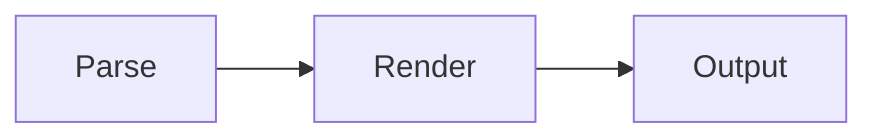
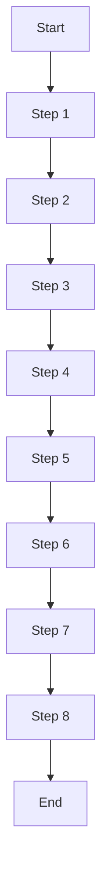
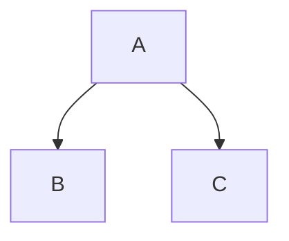

# Mermaid flowcharts drawn by mdcat

On a terminal with the Kitty graphics protocol, a ```` ```mermaid ```` block holding
a flowchart of boxes is drawn by mdcat itself: the boxes and arrows are one
transparent image, and the labels are ordinary text in the cells over it. Checked
by `mermaid-kitty.sh`, which renders it with `--img kitty` and pinned cell sizes.
Other terminals, and every diagram outside this subset, behave as before.
`mermaid-3-dag.md` covers the branching shapes in depth.

## Left to right

Expected: three boxes in a row joined by arrows. Every arrowhead touches the
next box's outline, and each label is centred in its box.



## Top down

Expected: ten boxes in a column, 48 rows tall (taller than most terminals), joined
by vertical arrows that all run through one column. In `gmore` the diagram scrolls
a row at a time.



## Branching

Expected: `A` above `B` and `C`, with one arrow from `A` splitting into two.


