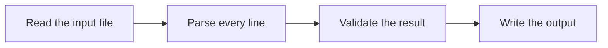
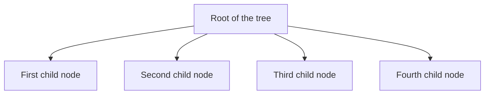
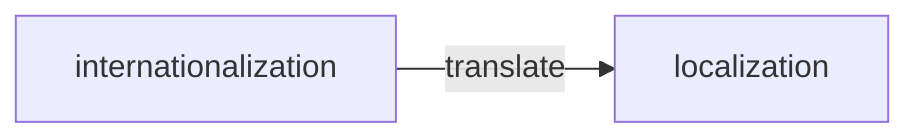

# Mermaid graphs fitted to the width

On a Kitty terminal, a diagram wider than the terminal is not given up on. The
built-in renderer retries it, never changing its direction: first with tighter
spacing (a column less between top-down siblings and left-to-right ranks, and
one column of padding instead of two around a label), then with labels that
contain spaces wrapped on word boundaries at 24, 16 and 12 columns. The first
attempt that fits is drawn. If none does, the narrowest is drawn anyway, wider
than the terminal: widen the window, or scroll sideways in a pager that does not
wrap lines.
Checked by `mermaid-kitty.sh` at widths 120, 80 and 50, with `--img kitty` and
pinned cell sizes. No width makes the renderer decline, so the `.err` goldens
are empty.

## Left to right

Expected: four boxes in a row. At width 120 the labels are on one line. At 80
the spacing is tight and the labels wrap in two lines, and at 50 they wrap
narrower still and the picture is wider than the 50 columns, with every arrow
and label intact.

## Top down

Expected: `Root` above four children in a row. At width 120 and 80 the children
sit on one line, a column apart at 80, and at 50 their labels wrap in two lines
and the row is still wider than the terminal.

## Labels that cannot wrap

Expected: a single word is never split, so a long identifier keeps its width and
the diagram is as wide as it must be.

