# Mermaid node shapes III: divided, lined process, lined cylinder, horizontal cylinder

On a Kitty terminal, the built-in renderer draws four more shapes, named with
`A@{ shape: name, label: "text" }`, the first three each a familiar shape with one extra
stroke inside its outline, as `mmdc` draws them:

- the **divided process** `div-rect` (aliases `div-proc`, `divided-process`,
  `divided-rectangle`): a box with a horizontal line across it, a row below its top
  edge, so the box is a row taller and its label sits under the line;
- the **lined process** `lin-rect` (aliases `lin-proc`, `lined-process`,
  `lined-rectangle`, `shaded-process`): a box with one vertical line half a cell inside
  its left side, 2 columns wider than a box, the label centred;
- the **lined cylinder** `lin-cyl` (aliases `disk`, `lined-cylinder`): a cylinder with
  a second front arc a row below the lid's, so it is two rows taller than a box;
- the **horizontal cylinder** `h-cyl` (aliases `das`, `horizontal-cylinder`): a cylinder
  on its side, straight along its top and bottom, with a cap a column deep at each end:
  a half ellipse on the left, a full one on the right (its inner arc is the extra
  stroke). It is 4 columns wider than a box, so that the label clears the inner arc, and the
  label is centred.

The extra line is part of the shape's interior: edges still meet the outer outline
exactly (an arrowhead touches it, as with a box, a subroutine or a cylinder; into the
horizontal cylinder's caps it touches the curve), a node's
`stroke` colour colours the extra line too, and its `fill` fills the whole outline.
Checked by `mermaid-kitty.sh` at width 80, with `--img kitty` and pinned cell sizes.

## Every new shape, top down

Expected: a box, then the three shapes in a column, joined by arrows that end exactly
on each outline. The divided process has a line across it one row under its top edge,
with its label below the line. The lined process has a vertical line just inside its
left side, and its label is centred. The lined cylinder has its lid and, a row under it,
a second arc of the same curve; its label is below both.

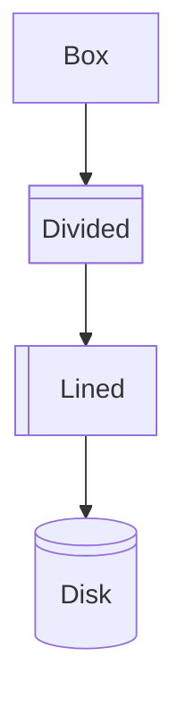

## Every new shape, left to right

Expected: the same three shapes in a row, an arrow into each side at the middle of the
label's row. The line of the divided process stays horizontal, near its top; the line of
the lined process is at its left side, and the arrow into it ends on the outer outline.

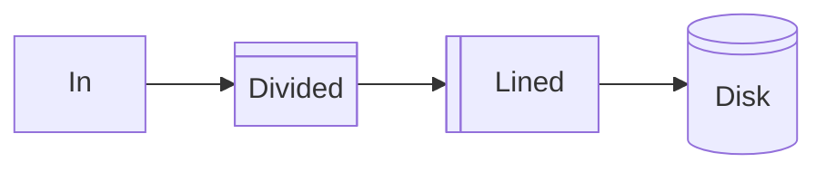

## Several lines

Expected: a label of several lines grows each shape by a row for each line, the way it
grows a box. The line of the divided process stays one row under its top, the label
below it, and each line of the label is centred.

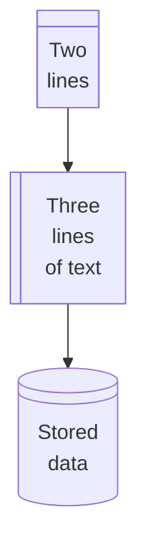

## Several edges at one node

Expected: edges arrive and leave off the middle of a side. Each arrowhead still touches
the outer outline, also on the cylinder's lid, and each stroke that leaves a side starts
on it. No edge ends on the extra line.

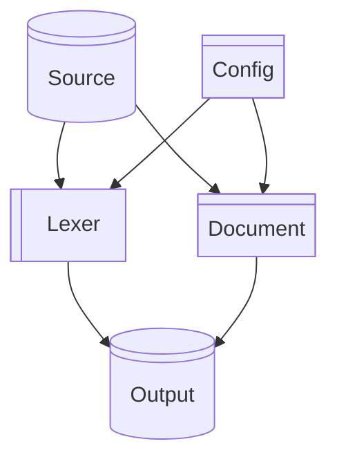

## Left to right, with several edges

Expected: arrows into and out of the shapes meet them level with their labels, as
they do for a cylinder: the divided process and the lined cylinder have their labels
below the lid or the line, and the edges follow.

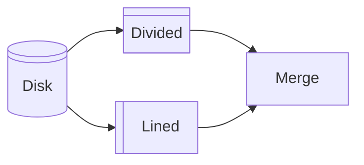

## Other directions

Expected: `BT` and `RL` keep every shape the right way up: the divided process's line
stays near the top, and the lined cylinder's lid and second arc stay on top, with the
label below them, in both. The lined process keeps its line at the left in `RL`.

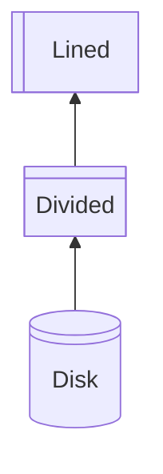

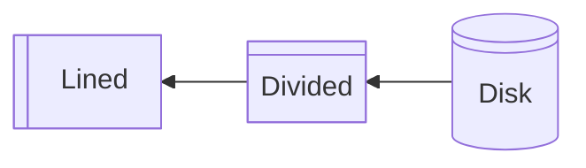

## Styled

Expected: the three shapes with a pale fill under the whole outline and a coloured
stroke, which also colours the line inside: the divided process's line and the lined
process's line are red, the lined cylinder's second arc is blue, like its outline.
(The previews show only the strokes; see the pixels in a Kitty terminal.)

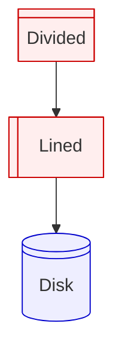

## Aliases

Expected: every name draws the shape it is an alias of, each box labelled with its
name: four divided processes (`div-rect` and three aliases), five lined processes
(in two diagrams, to keep each within 80 columns) and three lined cylinders.

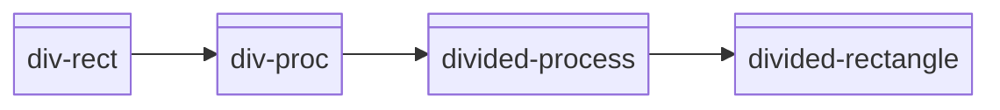

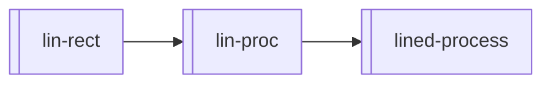

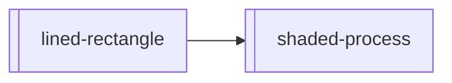

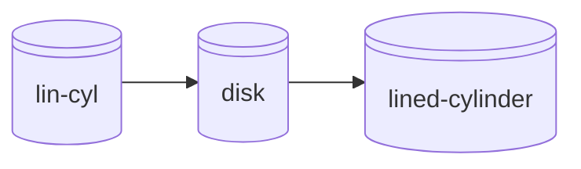

## The horizontal cylinder

Expected: a box, then a cylinder on its side, top down. The arrow from the box ends on
the straight top edge of the cylinder, in the middle; the arrow out of it leaves its
straight bottom edge. The left end is a half ellipse (a curved side), the right end a
full ellipse: its outline, and inside it the arc that closes the front of the cylinder.
The label is centred between the caps.

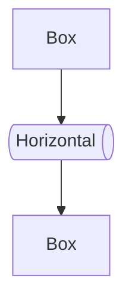

## The horizontal cylinder, left to right

Expected: the arrows run through the caps: the one into the cylinder ends on the
middle of the curved left end, the one out of it starts on the right end's outline, at
the level of the label, past the front arc. The full ellipse is on the right.

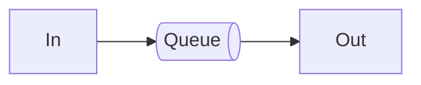

## The horizontal cylinder, in `RL` and `BT`

Expected: the full ellipse stays on the right in `RL`, where the flow runs from right
to left: the arrow enters through the full end and leaves through the half one. In `BT`
the cylinder is the same way up as top-down, full end on the right.

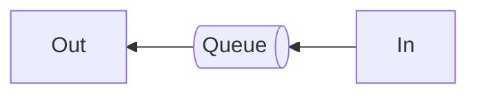

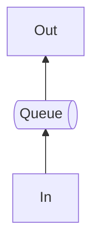

## The horizontal cylinder, one line and three

Expected: a one-line label and a label of three lines: the straight part grows by a
row per line, the caps follow the height, and each line of the label is centred.

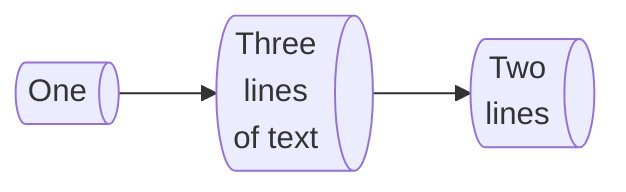

## The horizontal cylinder, several edges

Expected: edges arrive and leave off the middle of a side and meet the curved ends on
their outline, an arrowhead on the curve itself.

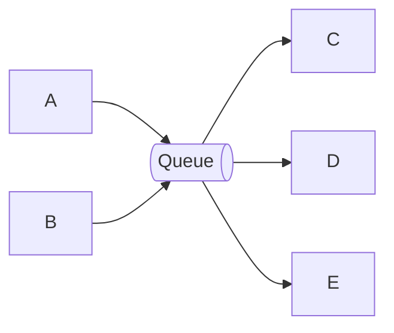

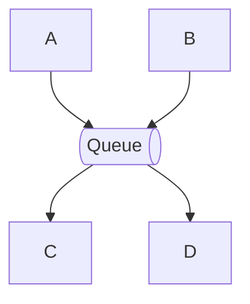

## The horizontal cylinder, styled

Expected: a pale fill under the whole outline, caps included, and a blue stroke that
also colours the inner arc of the right cap.

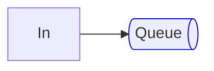

## The horizontal cylinder, aliases

Expected: three horizontal cylinders, each labelled with the name it was written with.

```mermaid
graph LR
    h0@{ shape: h-cyl, label: "h-cyl" } --> h1@{ shape: das, label: "das" }
    h1 --> h2@{ shape: horizontal-cylinder, label: "horizontal-cylinder" }
```

## Declined

Expected: shown as source, as the `.err` golden says. The document shapes are not drawn
here, even beside shapes that are.

```mermaid
graph TD
    a@{ shape: lin-rect, label: "Lined" } --> b@{ shape: lin-doc, label: "Lined document" }
```
