# Mermaid subgraphs: parsed, not drawn yet

`subgraph ... end` is read into the model (`Graph::clusters`, `Node::cluster`), but nothing lays
a subgraph out yet (docs/plan-mermaid-subgraphs.md, Steps 5-8), so every diagram that parses is
declined with `subgraph layout` and shown as source. The other cases are declined by the parser
for the reason named in their heading. `MDCAT_MERMAID_DEBUG=1` prints each reason on stderr, and
`mermaid-kitty.sh` compares it with `expected/mermaid-14-subgraphs.w80.err`. Which node belongs
to which subgraph can't be seen in the output; it is checked outside the repository.

## One subgraph

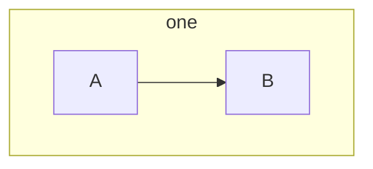

## MongoDB: admission control

The Mermaid source is the MongoDB diagram as written; its subgraphs have no titles of their own, so the id is the title.

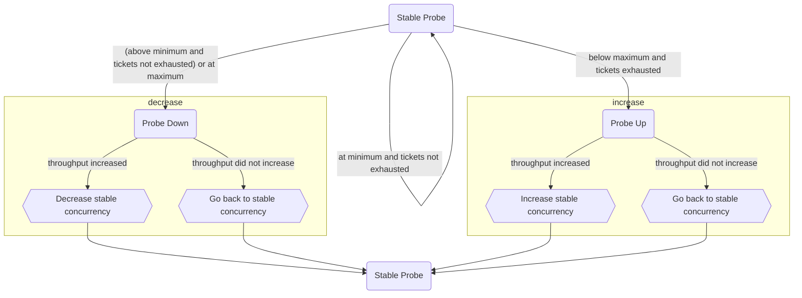

## Title forms

Every way Mermaid names a subgraph: a bare id, `id [Title]`, `id[Title]`, `id["Title"]`, a blank title, a quoted id, a title with spaces, and Markdown, `<br>` and `;` in titles.

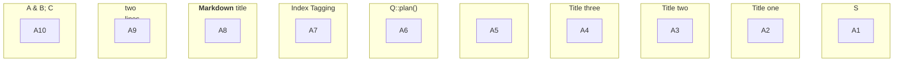

## Membership: a node named outside first

`C` and `F` belong to `S`, `A` does not.

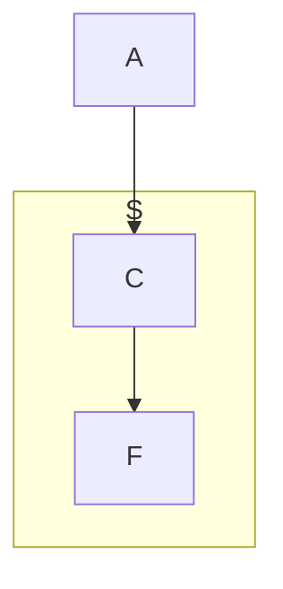

## Membership: a node named in two siblings

`Y` belongs to `S1`, which closes first.

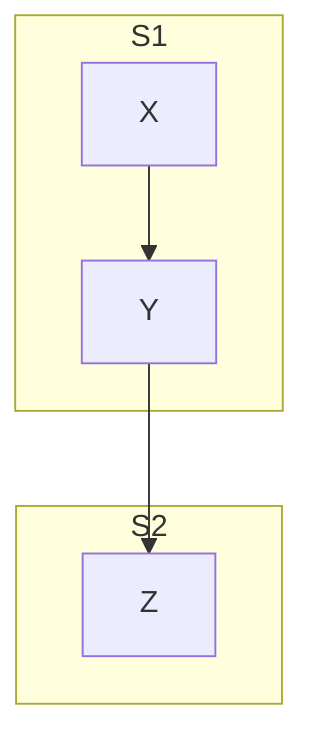

## Membership: nesting

`A` and `B` belong to `Q`, `C` and `D` to `P`.

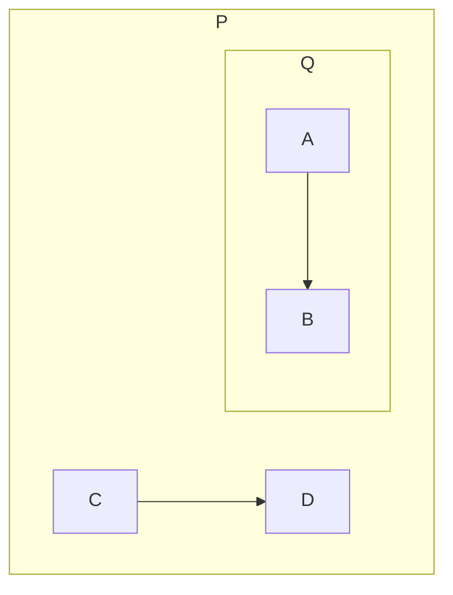

## Membership: a node named again in the outer subgraph

`A` stays in `Q`, `C` is in `P`.

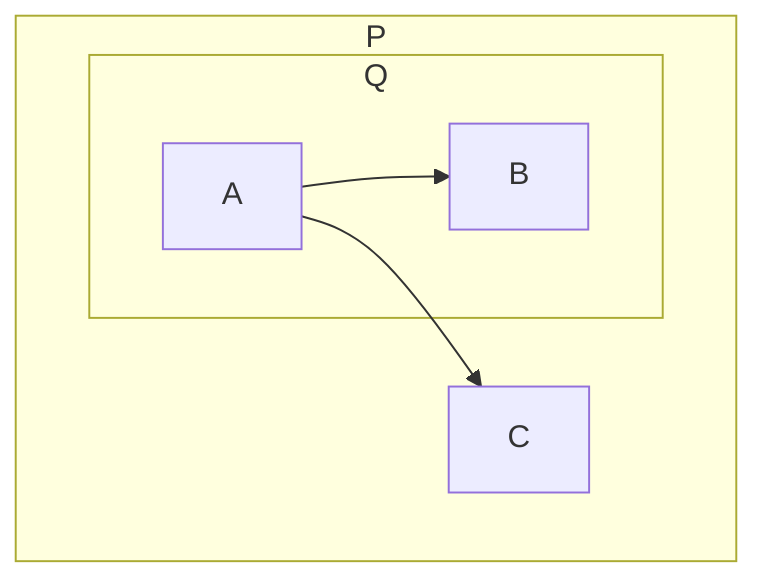

## Membership: three levels and siblings

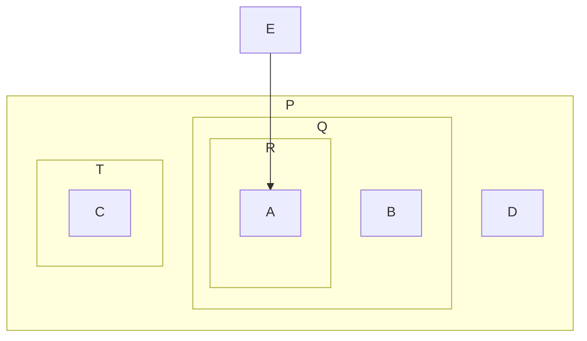

## Membership: a subgraph of subgraphs only

The outer subgraph names no node itself, as in MongoDB's plan enumerator diagram.

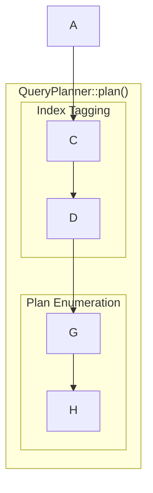

## Membership: style and class do not name a node

`C` and `D` are outside `S`: only a node declaration or a link puts a node in a subgraph.

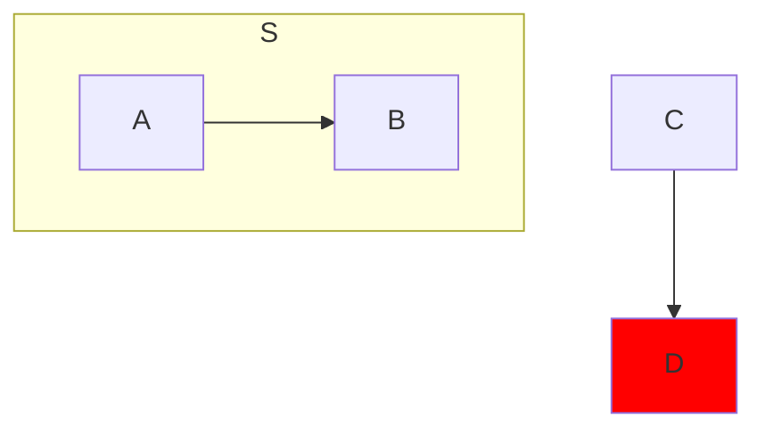

## Membership: `&`, `;` and one line

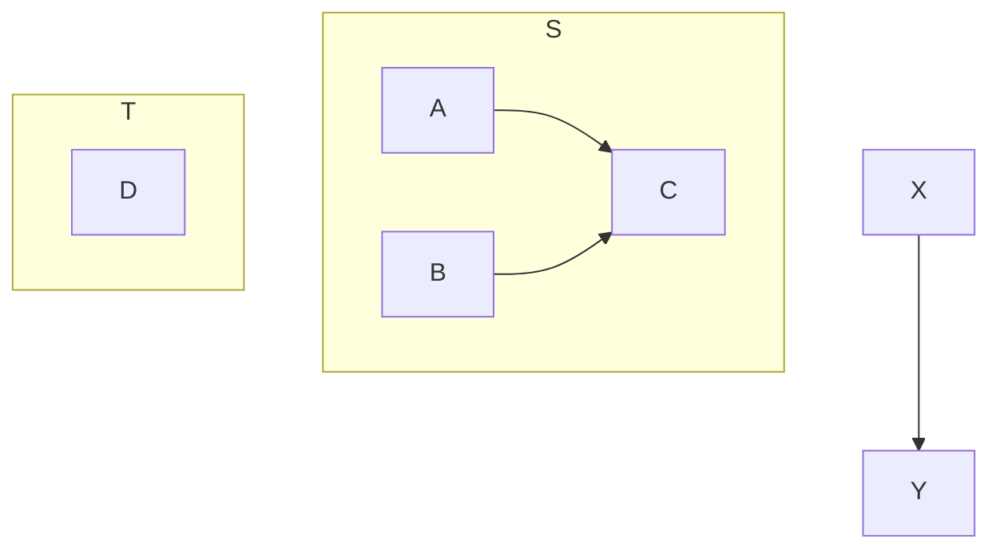

## Ids that start with `end` or `subgraph`

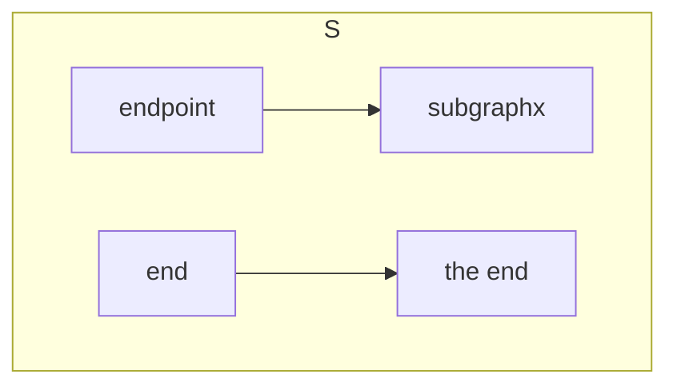

## Declined: a direction inside a subgraph


## Declined: a link to a subgraph

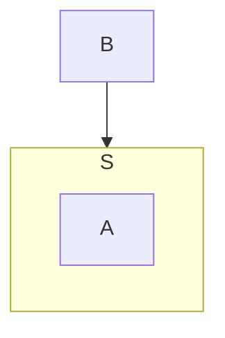

## Declined: a link to a subgraph written before it


## Declined: a link from a subgraph to itself

```mermaid
graph TD
    subgraph S
        S --> A
    end
```

## Declined: a subgraph's id as a node

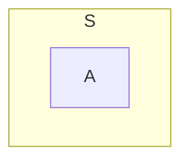

## Declined: `style` on a subgraph

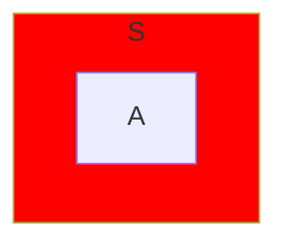

## Declined: `class` on a subgraph


## Declined: `end` with no subgraph

```mermaid
graph TD
    A --> B
    end
```

## Declined: a subgraph never closed

```mermaid
graph TD
    subgraph S
        A --> B
```

## Declined: two subgraphs with one id

```mermaid
graph TD
    subgraph S
        A
    end
    subgraph S
        B
    end
```

## Declined: an empty subgraph

`mmdc` draws an empty subgraph as an ordinary box.

```mermaid
graph TD
    subgraph S
    end
    A --> B
```

## Declined: a subgraph that holds nothing once an earlier one has its nodes

```mermaid
graph TD
    subgraph S1
        X --> Y
    end
    subgraph S2
        Y
    end
```

## Declined: `end` as a subgraph id

```mermaid
graph TD
    subgraph end
        A
    end
```

## Declined: text after a title

```mermaid
graph TD
    subgraph id [Title] extra
        A
    end
```

## Declined: an empty title

```mermaid
graph TD
    subgraph id[]
        A
    end
```

## Declined: parentheses in an unquoted title

```mermaid
graph TD
    subgraph id[Title (x)]
        A
    end
```

## Declined: HTML in a title

```mermaid
graph TD
    subgraph id["a<b>x</b>"]
        A
    end
```
