# Mermaid subgraphs

`subgraph ... end` is read into the model (`Graph::clusters`, `Node::cluster`) and, so far, drawn only
top-down, one level deep and without a title (docs/plan-mermaid-subgraphs.md, Steps 5-8): the box is
one outline under the nodes and edges, around the nodes named inside it. The cases whose
heading starts with *Drawn* are drawn. The rest are declined: a title, a nested subgraph or a direction other than
`TD` is `subgraph layout` for now, and the other cases are declined by the parser for the reason
named in their heading. `MDCAT_MERMAID_DEBUG=1` prints each reason on stderr, and
`mermaid-kitty.sh` compares it with `expected/mermaid-14-subgraphs.w80.err`. Which node belongs
to which subgraph is checked outside the repository, with a scratch parser.

A blank title (`subgraph s[" "]`) draws no title, so these cases use it.

## Drawn: one box around a chain

Expected: a box around A, B and C, one blank column inside it on each side. X's edge enters it through
the top border and C's leaves through the bottom border. Y is reached by X's second edge, which goes
round the right of the box.

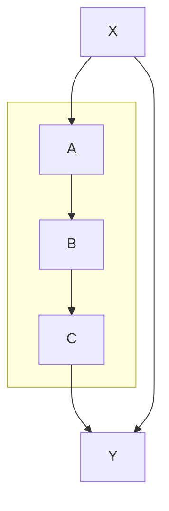

## Drawn: two boxes, both directions and a back edge

Expected: two boxes one above the other. The edge from the first to the second crosses both borders;
the back edge from the second to the first goes round the right of both boxes and enters the first
box through its right border.

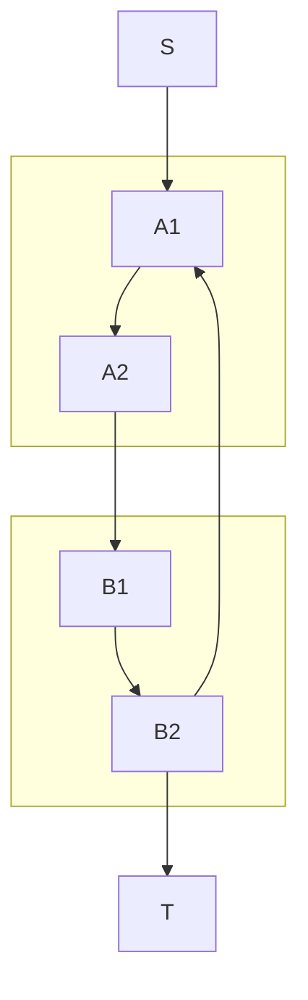

## Drawn: an edge goes round a box

Expected: X's edge to Y runs down the left of the box, round it, and Z's edge down the right; the edge
into A crosses the top border and D's leaves through the bottom one.

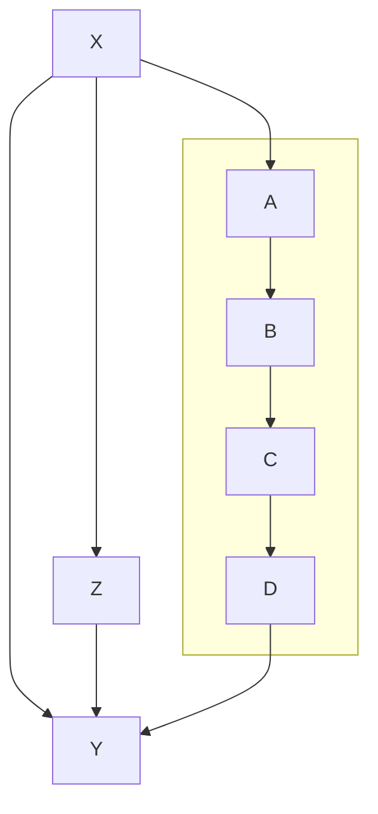

## Drawn: an edge between two outsiders, passing a box

Expected: R's edge to D enters the box through its left border, below C, and nothing outside it runs
through the box.

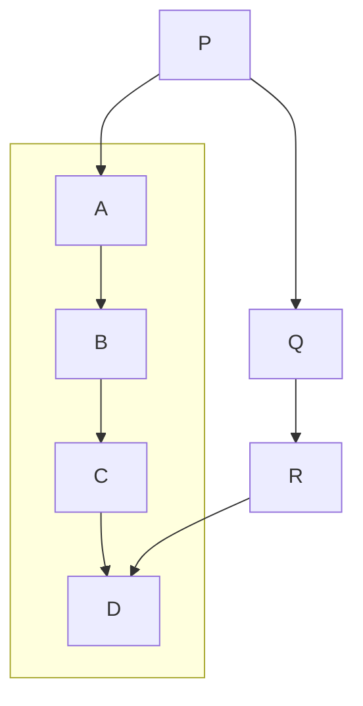

## Drawn: a rank of the span that holds no member

Expected: A and D are in the box and X, between them, is not. The box is wide enough to be clear of
X on the rank that holds only X, and the edges between A, X and D cross its left border.

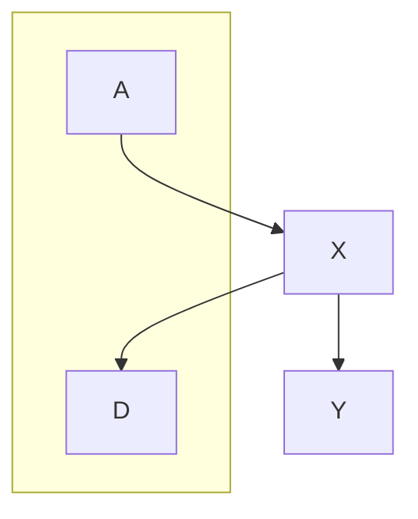

## Drawn: a long edge, a label and a self-loop inside a box

Expected: everything is inside the box: the edge from A to C runs down its right, "yes" sits between
B and D, and the loop on C is beside C.

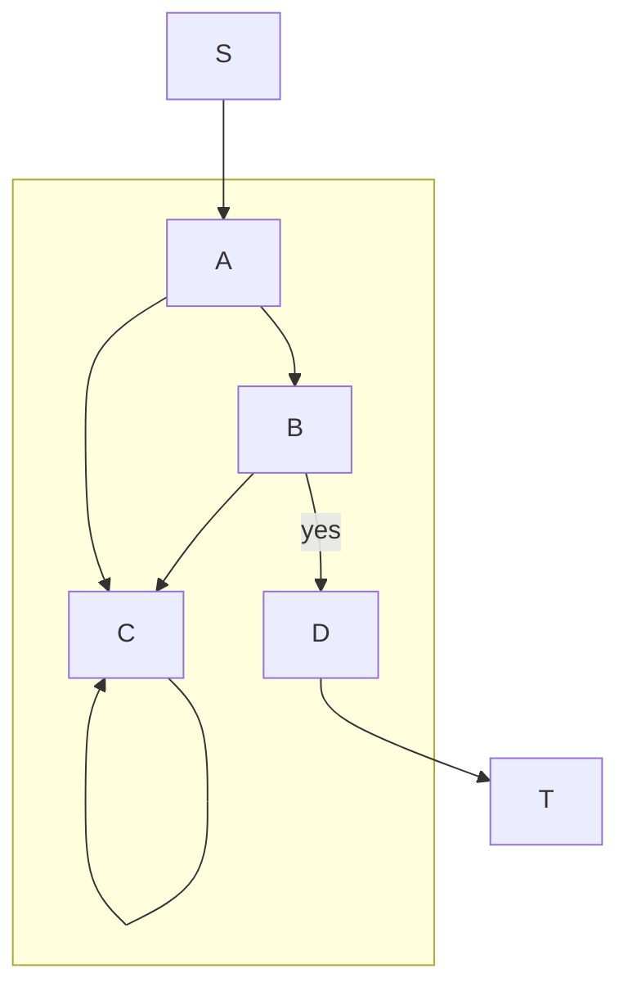

## Drawn: edges into and out of the middle of a box

Expected: X's edge joins the one into B, crossing the left border; B's edge to Z leaves through the
right border.

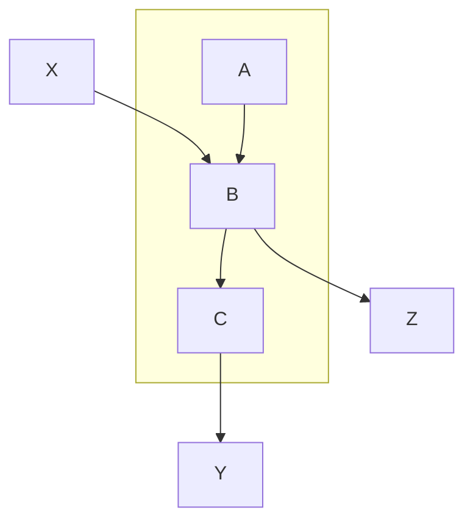

## Drawn: styled members, a lone box and boxes on one rank

Expected: three boxes side by side. P1 is filled red and Q2 green with a green label; the outlines of
the boxes keep the theme's colour.

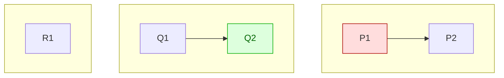

## Drawn: a box inside a longer chain

Expected: the chain A, B passes into the box at C and leaves it after E; the edge from A to G goes
round the right of the box.

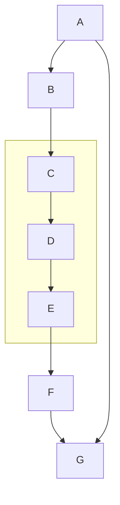

## Drawn: MongoDB admission control, titles blanked

The diagram as MongoDB wrote it, with the subgraph titles blanked. It is declined because of its
36-column edge label, as it would be without the subgraphs.

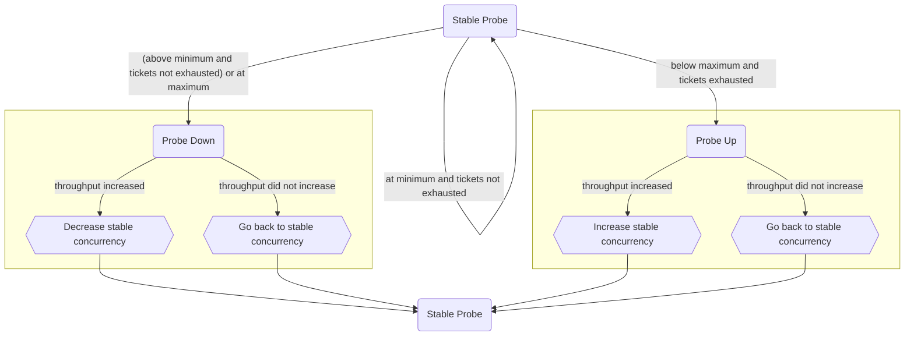

## Drawn: MongoDB admission control, shorter edge labels

The same diagram with its edge labels cut to at most 24 columns. Expected: the two boxes side by
side under Stable Probe, each with a probe and two hexagons, and all four edges merging into the
last Stable Probe below them.

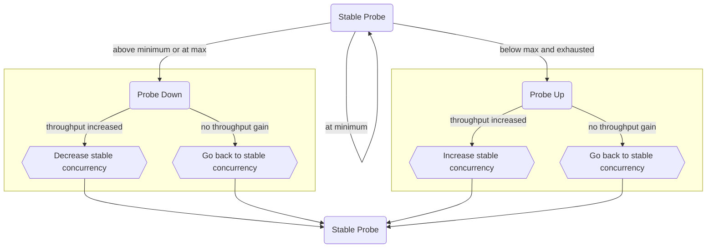

## Declined: a box that an edge would have to cross

Expected: declined. A box with several members that lie on far apart ranks, with other nodes between
them, cannot always be drawn without an edge running through it: here N1's edge to N6 would cross
the box of N3, N4 and N5.

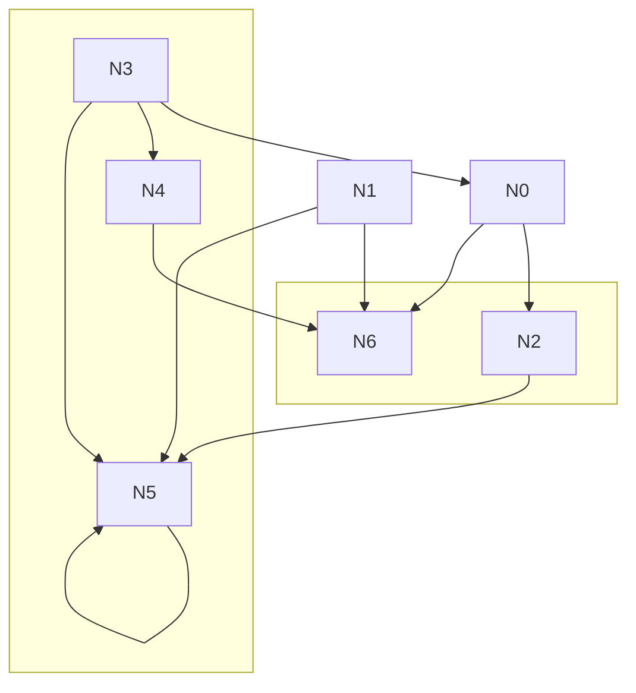

## One subgraph (titled, so not drawn yet)

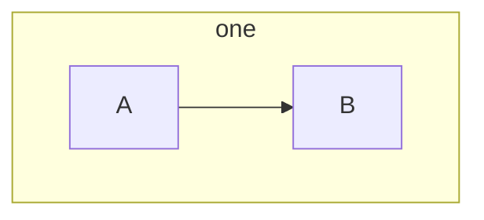

## MongoDB: admission control

The Mermaid source is the MongoDB diagram as written; its subgraphs have no titles of their own, so the id is the title.

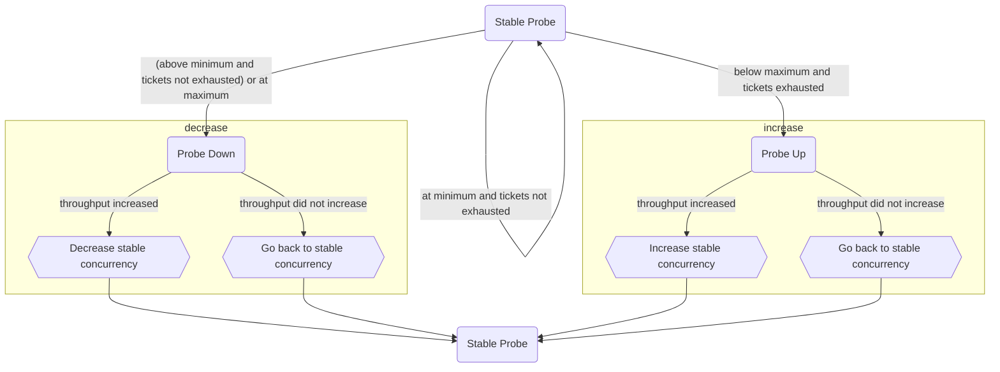

## Title forms

Every way Mermaid names a subgraph: a bare id, `id [Title]`, `id[Title]`, `id["Title"]`, a blank title, a quoted id, a title with spaces, and Markdown, `<br>` and `;` in titles.

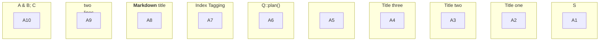

## Membership: a node named outside first

`C` and `F` belong to `S`, `A` does not.

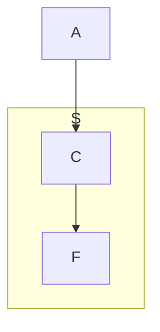

## Membership: a node named in two siblings

`Y` belongs to `S1`, which closes first.

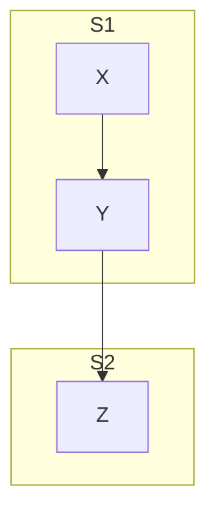

## Membership: nesting

`A` and `B` belong to `Q`, `C` and `D` to `P`.

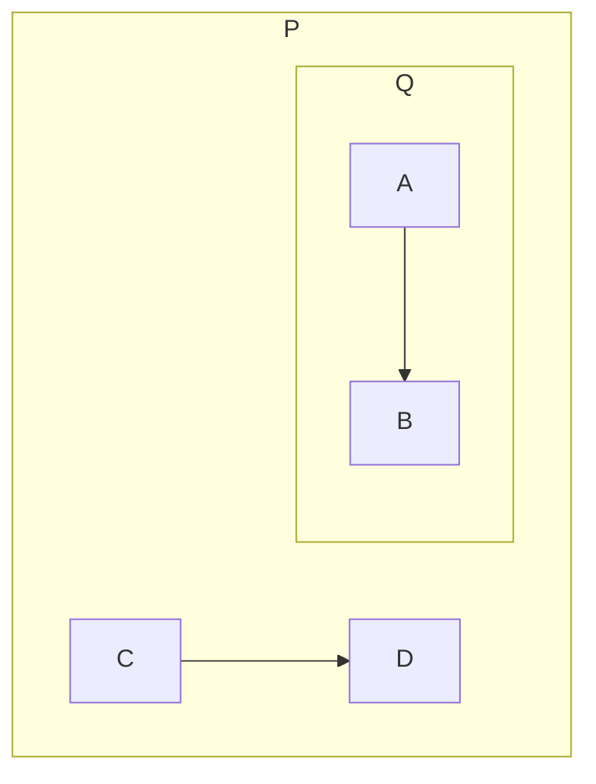

## Membership: a node named again in the outer subgraph

`A` stays in `Q`, `C` is in `P`.

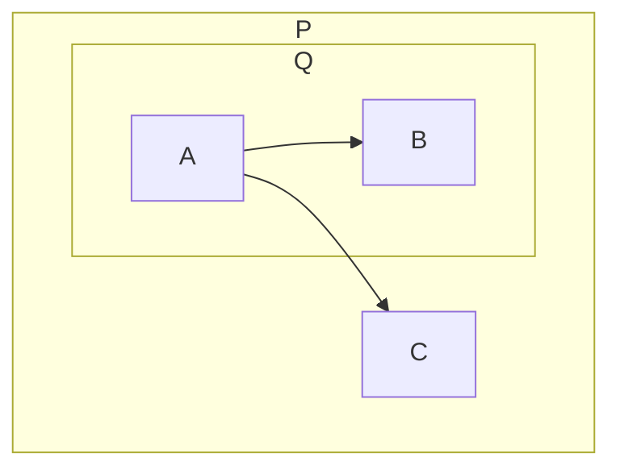

## Membership: three levels and siblings

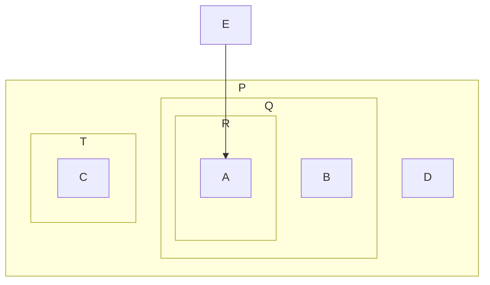

## Membership: a subgraph of subgraphs only

The outer subgraph names no node itself, as in MongoDB's plan enumerator diagram.

```mermaid
graph TD
    subgraph "QueryPlanner::plan()"
        subgraph Index Tagging
            C --> D
        end
        subgraph Plan Enumeration
            G --> H
        end
    end
    A --> C
    D --> G
```

## Membership: style and class do not name a node

`C` and `D` are outside `S`: only a node declaration or a link puts a node in a subgraph.

```mermaid
graph TD
    C --> D
    subgraph S
        A --> B
        class C foo
        style D fill:#f00
    end
```

## Membership: `&`, `;` and one line

```mermaid
graph TD
    subgraph S; A & B --> C; end
    subgraph T;
        D
    end;
    X --> Y
```

## Ids that start with `end` or `subgraph`

```mermaid
graph TD
    subgraph S
        endpoint --> subgraphx
        A["end"] --> D[the end]
    end
```

## Declined: a direction inside a subgraph

```mermaid
graph TD
    subgraph one
        direction LR
        A --> B
    end
```

## Declined: a link to a subgraph

```mermaid
graph TD
    subgraph S
        A
    end
    B --> S
```

## Declined: a link to a subgraph written before it

```mermaid
graph TD
    B --> S
    subgraph S
        A
    end
```

## Declined: a link from a subgraph to itself

```mermaid
graph TD
    subgraph S
        S --> A
    end
```

## Declined: a subgraph's id as a node

```mermaid
graph TD
    subgraph S
        A
    end
    S
```

## Declined: `style` on a subgraph

```mermaid
graph TD
    subgraph S
        A
    end
    style S fill:#f00
```

## Declined: `class` on a subgraph

```mermaid
graph TD
    subgraph S
        A
    end
    class S foo
```

## Declined: `end` with no subgraph

```mermaid
graph TD
    A --> B
    end
```

## Declined: a subgraph never closed

```mermaid
graph TD
    subgraph S
        A --> B
```

## Declined: two subgraphs with one id

```mermaid
graph TD
    subgraph S
        A
    end
    subgraph S
        B
    end
```

## Declined: an empty subgraph

`mmdc` draws an empty subgraph as an ordinary box.

```mermaid
graph TD
    subgraph S
    end
    A --> B
```

## Declined: a subgraph that holds nothing once an earlier one has its nodes

```mermaid
graph TD
    subgraph S1
        X --> Y
    end
    subgraph S2
        Y
    end
```

## Declined: `end` as a subgraph id

```mermaid
graph TD
    subgraph end
        A
    end
```

## Declined: text after a title

```mermaid
graph TD
    subgraph id [Title] extra
        A
    end
```

## Declined: an empty title

```mermaid
graph TD
    subgraph id[]
        A
    end
```

## Declined: parentheses in an unquoted title

```mermaid
graph TD
    subgraph id[Title (x)]
        A
    end
```

## Declined: HTML in a title

```mermaid
graph TD
    subgraph id["a<b>x</b>"]
        A
    end
```
