# Mermaid subgraphs

`subgraph ... end` is read into the model (`Graph::clusters`, `Node::cluster`) and drawn, in every
direction, nested up to three levels deep (docs/plan-mermaid-subgraphs.md, Steps 5-8): the box is one
outline under the nodes and edges, around the nodes named inside it and the boxes of the subgraphs
inside it, with the subgraph's title, if it has one, in bold under the top border. The cases whose
heading starts with *Drawn* are drawn; the title says the direction where it is not top-down, and
*nested* where a box holds another. The rest are declined: nesting deeper than three levels is
`subgraph layout: depth`, and the other cases are declined for the reason named in their heading or,
for the membership cases, because of what they hold. `MDCAT_MERMAID_DEBUG=1` prints each reason on
stderr, and `mermaid-kitty.sh` compares it with `expected/mermaid-14-subgraphs.w80.err`. Which node
belongs to which subgraph is checked outside the repository, with a scratch parser.

A blank title (`subgraph s[" "]`) draws no title, so the first cases use it.

## Drawn: one box around a chain

Expected: a box around A, B and C, one blank column inside it on each side. X's edge enters it through
the top border and C's leaves through the bottom border. Y is reached by X's second edge, which goes
round the right of the box.

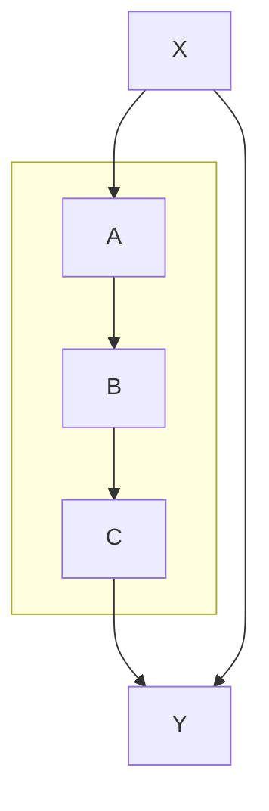

## Drawn: two boxes, both directions and a back edge

Expected: two boxes one above the other. The edge from the first to the second crosses both borders;
the back edge from the second to the first goes round the right of both boxes and enters the first
box through its right border.

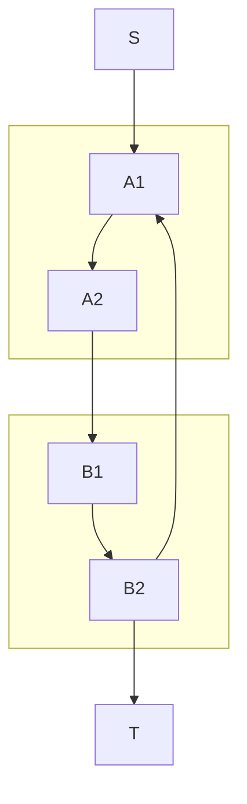

## Drawn: an edge goes round a box

Expected: X's edge to Y runs down the left of the box, round it, and Z's edge down the right; the edge
into A crosses the top border and D's leaves through the bottom one.

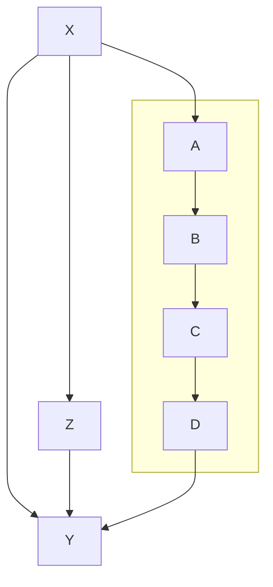

## Drawn: an edge between two outsiders, passing a box

Expected: R's edge to D enters the box through its left border, below C, and nothing outside it runs
through the box.

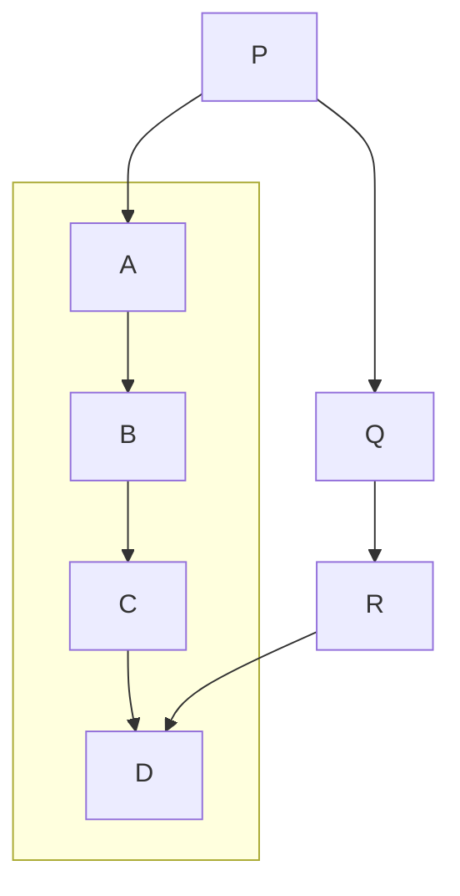

## Drawn: a rank of the span that holds no member

Expected: A and D are in the box and X, between them, is not. The box is wide enough to be clear of
X on the rank that holds only X, and the edges between A, X and D cross its left border.

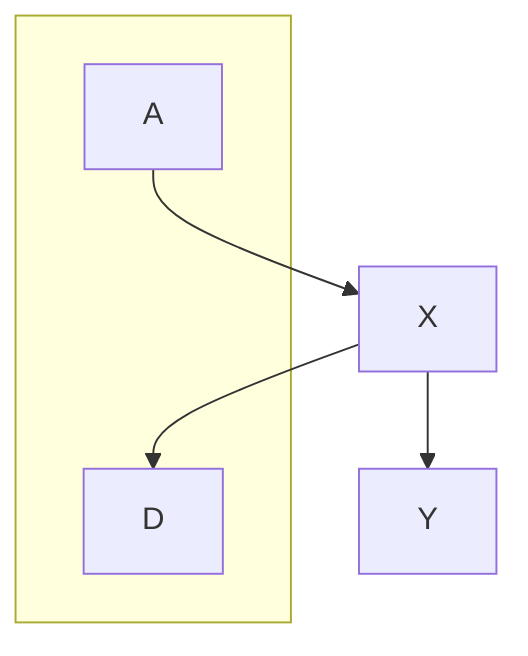

## Drawn: a long edge, a label and a self-loop inside a box

Expected: everything is inside the box: the edge from A to C runs down its right, "yes" sits between
B and D, and the loop on C is beside C.

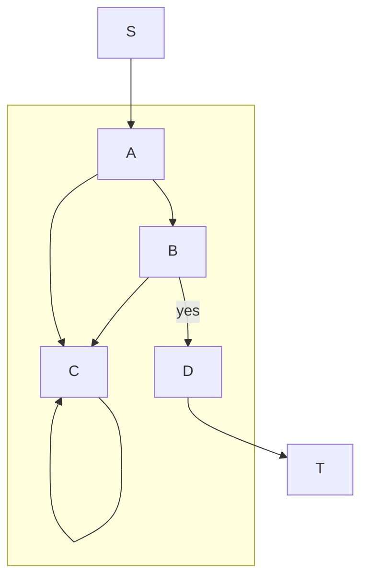

## Drawn: edges into and out of the middle of a box

Expected: X's edge joins the one into B, crossing the left border; B's edge to Z leaves through the
right border.

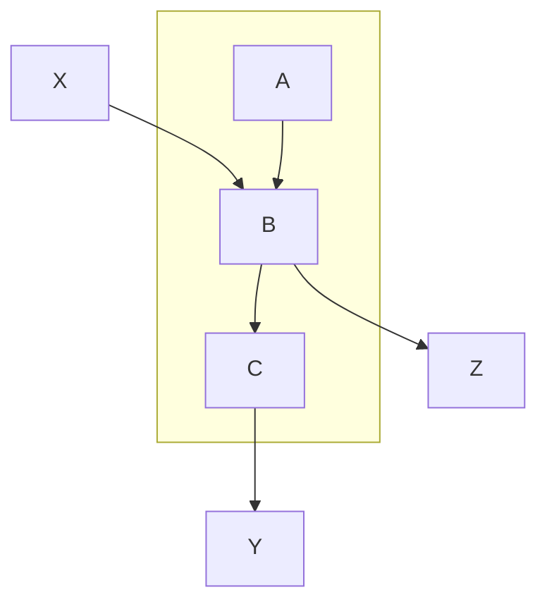

## Drawn: styled members, a lone box and boxes on one rank

Expected: three boxes side by side. P1 is filled red and Q2 green with a green label; the outlines of
the boxes keep the theme's colour.

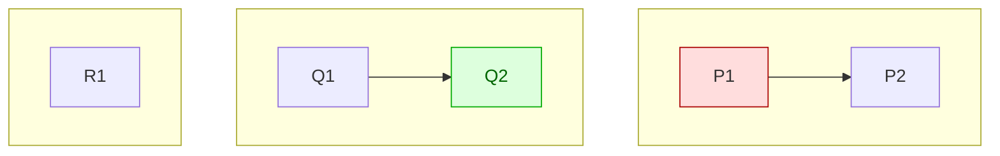

## Drawn: a box inside a longer chain

Expected: the chain A, B passes into the box at C and leaves it after E; the edge from A to G goes
round the right of the box.

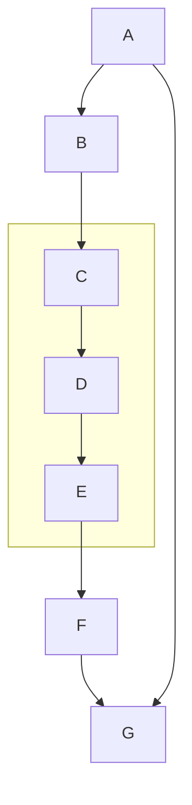

## Drawn: MongoDB admission control, titles blanked

The diagram as MongoDB wrote it, with the subgraph titles blanked. Its 36-column edge label wraps
at 24 columns, as it would without the subgraphs.

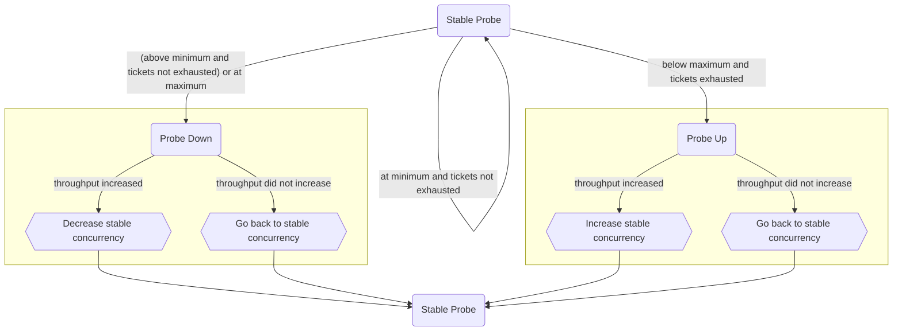

## Drawn: MongoDB admission control, shorter edge labels

The same diagram with its edge labels cut to at most 24 columns. Expected: the two boxes side by
side under Stable Probe, each with a probe and two hexagons, and all four edges merging into the
last Stable Probe below them.

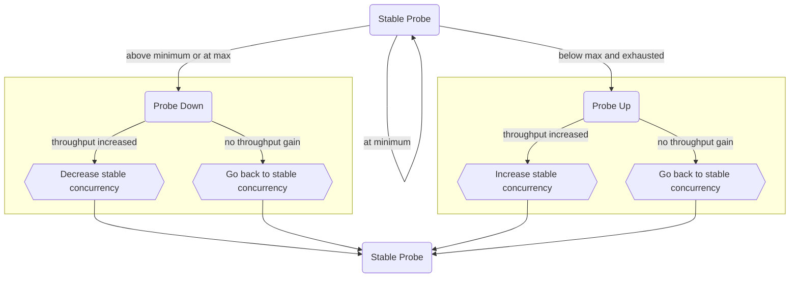

## Drawn: a title, centred where no edge crosses it

Expected: a box around A and B with `Plan` in bold on the row under the top border, in the middle of
the box, which is as wide as its members make it: nothing enters the box from above.

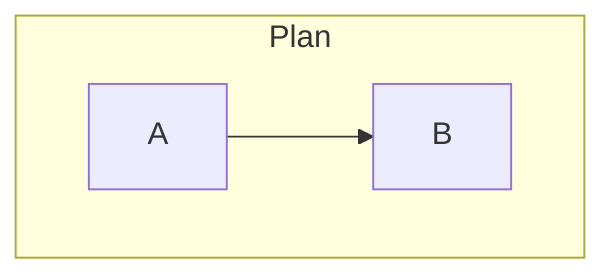

## Drawn: a title beside the edge that enters the box

Expected: X's edge enters the box through the top border and runs down through the box's title row,
so `one` is not centred: it sits beside the edge, a blank column from it, and the box is as wide as
that takes, growing to the right of the members.

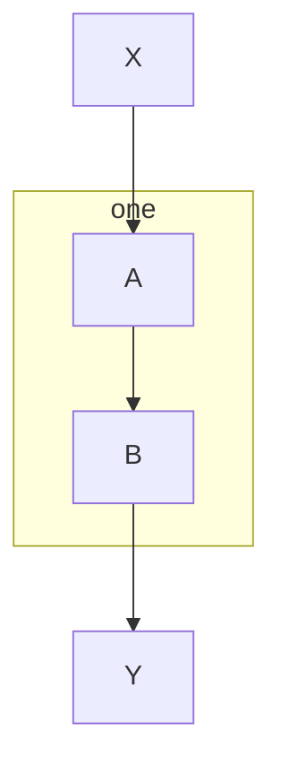

## Drawn: every way to write a title

Expected: four boxes in a chain, each titled, in bold, and each entered by an edge from the box above:
a bare id (`S`), `id [Title one]`, `id[Title two]` and `id["Title three"]`. The title of `S` is the
widest thing in its box; the others are beside their edge.

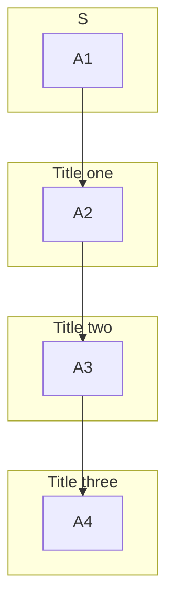

## Drawn: a quoted id and a title with spaces

Expected: the boxes `Q::plan()` and `Index Tagging` (a generated id), one above the other, with the
edge from Q to R between them. The second title sits left of the edge into R, and its box grows to
the right, not to the left.

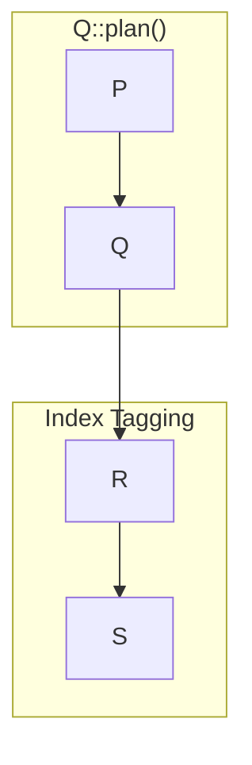

## Drawn: Markdown, `<br>` and `;` in titles

Expected: `Markdown title` with `Markdown` bold on top of the bold of the title (so it reads the same),
`two` over `lines` in a box with a two-line title, and `A & B; C` as written.

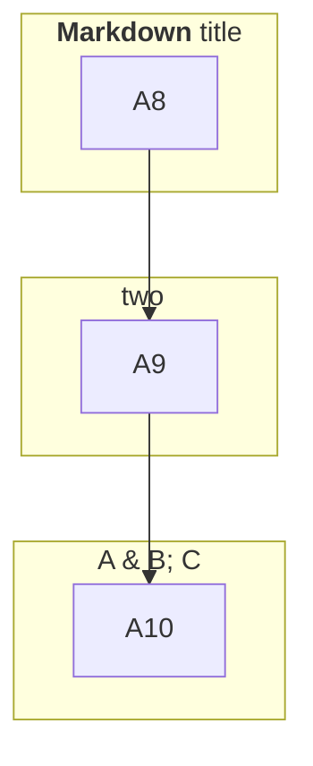

## Drawn: a title wider than its members

Expected: each box is as wide as its title needs plus a blank column and the border on each side.
Both are entered from above, by `X --> A` and `A --> C`, so neither title is centred: each sits to
the right of the entering edge, a blank column from it, and the box grows to the right, leaving its
one member near its left side. The second box has a Markdown title that is wrapped at 24 columns.

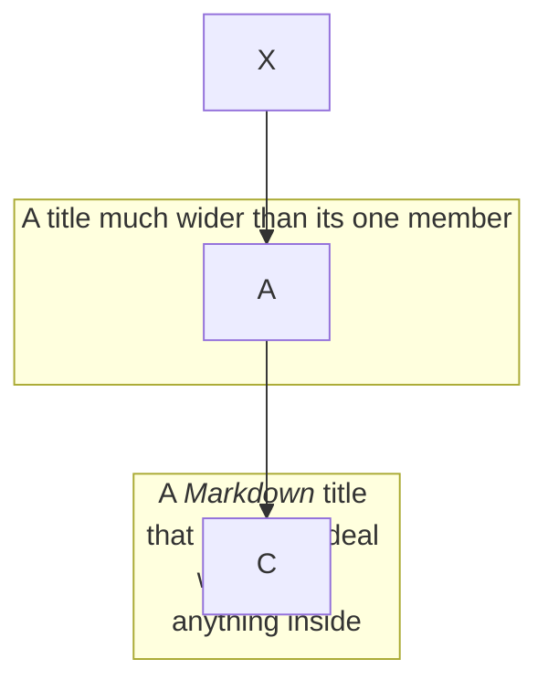

## Drawn: titles wrapped to fit the width

Expected: three boxes side by side whose plain titles are 30 columns wide or more. At 80 columns they
do not fit with their titles on one line, so the fit attempts wrap the titles at spaces, in three
lines each, and the box widths follow.

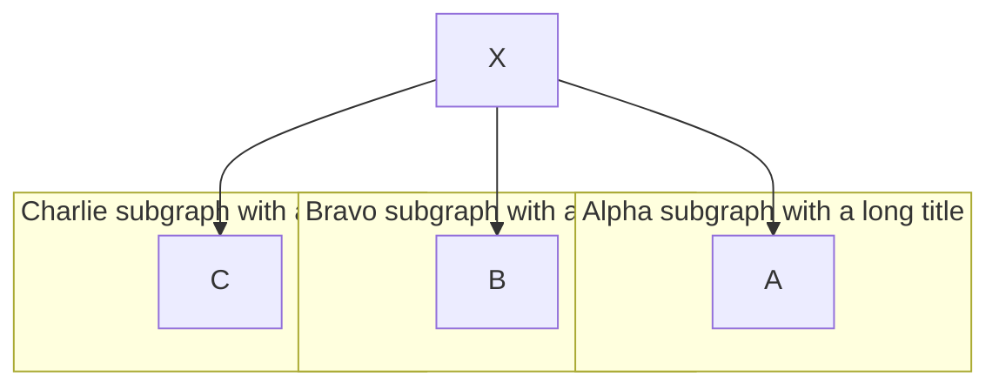

## Drawn: boxes side by side, titles of different heights

Expected: the top borders of the two boxes are on one row. The title of the left one is two lines and
the right one's is one; the right box has a blank row more between its title and its first member.

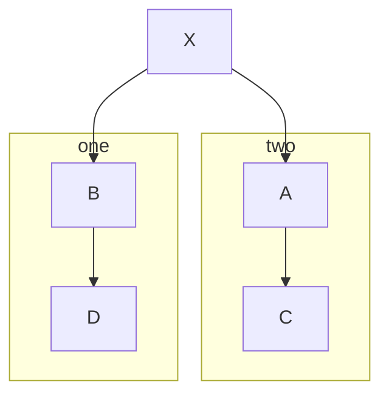

## Drawn: MongoDB admission control, real titles, shorter edge labels

The diagram with its own subgraph titles (`decrease` and `increase`, the ids) and the edge labels cut
to at most 24 columns. Expected: the two boxes side by side under Stable Probe, each with its title
in bold at the top, and the edges into the probes crossing the top borders.

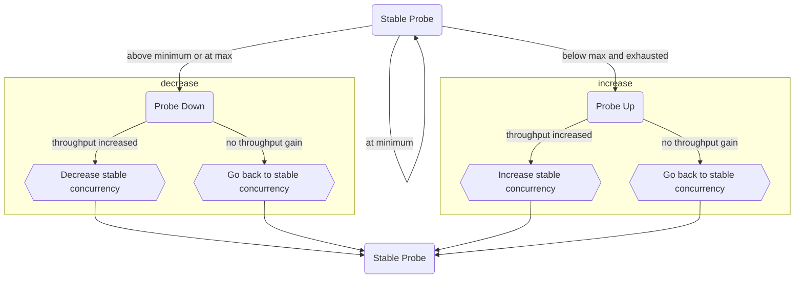

## Drawn, LR: one box around a chain

Expected: the top-down chain case turned on its side. A box around A, B and C, one blank column and one
blank row inside it on each side. X's edge enters it through the left border and C's leaves through the
right border. Y is reached by X's second edge, which goes round under the box.

```mermaid
graph LR
    X --> A
    subgraph s[" "]
        A --> B --> C
    end
    C --> Y
    X --> Y
```

## Drawn, LR: two boxes, both directions and a back edge

Expected: two boxes side by side, a few columns apart so that the jog of the edge between them is a
blank column from each border. That edge crosses both borders; the back edge from the second to the
first goes round under both boxes and enters the first box through its bottom border.

```mermaid
graph LR
    subgraph a[" "]
        A1 --> A2
    end
    subgraph b[" "]
        B1 --> B2
    end
    A2 --> B1
    B2 --> A1
    S --> A1
    B2 --> T
```

## Drawn, LR: an edge goes round a box

Expected: X's edge to Y runs above the box and Z's below it; the edge into A crosses the left border
and D's leaves through the right one.

```mermaid
graph LR
    X --> Y
    subgraph s[" "]
        A --> B --> C --> D
    end
    X --> A
    X --> Z
    Z --> Y
    D --> Y
```

## Drawn, LR: a rank of the span that holds no member

Expected: A and D are in the box and X, between them, is not. X is above the box, and the edges from A
to X and from X to D cross its top border.

```mermaid
graph LR
    subgraph s[" "]
        A
        D
    end
    A --> X --> D
    X --> Y
```

## Drawn, LR: a long edge, a label and a self-loop inside a box

Expected: everything is inside the box: the edge from A to C runs along its bottom, "yes" sits between
B and D, and the loop on C is below C.

```mermaid
graph LR
    subgraph s[" "]
        A --> B --> C
        A --> C
        B -->|yes| D
        C --> C
    end
    S --> A
    D --> T
```

## Drawn, LR: a title, centred where no edge crosses it

Expected: a box around A and B with `Plan` in bold on the row under the top border, in the middle of
the box, then a blank row, then the members. Nothing crosses the top border.

```mermaid
graph LR
    subgraph s[Plan]
        A --> B
    end
```

## Drawn, LR: a title wider than the box

Expected: the box is as wide as its title needs plus a blank column and the border on each side, not
as wide as its one member: the extra columns are inside the box, half before the member and half after
it, so the edges into and out of the box are longer there.

```mermaid
graph LR
    subgraph s[A title much wider than its one member]
        A
    end
    X --> A
    A --> Y
```

## Drawn, LR: a title beside an edge that crosses the top border

Expected: Y is above the box, and its edge from X runs along above the box and then down into D, through
the top border. `A long title here for the box to hold` is not centred: it sits to the right of that edge,
a blank column from it, and the box grows to the right of D to make room.

```mermaid
graph LR
    X --> Y
    Y --> D
    X --> A
    subgraph s[A long title here for the box to hold]
        A --> B --> C --> D
    end
```

## Drawn, LR: boxes side by side, titles of different heights

Expected: two boxes, one above the other, X's edges entering both through their left borders. The title
of the upper one is two lines and the lower one's is one; each has a blank row after its title and then
its members.

```mermaid
graph LR
    subgraph l["two<br>lines"]
        A --> C
    end
    subgraph r[one]
        B --> D
    end
    X --> A
    X --> B
```

## Drawn, LR: the title of a box that an edge leaves through the top

Expected: the box's first member has an edge to Y, which lies above the box. The edge runs up from the
gap between A and B, through the top border and past the title: `Wide title here for it` sits to the
right of that edge, and the box grows to the right.

```mermaid
graph LR
    P --> Y
    subgraph s[Wide title here for it]
        A --> B
    end
    P --> A
    A --> Y
```

## Drawn, BT: a titled box, an edge leaving through the title's rows

Expected: the flow runs upwards, so the top of the box is where its edges leave: X's edge enters it
through the bottom border and B's leaves through the top one, past the title. `one` is in bold on
the row under the top border, left of that edge and a blank column from it.

```mermaid
graph BT
    X --> A
    subgraph one
        A --> B
    end
    B --> Y
```

## Drawn, BT: boxes in a chain, titled

Expected: two boxes one above the other, each with its title in bold under its top border. A1's edge
leaves the lower box through its top border and enters the upper box through its bottom border, and A2's
edge to A3 leaves that through its top border. Both leave through the title's rows, so each title sits
beside its edge, a blank column from it.

```mermaid
graph BT
    subgraph S
        A1
    end
    subgraph id1 [Title one]
        A2
    end
    A1 --> A2
    A2 --> A3
```

## Drawn, BT: two boxes, both directions and a back edge, one title two lines high

Expected: the second box has the two-line title `two` and `lines` under its top border, and the first
none. The back edge goes round the right of both boxes.

```mermaid
graph BT
    subgraph a[" "]
        A1 --> A2
    end
    subgraph b["two<br>lines"]
        B1 --> B2
    end
    A2 --> B1
    B2 --> A1
    S --> A1
    B2 --> T
```

## Drawn, RL: a titled box

Expected: the flow runs from the right: X is at the right of the box, which holds A then B right to
left, and Y is at the left. `one` is centred under the top border.

```mermaid
graph RL
    X --> A
    subgraph one
        A --> B
    end
    B --> Y
```

## Drawn, RL: a title wider than the box, and one beside an edge

Expected: the first box is as wide as its title needs, with the extra columns inside it before and
after the member. In the second, Y is above the box and its edge enters through the top border, so the
title is not centred: it sits at the left of that edge and the box grows to the left.

```mermaid
graph RL
    subgraph s[A title much wider than its one member]
        A
    end
    X --> A
    A --> Y
```

```mermaid
graph RL
    P --> Y
    subgraph t[Wide title here for it]
        A --> B
    end
    P --> A
    A --> Y
```

## Drawn, RL: two boxes, both directions and a back edge

Expected: the left-to-right case mirrored: two boxes side by side, the first on the right, and the back
edge goes round under both. The first box has no title and the second has two lines.

```mermaid
graph RL
    subgraph a[" "]
        A1 --> A2
    end
    subgraph b["two<br>lines"]
        B1 --> B2
    end
    A2 --> B1
    B2 --> A1
    S --> A1
    B2 --> T
```

## Drawn, LR: MongoDB query commands, shorter edge labels

The diagram from `src/mongo/db/commands/query_cmd/README.md`, with its subgraph title blank as written
and its edge labels cut to at most 24 columns, and `n10`'s `extract` shape (which this renderer has
not got) left out. Expected: the box holds Find, Distinct and Count, and the three edges from it merge
into IDL Parsing, outside it to its right.

```mermaid
---
config:
  themeVariables:
    fontSize: 32px
---
flowchart LR
 subgraph s1[" "]
        n1["Find"]
        n2["Distinct"]
        n3["Count"]
  end
    n1 --> n10["IDL Parsing"]
    n2 --> n10
    n3 --> n10
    n10 --> n11["FindCommandRequest"] & n12["DistinctCommandRequest"]
    n10 --> n21["CountCommandRequest"]
    n13["ParsedFindCommand"] --> n17["CanonicalQuery"]
    n19["ParsedDistinctCommand"] --> n17
    n21 -- parseFromCount() --> n11
    n11 -- "find::parse()<br>MatchParser::parse()" --> n13
    n12 -- "distinct::parse()<br>MatchParser::parse()" --> n19

    n17@{ shape: dbl-circ}
```

## Declined, LR: a box that an edge would have to cross

Expected: declined, as the same graph is top-down: N1's edge to N6 would cross the box of N3, N4 and N5.

```mermaid
graph LR
    subgraph c0[" "]
        N3
        N4
        N5
    end
    subgraph c1[" "]
        N2
        N6
    end
    N0 --> N2
    N0 --> N6
    N1 --> N5
    N1 --> N6
    N2 --> N5
    N3 --> N0
    N3 --> N4
    N3 --> N5
    N4 --> N6
    N5 --> N5
```

## Drawn, LR: MongoDB query commands, as written

The diagram exactly as MongoDB wrote it, except for the `extract` shape left out. Its edge labels are
words such as `parsed_find_command::parse()` and `MatchExpressionParser::parse()` (up to 30 columns),
which cannot be wrapped; an edge label may hold one up to 40 columns.

```mermaid
flowchart LR
 subgraph s1[" "]
        n1["Find"]
        n2["Distinct"]
        n3["Count"]
  end
    n1 --> n10["IDL Parsing"]
    n2 --> n10
    n3 --> n10
    n10 --> n11["FindCommandRequest"] & n12["DistinctCommandRequest"]
    n10 --> n21["CountCommandRequest"]
    n13["ParsedFindCommand"] --> n17["CanonicalQuery"]
    n19["ParsedDistinctCommand"] --> n17
    n21 -- parseFromCount() --> n11
    n11 -- "parsed_find_command::parse()<br>MatchExpressionParser::parse()" --> n13
    n12 -- "parsed_distinct_command::parse()<br>MatchExpressionParser::parse()" --> n19

    n17@{ shape: dbl-circ}
```

## Declined: a box that an edge would have to cross

Expected: declined. A box with several members that lie on far apart ranks, with other nodes between
them, cannot always be drawn without an edge running through it: here N1's edge to N6 would cross
the box of N3, N4 and N5.

```mermaid
graph TD
    subgraph c0[" "]
        N3
        N4
        N5
    end
    subgraph c1[" "]
        N2
        N6
    end
    N0 --> N2
    N0 --> N6
    N1 --> N5
    N1 --> N6
    N2 --> N5
    N3 --> N0
    N3 --> N4
    N3 --> N5
    N4 --> N6
    N5 --> N5
```

## Drawn: MongoDB admission control, real titles

The Mermaid source is the MongoDB diagram as written; its subgraphs have no titles of their own, so
the id is the title. The 36-column edge label wraps at 24 columns, as it would without subgraphs.

```mermaid
flowchart TB
A(Stable Probe) --> |at minimum and tickets not exhausted|A

A --> |"(above minimum and tickets not exhausted) or at maximum"|C(Probe Down)
subgraph decrease
C --> |throughput increased|F{{Decrease stable concurrency}}
C --> |throughput did not increase|G{{Go back to stable concurrency}}
end
F --> H
G --> H

A --> |below maximum and tickets exhausted| B(Probe Up)
subgraph increase
B --> |throughput increased|D{{Increase stable concurrency}}
B --> |throughput did not increase|E{{Go back to stable concurrency}}
end
D --> H(Stable Probe)
E --> H
```

## Drawn, nested: edges into the inner box from outside both

Expected: the inner box lies inside the outer one, with a blank column between each border and the
next. X's and Y's edges merge above the outer box into one that crosses the outer border and then the
inner one, into A. B's edge to C and D's merge below the inner box, inside the outer one.

```mermaid
graph TD
    X --> A
    Y --> A
    subgraph outer[" "]
        subgraph inner[" "]
            A --> B
        end
        B --> C
        D --> C
    end
```

## Drawn, nested: an edge from the inner box to a member of the outer box only, and a back edge

Expected: A and B in the inner box, C in the outer one beside it. B's edge to C leaves the inner box
through its bottom border; the back edge from C to A runs up inside the outer box and enters the inner
one through its right border.

```mermaid
graph TD
    subgraph P[" "]
        subgraph Q[" "]
            A --> B
        end
        C
    end
    B --> C
    C --> A
```

## Drawn, nested: a label, a self-loop and long edges

Expected: the inner box holds A, B and C, with the label on A's edge to B, a loop on B and A's long
edge to C. P's edge into A crosses the inner box's top border. P's long edge to R runs down the left of
the inner box, and C's edge to R leaves it through its bottom border, both inside the outer one.

```mermaid
graph TD
    subgraph outer[" "]
        subgraph inner[" "]
            A -- label --> B --> C
            A --> C
            B --> B
        end
        P --> Q --> R
        P --> R
        P --> A
        C --> R
    end
```

## Drawn, nested: titles, both boxes starting on one rank

Expected: both titles in bold, each under its box's top border, with a blank row between the outer
title and the inner border. X's edge to A runs through the outer title's row, so that title is moved
left of the edge; the inner title is as well.

```mermaid
graph TD
    subgraph outer["Outer Title"]
        subgraph inner["Inner Title"]
            A --> B
        end
    end
    X --> A
    B --> Y
```

## Drawn, nested: an inner box and a node of the outer box

Expected: the outer box holds the inner one and C, which is below the inner box and so on a later rank.
B's edge to C leaves the inner box through its bottom border.

```mermaid
graph TD
    subgraph Outer
        subgraph Inner
            A --> B
        end
        C
    end
    X --> A
    B --> C
```

## Drawn, nested: the inner title wider than the box, the outer wider still

Expected: both titles lie to the right of X's edge, so both boxes are wider than their members, on the
right, to hold them; the outer box is wider than the inner one by a blank column and the borders.

```mermaid
graph TD
    subgraph outer["The outer subgraph with a long title"]
        subgraph inner["The inner subgraph title"]
            A --> B
        end
    end
    X --> A
```

## Drawn, nested: an inner box that starts later and ends earlier

Expected: P and Q above the inner box and R and S below it, all in the outer box. The inner box has
its own title, "Inner", and the outer one "Outer". Q's edge to A crosses the inner top border, and B's
edge to R the bottom one.

```mermaid
graph TD
    subgraph outer["Outer"]
        P --> Q
        subgraph inner["Inner"]
            A --> B
        end
        Q --> A
        B --> R
        R --> S
    end
```

## Drawn, nested: siblings inside a parent, edges between them

Expected: the box "Parent" holds the boxes "Left" (A, B) and "Right" (C, D), one above the other. B's
edge to C crosses both inner borders and none of the parent's. X's edge to C goes round the right of
the parent and enters it through its right border.

```mermaid
graph TD
    subgraph Parent
        subgraph Left
            A --> B
        end
        subgraph Right
            C --> D
        end
    end
    B --> C
    X --> A
    X --> C
```

## Drawn, nested: two boxes in a parent, one nested again

Expected: "Outer" holds "One" (A, B) and "Two"; "Two" holds "Three" (C, D) and E. X's two edges split
above the outer box. B's edge to E leaves One through its bottom border and enters Two through its left
border, where D's edge, from Three, joins it.

```mermaid
graph TD
    subgraph outer["Outer"]
        subgraph one["One"]
            A --> B
        end
        subgraph two["Two"]
            subgraph three["Three"]
                C --> D
            end
            E
        end
    end
    X --> A
    X --> C
    B --> E
    D --> E
```

## Drawn, nested: three levels

Expected: P holds Q, which holds R, which holds A and B, with a blank column between each border and
the next. X's edge crosses all three top borders.

```mermaid
graph TD
    subgraph P
        subgraph Q
            subgraph R
                A --> B
            end
        end
    end
    X --> A
```

## Drawn, nested: MongoDB plan enumeration

The diagram from `src/mongo/db/query/plan_enumerator/README.md`, with its `procs` shapes written as
`subproc` and its `docs` and `doc` shapes as `rect`, which this renderer has. Expected: "QueryPlanner::plan()"
holds no node of its own, only "Index Tagging" (C to F) and "Plan Enumeration" (G to J), one below the
other. The title of the outer box is beside the edge from CanonicalQuery.

```mermaid
graph TD
    %% Labels (High-Level Components)
    A@{ shape: dbl-circ, label: CanonicalQuery }
    subgraph "QueryPlanner::plan()"
        subgraph Index Tagging
            C["Identify Indexable Fields"]
            D["Find Relevant Indexes"]
            E["Evaluate Index Applicability"]
            F["Tag MatchExpression<br>with RelevantTags"]
        end

        subgraph Plan Enumeration
            G@{ shape: subproc, label: "Generate Logical Plans<br>(Assign IndexTags)" }
            H@{ shape: subproc, label: "Build Data Access Plans" }
            I@{ shape: subproc, label: "Coverage Analysis<br>(Sort, Project)" }
            J@{ shape: rect, label: "Candidate Plans" }
        end
    end

    K["MultiPlanner"]
    L@{ shape: rect, label: "Winning Plan" }

    %% Flow Connections
    A -->  C
    C --> D
    D --> E
    E --> F
    F --> G
    G --> H
    H --> I
    I --> J
    J --> K
    K --> L
```

## Drawn, LR, nested: an inner box and a node of the outer box

Expected: X's edge crosses the outer left border and then the inner one, into A; B's edge to C crosses
the inner right border. The outer title is centred under the outer top border, the inner one under the
inner top border.

```mermaid
graph LR
    subgraph Outer
        subgraph Inner
            A --> B
        end
        C
    end
    X --> A
    B --> C
```

## Drawn, LR, nested: titles, both boxes starting on one rank

Expected: the outer and inner titles each in the rows under their box's top border, and the columns
of the two left borders two apart.

```mermaid
graph LR
    subgraph outer["Outer Title"]
        subgraph inner["Inner Title"]
            A --> B
        end
    end
    X --> A
    B --> Y
```

## Drawn, LR, nested: three levels

Expected: Outer holds Middle, which holds Innermost, which holds A and B; C is in Outer only. X's edge
crosses three left borders, B's edge to C two right borders and C's edge to Y one.

```mermaid
graph LR
    subgraph outer["Outer"]
        subgraph mid["Middle"]
            subgraph in["Innermost"]
                A --> B
            end
        end
        C
    end
    X --> A
    B --> C
    C --> Y
```

## Drawn, BT, nested: titles

Expected: the flow runs upward, so the top borders are where the boxes end, and the titles are under
them as drawn: the outer title above C, the inner title above B. C is above the inner box, A and B are
inside it, and X's edge comes from below the outer box.

```mermaid
graph BT
    subgraph Outer Title
        subgraph Inner Title
            A --> B
        end
        C
    end
    X --> A
    B --> C
```

## Drawn, BT, nested: two boxes in a parent

Expected: two untitled boxes side by side in an untitled parent, X below them all and Y above. X's two
edges split below the parent and cross its bottom border and that of each inner box; B's edge to Y
crosses the top borders of the first inner box and of the parent.

```mermaid
graph BT
    subgraph outer[" "]
        subgraph s1[" "]
            A --> B
        end
        subgraph s2[" "]
            C --> D
        end
    end
    X --> A
    X --> C
    B --> Y
```

## Drawn, RL, nested: titles

Expected: the flow runs right to left; the titles are under the top borders and not mirrored.

```mermaid
graph RL
    subgraph Outer Title
        subgraph Inner Title
            A --> B
        end
        C
    end
    X --> A
    B --> C
```

## Drawn, RL, nested: a title wider than the box

Expected: the outer title is wider than the outer box would be, so the box is as wide as the title with
a blank column and the border on each side.

```mermaid
graph RL
    subgraph outer["The outer subgraph title"]
        subgraph inner["Inner"]
            A --> B
        end
    end
    X --> A
    B --> Y
```

## Declined: subgraphs nested more than three levels

Expected: declined as `subgraph layout: depth`: S is the fourth level.

```mermaid
graph TD
    subgraph P
        subgraph Q
            subgraph R
                subgraph S
                    A --> B
                end
            end
        end
    end
    X --> A
```

## Drawn: membership, a node named outside first

`C` and `F` belong to `S`, `A` does not.

```mermaid
graph TD
    A --> C
    subgraph S
        C --> F
    end
```

## Drawn: membership, a node named in two siblings

`Y` belongs to `S1`, which closes first.

```mermaid
graph TD
    subgraph S1
        X --> Y
    end
    subgraph S2
        Y --> Z
    end
```

## Drawn, nested: membership, a box inside the outer one

`A` and `B` belong to `Q`, `C` and `D` to `P`. Expected: the box of `Q` holds A and B, one above the
other, and the box of `P` holds it and C and D, one above the other, to its right.

```mermaid
graph TD
    subgraph P
        A
        subgraph Q
            A --> B
        end
        C --> D
    end
```

## Drawn, nested: membership, a node named again in the outer subgraph

`A` stays in `Q`, `C` is in `P`. Expected: A and B are in the box of `Q`, C beside B in that of `P`
only. A's edges to B and C split below A, inside the inner box; the one to C leaves the inner box
through its right border.

```mermaid
graph TD
    subgraph P
        subgraph Q
            A --> B
        end
        A --> C
    end
```

## Drawn, nested: membership, three levels and siblings

Expected: `R` holds A, `Q` holds `R` and B, `T` holds C, and `P` holds `Q`, `T` and D. E is outside
every box: its edge to A crosses the left borders of `P` and `Q` and then the top border of `R`.

```mermaid
graph TD
    subgraph P
        subgraph Q
            subgraph R
                A
            end
            B
        end
        subgraph T
            C
        end
        D
    end
    E --> A
```

## Drawn, nested: membership, a subgraph of subgraphs only

The outer subgraph names no node itself, as in MongoDB's plan enumerator diagram. Expected: the outer
box holds the boxes of `Index Tagging` (C, D) and `Plan Enumeration` (G, H) and no node; A is above it,
and its edge to C crosses its top border, beside the title.

```mermaid
graph TD
    subgraph "QueryPlanner::plan()"
        subgraph Index Tagging
            C --> D
        end
        subgraph Plan Enumeration
            G --> H
        end
    end
    A --> C
    D --> G
```

## Drawn: membership, style and class do not name a node

`C` and `D` are outside `S`: only a node declaration or a link puts a node in a subgraph.

```mermaid
graph TD
    C --> D
    subgraph S
        A --> B
        class C foo
        style D fill:#f00
    end
```

## Drawn: membership, `&`, `;` and one line

```mermaid
graph TD
    subgraph S; A & B --> C; end
    subgraph T;
        D
    end;
    X --> Y
```

## Drawn: ids that start with `end` or `subgraph`

```mermaid
graph TD
    subgraph S
        endpoint --> subgraphx
        A["end"] --> D[the end]
    end
```

## Declined: a direction inside a subgraph

```mermaid
graph TD
    subgraph one
        direction LR
        A --> B
    end
```

## Declined: a link to a subgraph

```mermaid
graph TD
    subgraph S
        A
    end
    B --> S
```

## Declined: a link to a subgraph written before it

```mermaid
graph TD
    B --> S
    subgraph S
        A
    end
```

## Declined: a link from a subgraph to itself

```mermaid
graph TD
    subgraph S
        S --> A
    end
```

## Declined: a subgraph's id as a node

```mermaid
graph TD
    subgraph S
        A
    end
    S
```

## Declined: `style` on a subgraph

```mermaid
graph TD
    subgraph S
        A
    end
    style S fill:#f00
```

## Declined: `class` on a subgraph

```mermaid
graph TD
    subgraph S
        A
    end
    class S foo
```

## Declined: `end` with no subgraph

```mermaid
graph TD
    A --> B
    end
```

## Declined: a subgraph never closed

```mermaid
graph TD
    subgraph S
        A --> B
```

## Declined: two subgraphs with one id

```mermaid
graph TD
    subgraph S
        A
    end
    subgraph S
        B
    end
```

## Declined: an empty subgraph

`mmdc` draws an empty subgraph as an ordinary box.

```mermaid
graph TD
    subgraph S
    end
    A --> B
```

## Declined: a subgraph that holds nothing once an earlier one has its nodes

```mermaid
graph TD
    subgraph S1
        X --> Y
    end
    subgraph S2
        Y
    end
```

## Declined: `end` as a subgraph id

```mermaid
graph TD
    subgraph end
        A
    end
```

## Declined: text after a title

```mermaid
graph TD
    subgraph id [Title] extra
        A
    end
```

## Declined: an empty title

```mermaid
graph TD
    subgraph id[]
        A
    end
```

## Declined: parentheses in an unquoted title

```mermaid
graph TD
    subgraph id[Title (x)]
        A
    end
```

## Declined: HTML in a title

```mermaid
graph TD
    subgraph id["a<b>x</b>"]
        A
    end
```
