# Built-in Mermaid sequence diagrams

Step 2 of `docs/plan-mermaid-sequence.md`: participants, boxes at the top and the
bottom, dotted lifelines and messages. Checked by `mermaid-kitty.sh` at width 80.

## Every arrow kind

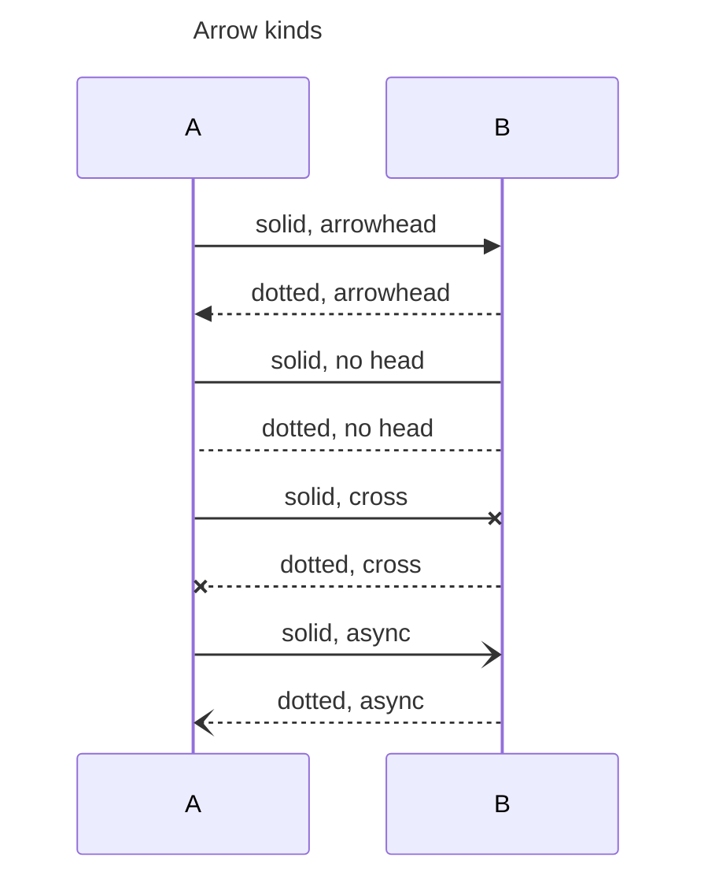

## Implicit participants

Names may hold spaces and the case matters: `Generate task script` and
`Generate Task Script` are two participants.

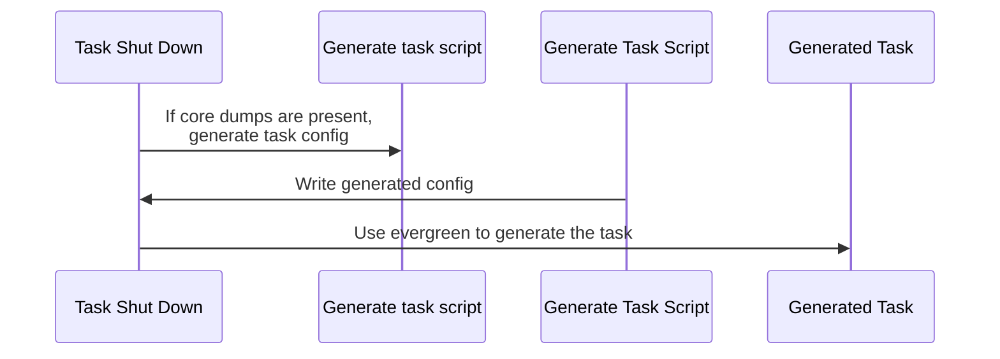

## Aliases and declared participants

The order of first mention is the order on the page, whether a participant is declared
or not. A later `as` renames a participant that a message created.

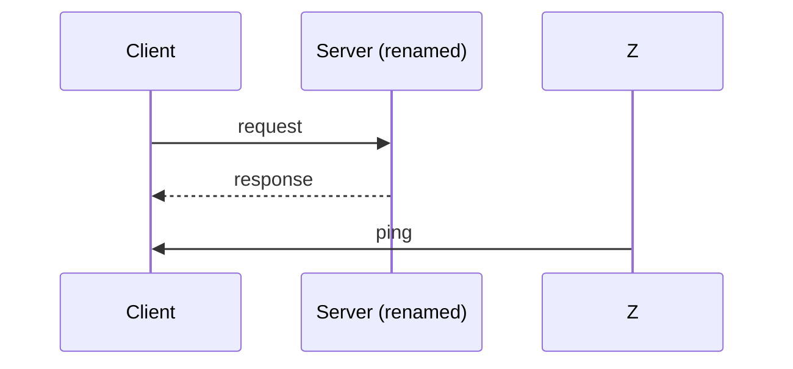

## A message that spans lifelines

The lifelines it passes break behind its text.

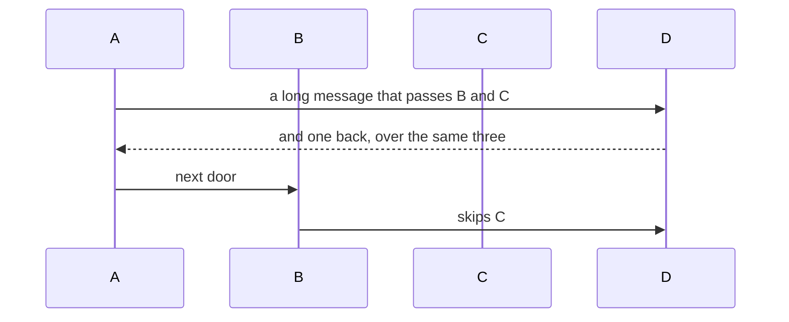

## Multi-line text

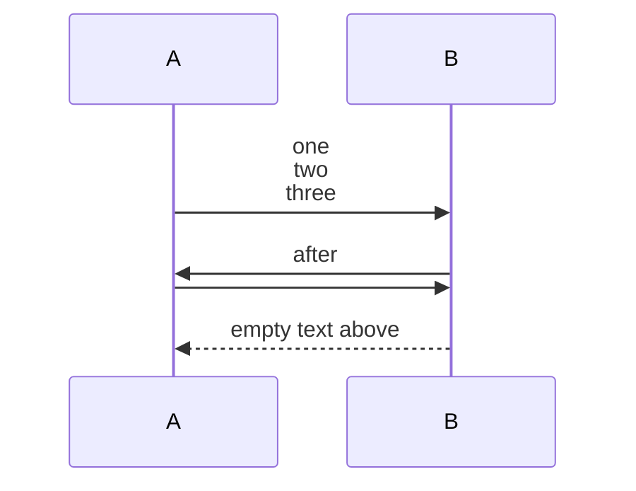

## Syntax that is read

`;` and newlines separate statements, `%%` lines and `#` comments are dropped, `#35;`
is an entity, `+` and `-` after an arrow and `activate` / `deactivate` are read and
not drawn yet, and the keywords ignore case.

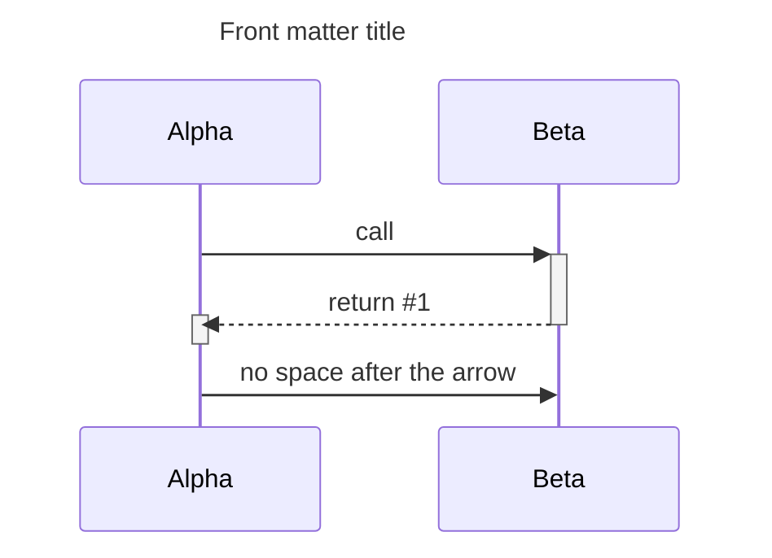

## Not drawn yet

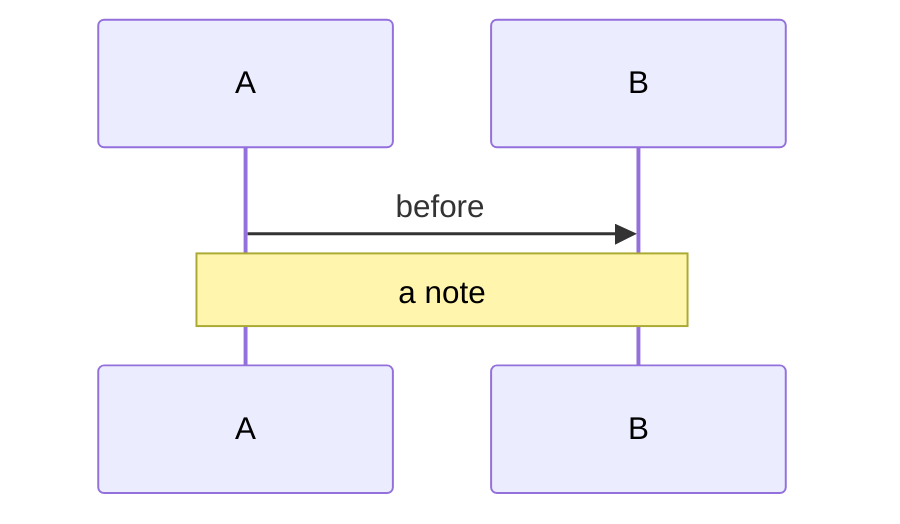

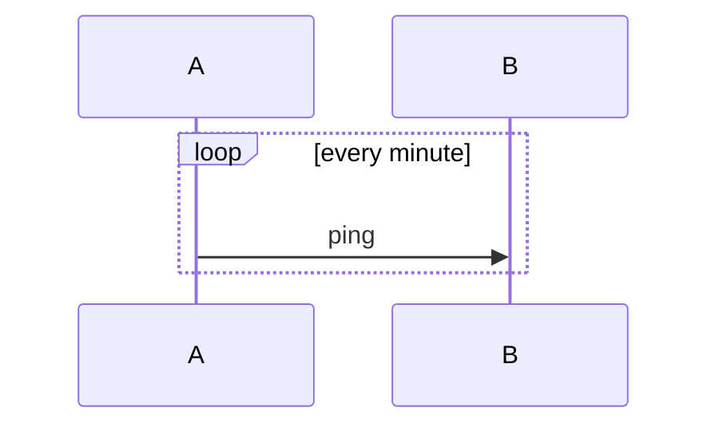

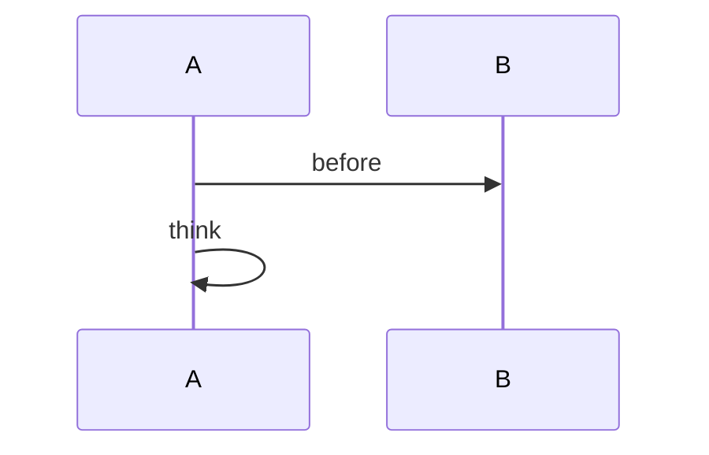

## Not supported

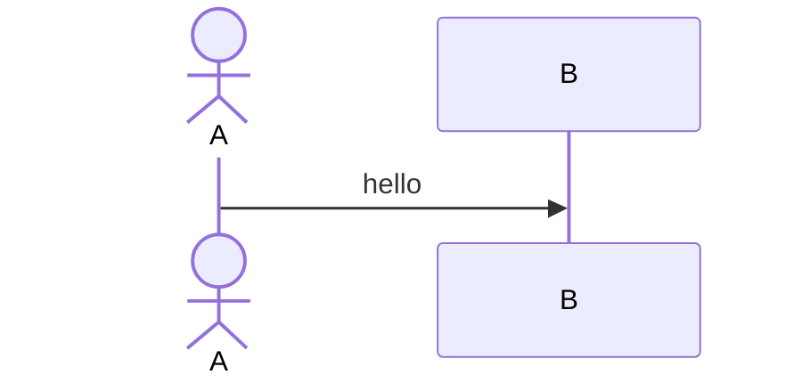

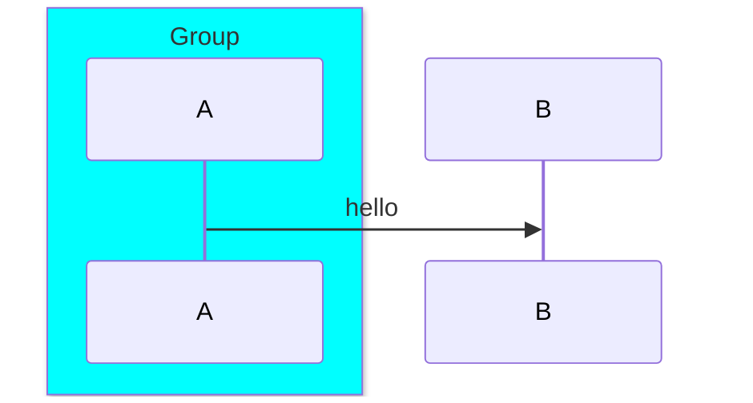

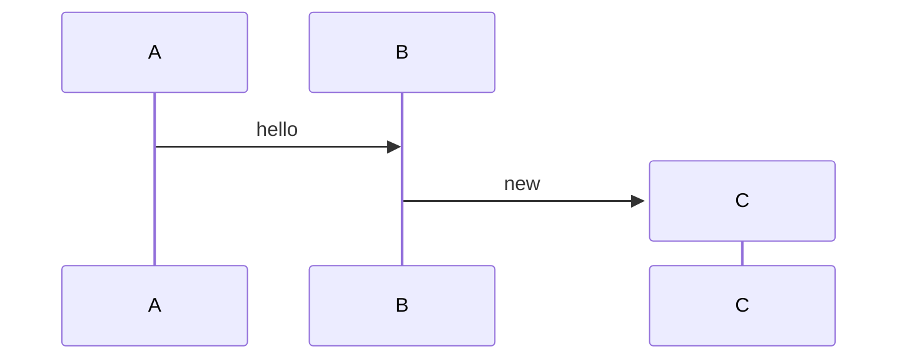

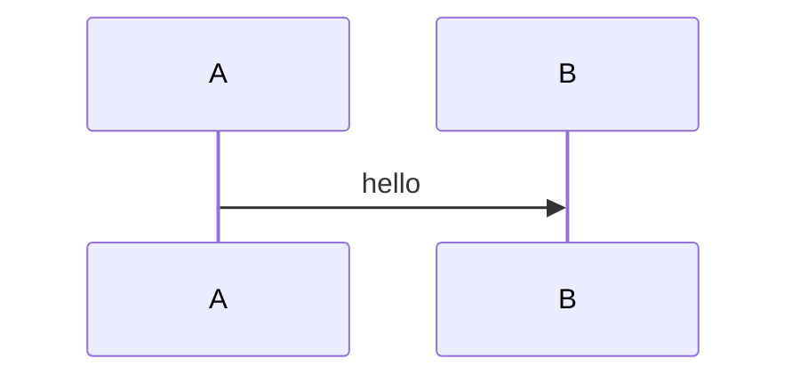

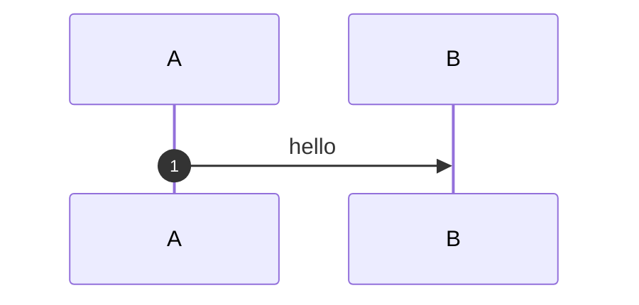

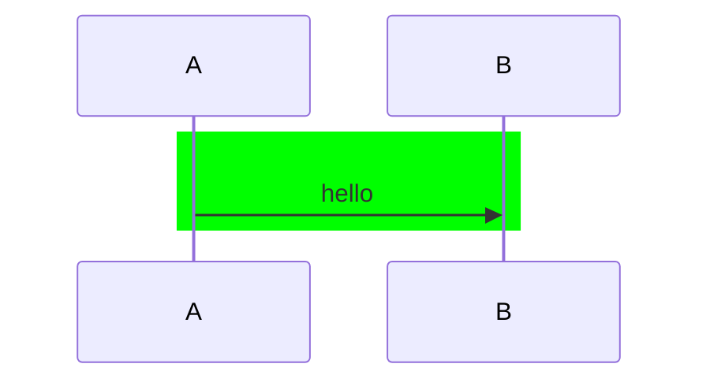


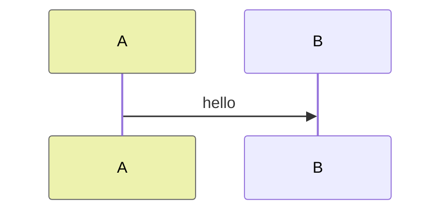


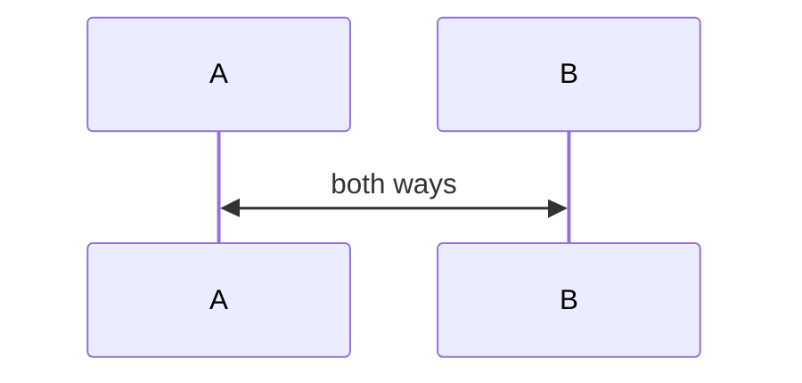

```mermaid
sequenceDiagram
    A->>B
```

```mermaid
sequenceDiagram
    A->>B: hello
    A--|\B: half arrow
```

```mermaid
sequenceDiagram
    A->>B: hello
    activate C
```

```mermaid
sequenceDiagram
    A->>B: hello
    else nothing to else
```

```mermaid
sequenceDiagram
    A->>B: hello
    end
```

```mermaid
sequenceDiagram
    loop never closed
        A->>B: hello
```

```mermaid
sequenceDiagram
    A->>B: <b>bold</b>
```

```mermaid
sequenceDiagram
    title: Nothing happens
```

## Too large

Thirteen participants:

```mermaid
sequenceDiagram
    A->>B: 1
    B->>C: 2
    C->>D: 3
    D->>E: 4
    E->>F: 5
    F->>G: 6
    G->>H: 7
    H->>I: 8
    I->>J: 9
    J->>K: 10
    K->>L: 11
    L->>M: 12
```

A hundred and fifty-one messages:

```mermaid
sequenceDiagram
    A->>B: x; A->>B: x; A->>B: x; A->>B: x; A->>B: x; A->>B: x; A->>B: x; A->>B: x; A->>B: x; A->>B: x
    A->>B: x; A->>B: x; A->>B: x; A->>B: x; A->>B: x; A->>B: x; A->>B: x; A->>B: x; A->>B: x; A->>B: x
    A->>B: x; A->>B: x; A->>B: x; A->>B: x; A->>B: x; A->>B: x; A->>B: x; A->>B: x; A->>B: x; A->>B: x
    A->>B: x; A->>B: x; A->>B: x; A->>B: x; A->>B: x; A->>B: x; A->>B: x; A->>B: x; A->>B: x; A->>B: x
    A->>B: x; A->>B: x; A->>B: x; A->>B: x; A->>B: x; A->>B: x; A->>B: x; A->>B: x; A->>B: x; A->>B: x
    A->>B: x; A->>B: x; A->>B: x; A->>B: x; A->>B: x; A->>B: x; A->>B: x; A->>B: x; A->>B: x; A->>B: x
    A->>B: x; A->>B: x; A->>B: x; A->>B: x; A->>B: x; A->>B: x; A->>B: x; A->>B: x; A->>B: x; A->>B: x
    A->>B: x; A->>B: x; A->>B: x; A->>B: x; A->>B: x; A->>B: x; A->>B: x; A->>B: x; A->>B: x; A->>B: x
    A->>B: x; A->>B: x; A->>B: x; A->>B: x; A->>B: x; A->>B: x; A->>B: x; A->>B: x; A->>B: x; A->>B: x
    A->>B: x; A->>B: x; A->>B: x; A->>B: x; A->>B: x; A->>B: x; A->>B: x; A->>B: x; A->>B: x; A->>B: x
    A->>B: x; A->>B: x; A->>B: x; A->>B: x; A->>B: x; A->>B: x; A->>B: x; A->>B: x; A->>B: x; A->>B: x
    A->>B: x; A->>B: x; A->>B: x; A->>B: x; A->>B: x; A->>B: x; A->>B: x; A->>B: x; A->>B: x; A->>B: x
    A->>B: x; A->>B: x; A->>B: x; A->>B: x; A->>B: x; A->>B: x; A->>B: x; A->>B: x; A->>B: x; A->>B: x
    A->>B: x; A->>B: x; A->>B: x; A->>B: x; A->>B: x; A->>B: x; A->>B: x; A->>B: x; A->>B: x; A->>B: x
    A->>B: x; A->>B: x; A->>B: x; A->>B: x; A->>B: x; A->>B: x; A->>B: x; A->>B: x; A->>B: x; A->>B: x
    A->>B: x
```
