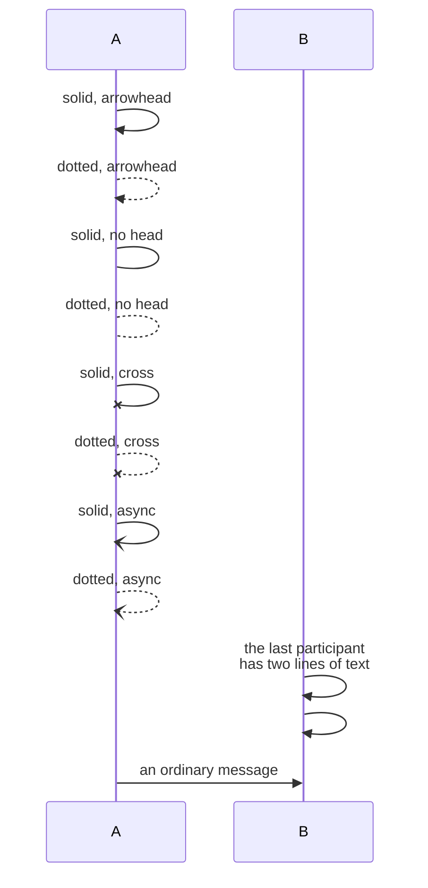
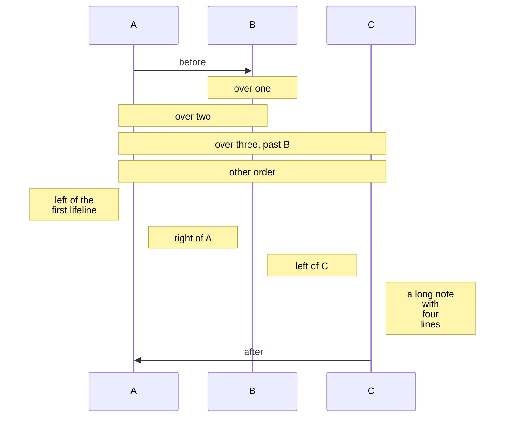
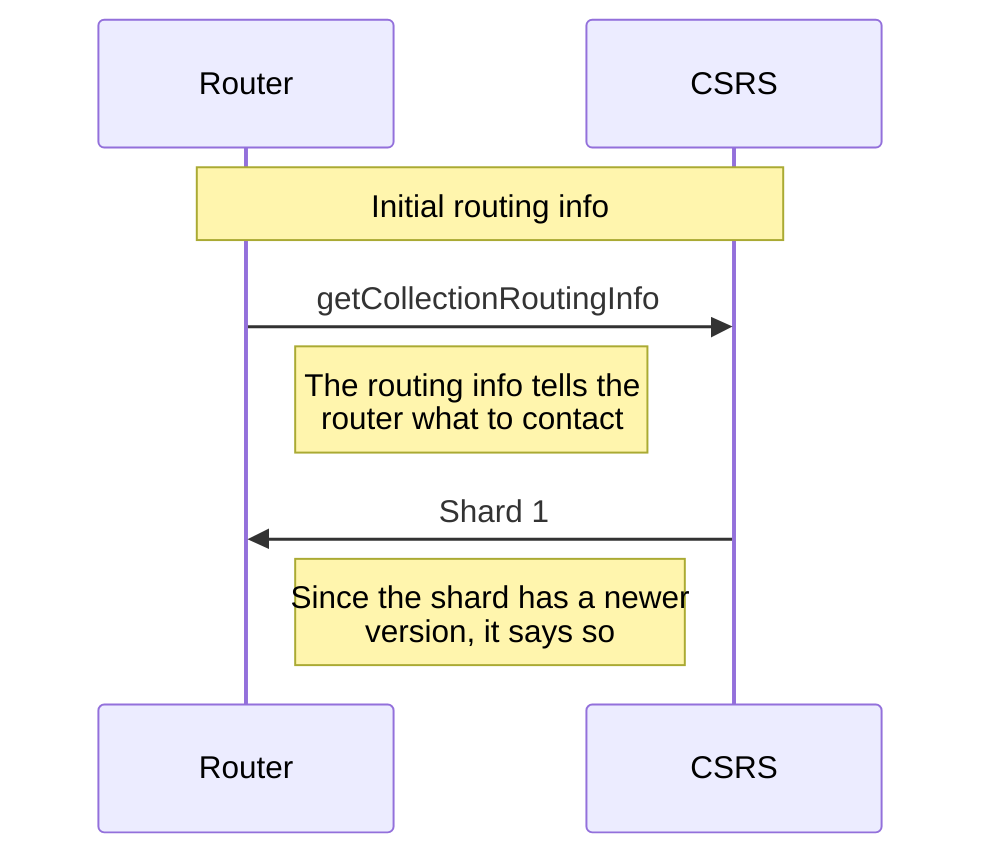
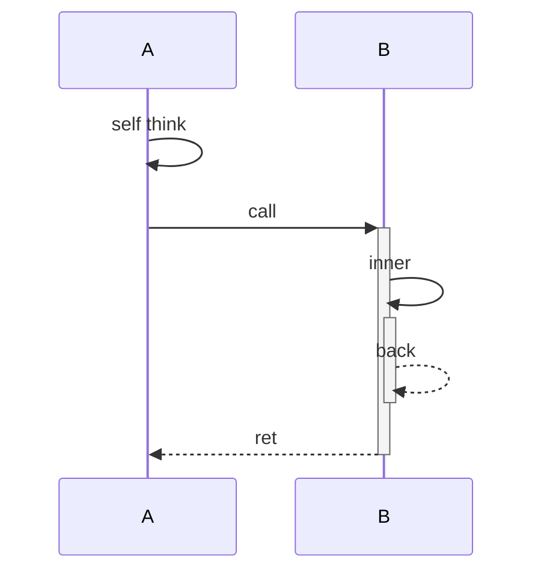
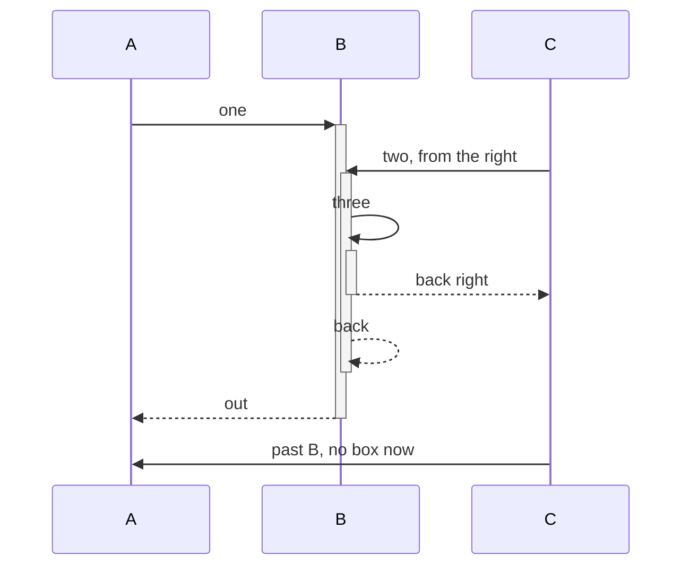
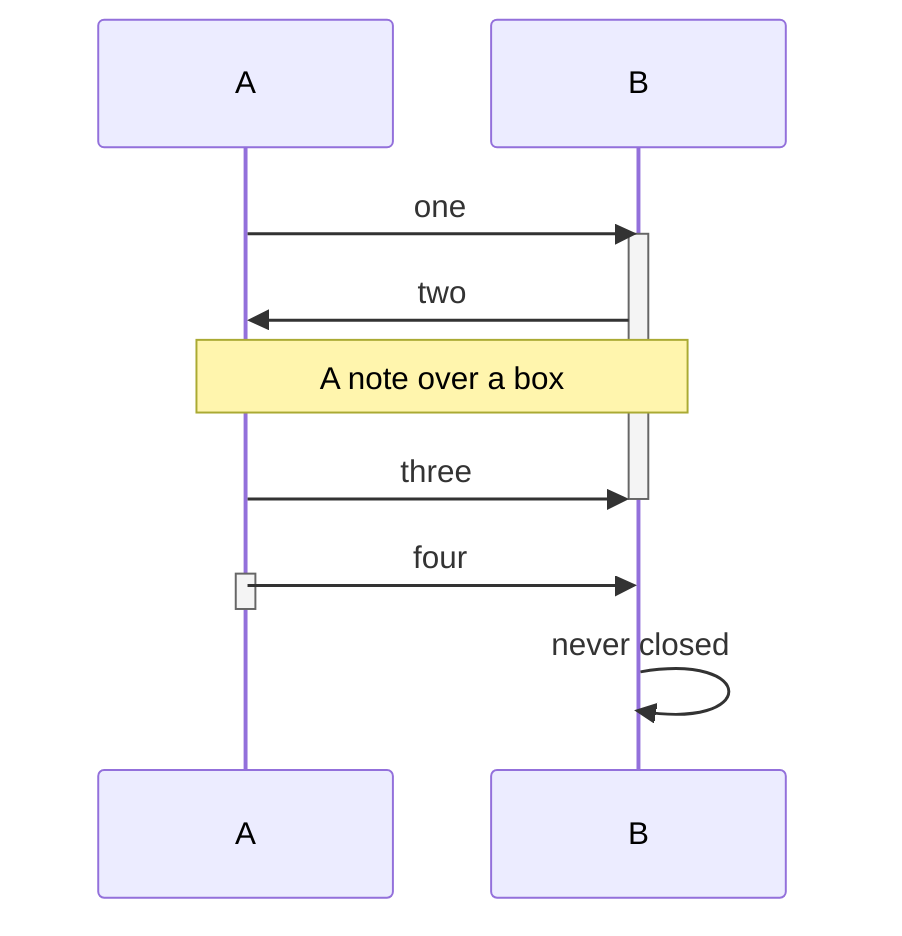
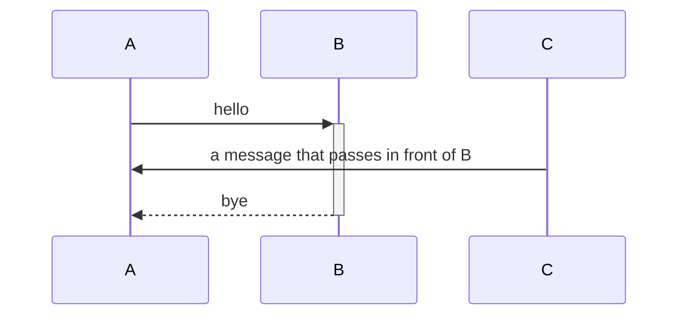

# Built-in Mermaid sequence diagrams: self-messages, notes, activations

Step 3 of `docs/plan-mermaid-sequence.md`. Checked by `mermaid-kitty.sh` at width 80.

## Self-messages

A loop to the right that comes back to the lifeline, with its text above it, in every
arrow style. The text makes room before the next lifeline, and the last participant's
widens the picture.



## Notes

All four placements. `over` one lifeline is centred on it, over two it reaches past both,
and over three the lifeline between breaks at its border. `left of` the first lifeline
widens the picture to the left, and a long multi-line note `right of` the last widens it
to the right.



A note beside a lifeline makes room between it and its neighbour:



## Activations

`+` after the arrow activates the receiver, `-` deactivates the sender. A box is a cell
wide on the lifeline, a nested one is shifted half a box to the right, and an arrow meets
the box, not the lifeline. A self-message leaves from the side of the stack.



Three levels, and arrows from both sides into a box:



Standalone `activate` and `deactivate` act on the row of the message before. A box still
open at the end closes there, a note over a box stops it at the note's border, and an
`activate` followed at once by `deactivate` is one row tall.



## Falls back

A `-` with nothing to close, `deactivate` with nothing open, and a message whose text passes in
front of an activated lifeline are not drawn.

```mermaid
sequenceDiagram
    A->>B: hello
    B-->>-A: nothing to close
```

```mermaid
sequenceDiagram
    A->>B: hello
    deactivate B
```


