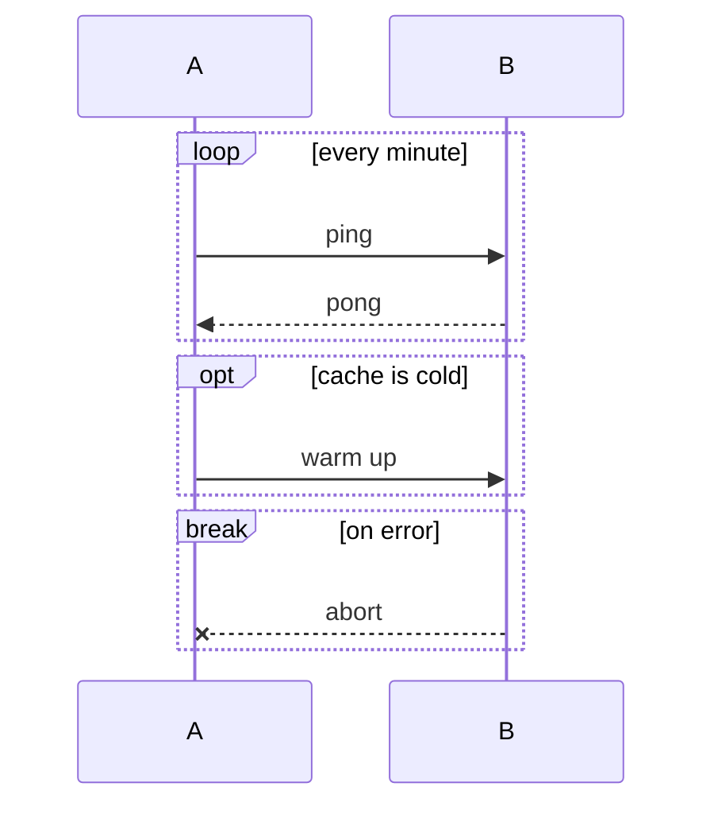
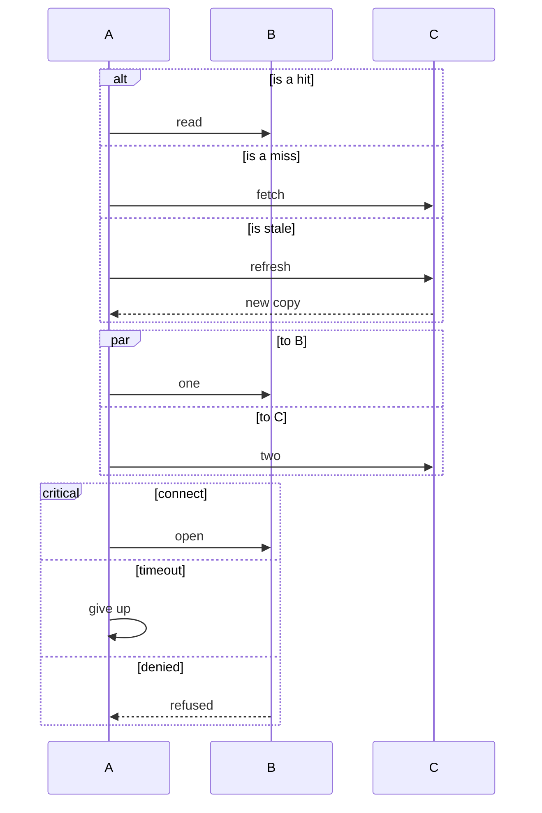
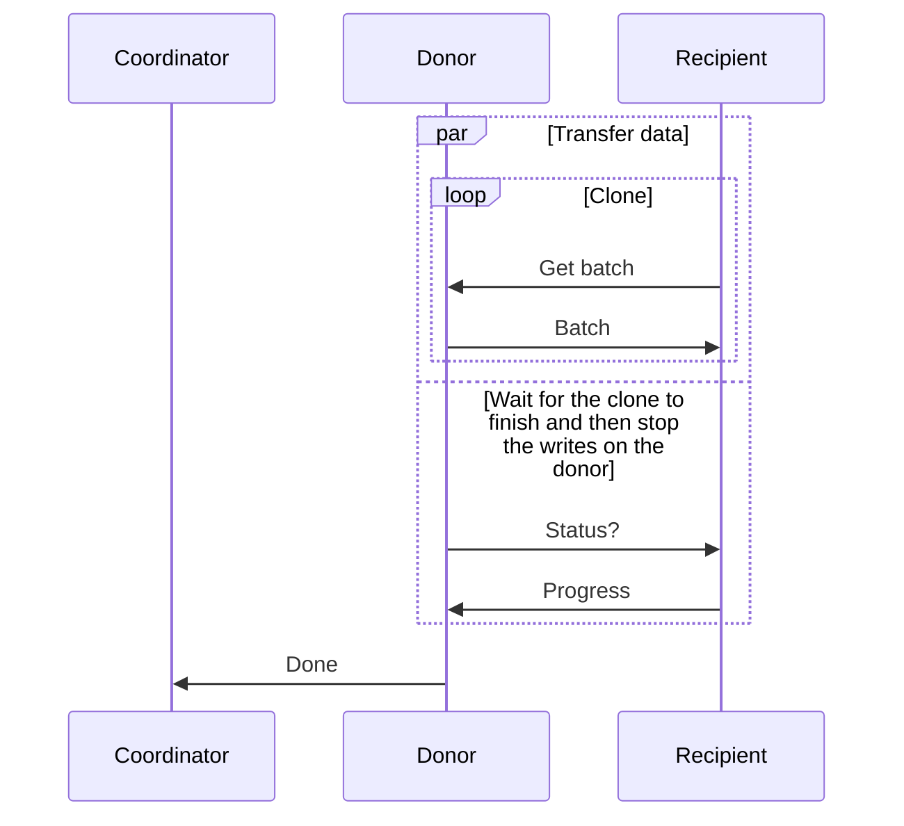
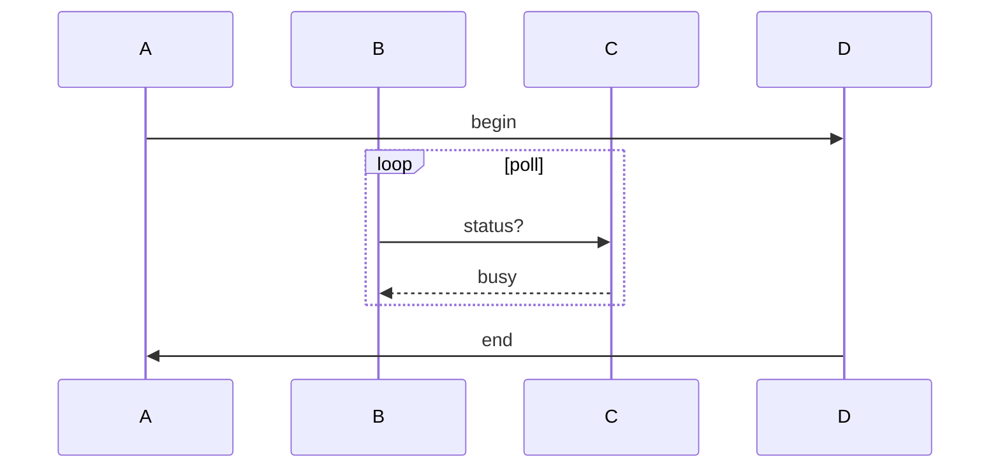
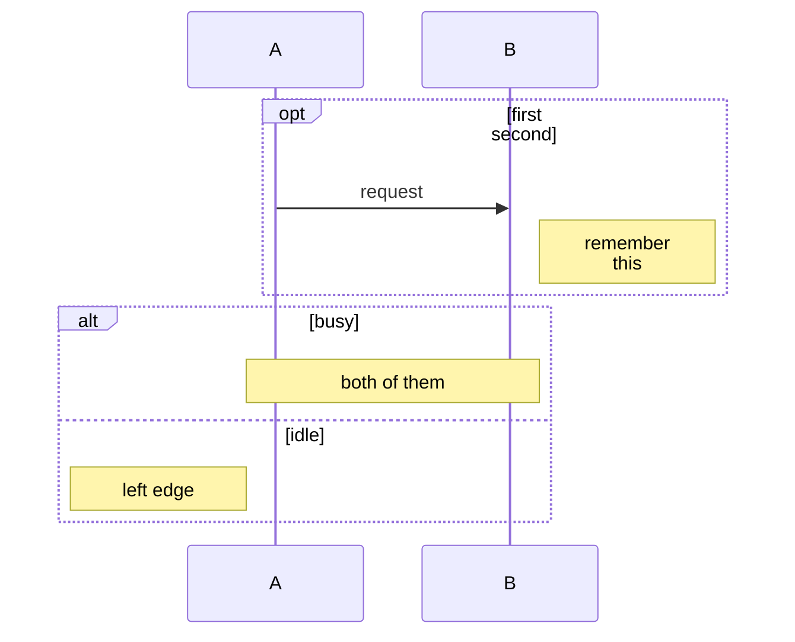
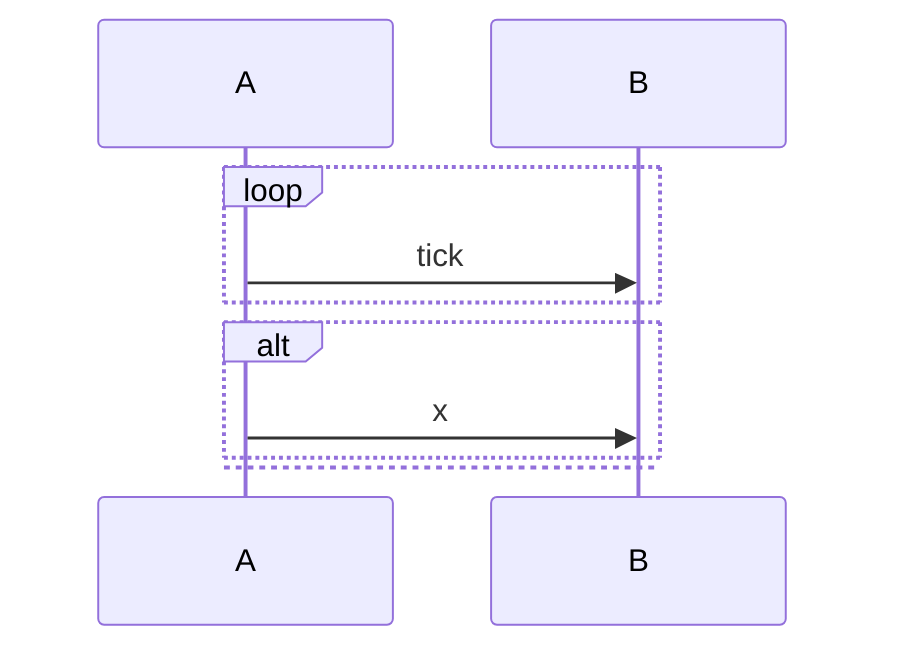
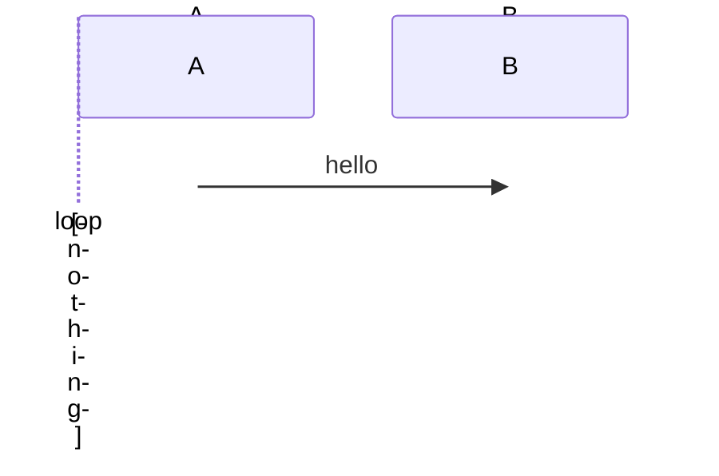
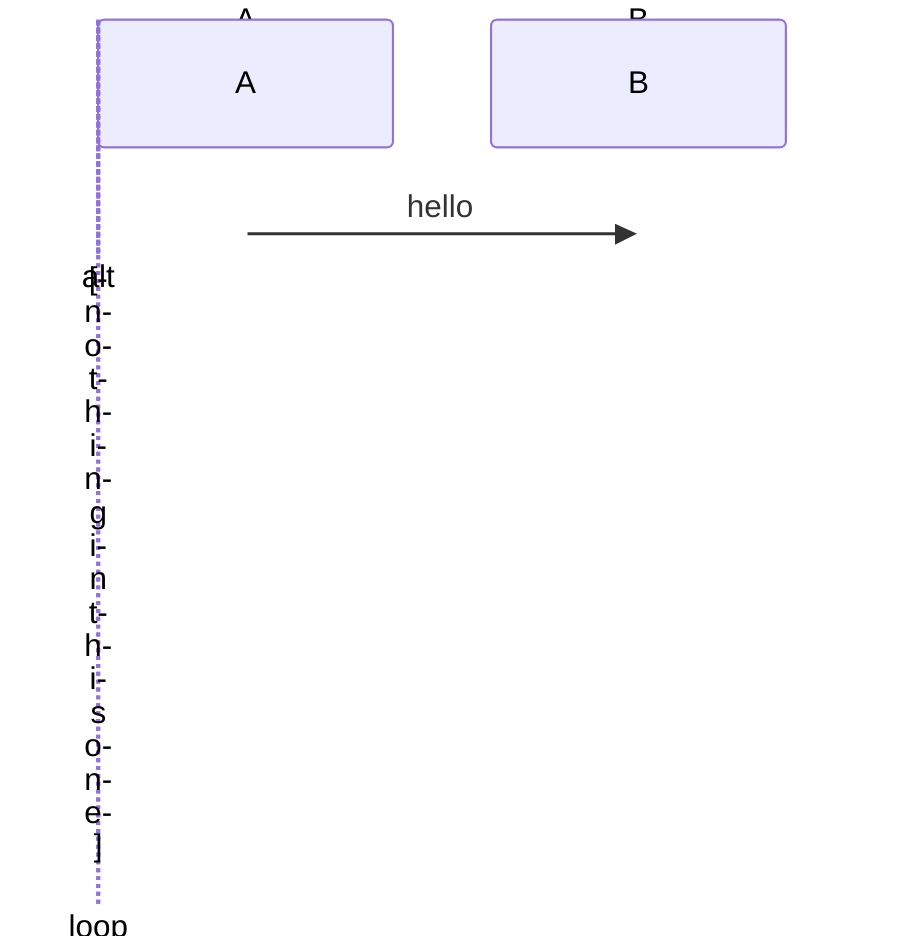
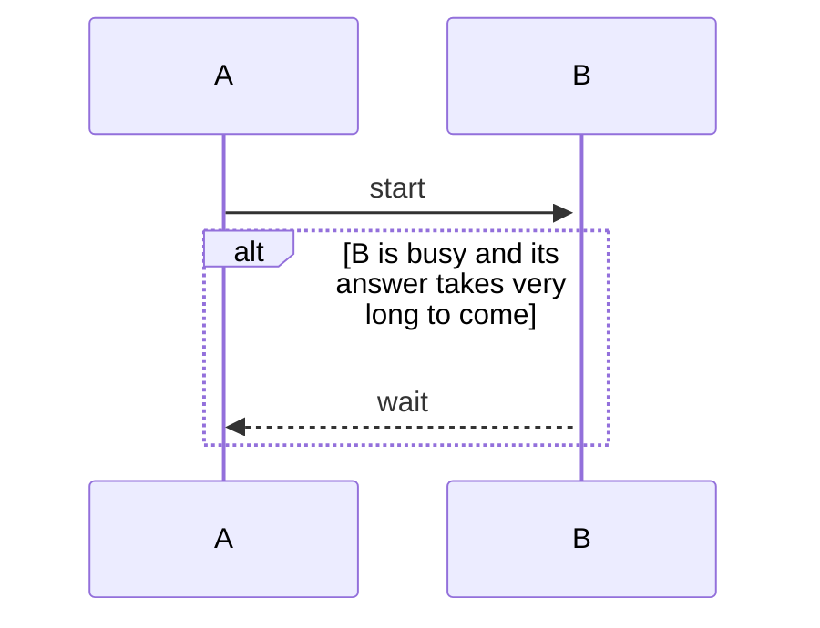

# Built-in Mermaid sequence diagrams: blocks

Step 4 of `docs/plan-mermaid-sequence.md`. Checked by `mermaid-kitty.sh` at width 80.

## One of each keyword

`loop`, `opt` and `break` are frames with a tab for the keyword and their text in
brackets beside it. A frame is as wide as the lifelines its events touch, and two
columns beyond them.

## Sections: alt, par, critical

`alt` with two `else` sections, `par` with `and`, and `critical` with `option`.
A divider is a dotted line across the frame with its section's text on the row
below it.

## Nested frames

A loop inside a `par` section, as in the migration protocol: the inner frame is one
column inside the outer one, on both sides, and one row below its header. The second
section's text is long, and wraps where the frame is narrow.

## A frame over some of the lifelines

Its events touch only the middle two of four participants, so it stops short of the
outer two, and their lifelines pass outside it.

## A frame with a note

The frame reaches around the note, and a note to the right of the last lifeline
widens the picture. A header text of its own line breaks sits next to the tab.

## A frame with no text, and an empty section

## Not drawn

A block with nothing in it has no size in Mermaid either.

A divider text that would pass in front of an activated lifeline is left to
`overlap`, as a message text is.

