# Mermaid graphs that need several tracks

On a Kitty terminal, the built-in renderer gives each bus of edges between two
ranks a track of its own, so edges that interleave no longer need to share one.
Where one edge must cross another, the horizontal stroke breaks to make a bridge,
so a crossing never looks like a join. Checked by `mermaid-kitty.sh` at width 80,
with `--img kitty` and pinned cell sizes. The `.err` golden names the diagrams
that are declined, and so are shown as source.

A dot always marks a split or a merge. A bridge has no dot. Edges only share
strokes in a split (one source) or a merge (one target), so no run of strokes can
be followed from one source into another's bus, and the picture never shows a
link the graph does not have.

## Two tracks (top down)

Expected: both boxes in the first row link to both boxes in the second. `A` and
`B` each split a bus on their own track, and `C` and `D` each take two arrowheads
side by side. The buses do not join: joined, `A`'s strokes would lead up into
`B`. So they cross twice, each time on a bridge.

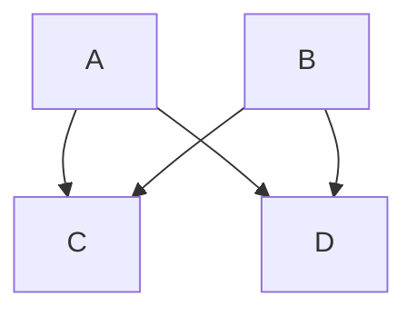

## Three tracks (top down)

Expected: three boxes link to the two below. `D` and `E` each merge all three on
a track of their own, and each source leaves through two ports, one per merge.
Three edges cross another, each on a bridge, the fewest this graph allows.

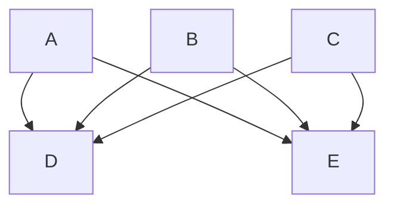

## Three tracks (left to right)

Expected: the same graph turned on its side. Each merge runs along a column of
its own between the two ranks.

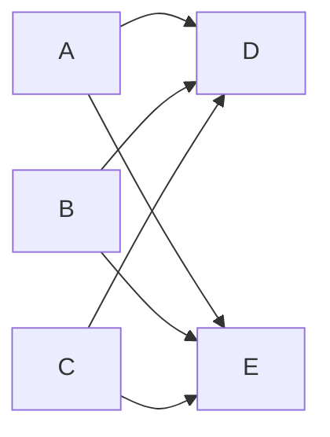

## Two splits sharing targets (top down)

Expected: `A` and `B` both link to `C` and `D`, and `B` also links to `E`. `A`
and `B` each split a bus of their own, and `C` and `D` each take two arrowheads
side by side, so nothing suggests that `A` links to `E`. One edge crosses the
other bus on a bridge.

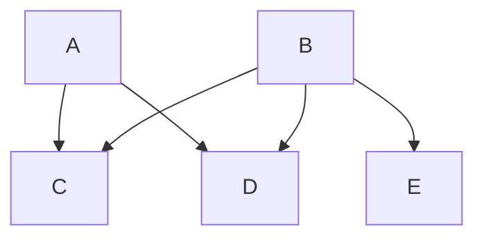

## Two splits sharing targets (left to right)

Expected: the same graph turned on its side. `C` and `D` each take two arrowheads
half a row apart.

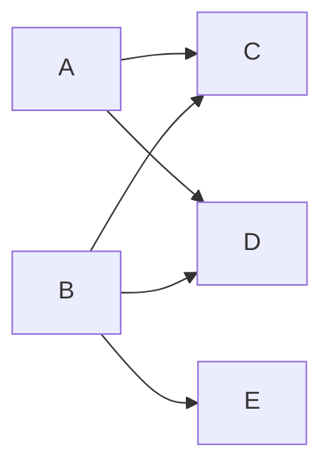

## Crossings (top down)

Expected: six edges link three boxes to three in a ring (`A`–`D`–`B`–`F`–`C`–`E`),
which cannot be drawn between two rows without a crossing. Each edge into a box
has its own arrowhead, since no two sources share both targets. The two
crossings are bridges, with no dot.

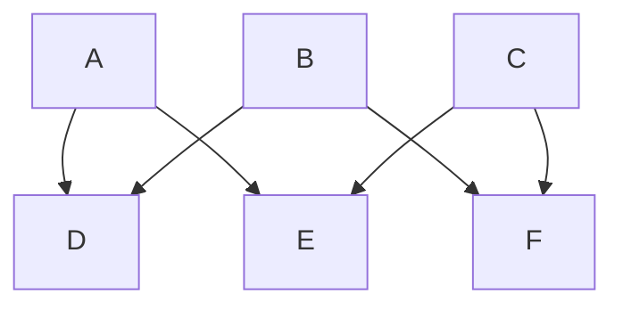

## Crossings (left to right)

Expected: the same graph turned on its side. A horizontal stroke breaks where it
crosses a vertical track.

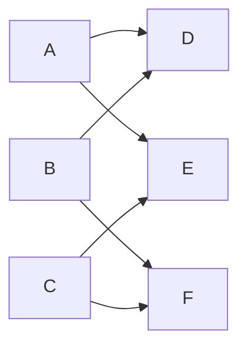

## Two buses sharing a target (top down)

Expected: `Left` fans out to `Out` and `Far`, and `Right` fans out to `Out` and
`Mid`. The two buses do not merge at `Out`, which would show `Left` linking to
`Mid` and `Right` to `Far`: each arrives through its own arrowhead, side by side.
`Out` sits between the other two, so no edge has to cross another.

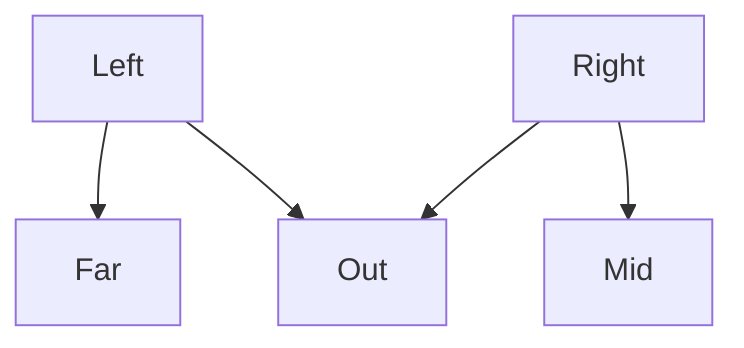

## Aligned boxes (left to right)

Expected: in this orientation `A` and `C`, and `B` and `D`, line up. `A` and `B`
each split a bus, the two buses cross once on a bridge, and `C` and `D` each take
two arrowheads.

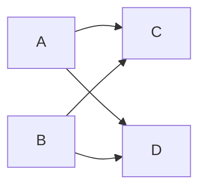

## Three by three (top down)

Expected: each of three boxes links to each of three others. Without shared buses
that takes eight crossings, which the builtin draws: it allows one crossing for each
ten columns, eight at width 80. Every crossing is a bridge, and each box takes three
arrowheads side by side.

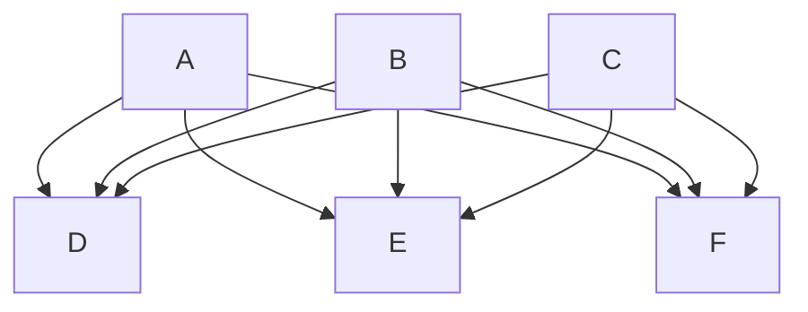

## Too many crossings (declined)

Expected: each of four boxes links to each of four others, twenty-four crossings and
more than the eight that fit 80 columns. It declines with `crossings: 24 > 8`, and the
source is shown, without trying `mmdc`.

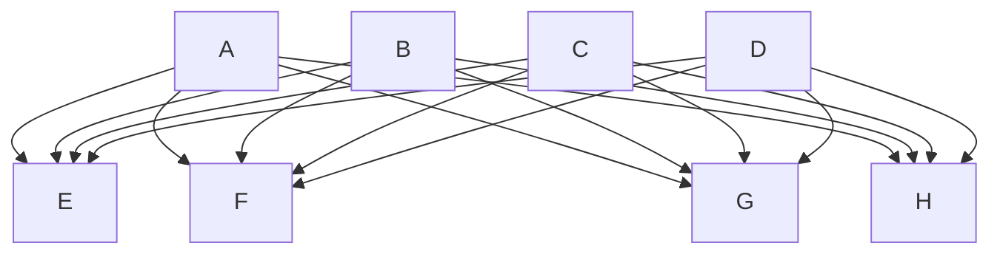
