# Mermaid link types and lengths

On a Kitty terminal, the built-in renderer draws every Mermaid link style: arrows
and open links, dotted and thick ones, invisible ones that only place boxes,
circle and cross ends, and markers at both ends. Checked by `mermaid-kitty.sh` at
width 80, with `--img kitty` and pinned cell sizes; the quadrant preview is too
coarse to show dashes, so `mermaid-kitty.sh` also reads a dotted link's pixels.

## Every link style (top down)

Expected: each pair is joined as its label says. `-->` has a filled arrowhead and
`---` has none; `-.->` and `-.-` are dashed, the first with an arrowhead; `==>`
and `===` are thick, the first with a larger arrowhead; `--o` ends in a filled
circle and `--x` in an X. Nothing is drawn for `~~~`, but its two boxes still sit
one rank apart.

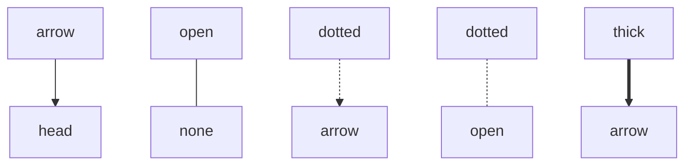

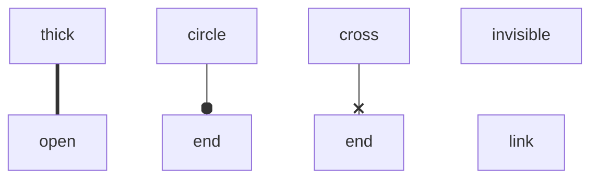

## Every link style (left to right)

Expected: the same links turned on their side.

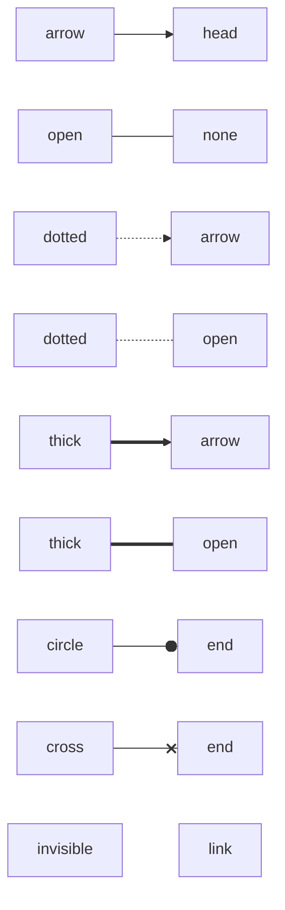

## Markers at both ends (top down)

Expected: a marker at each end of every link, sitting on the outline of its box:
arrowheads for `<-->`, circles for `o--o` and X's for `x--x`, then the dotted and
thick forms.

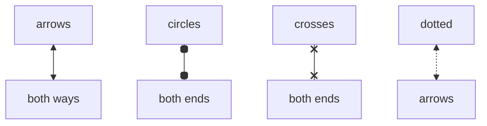

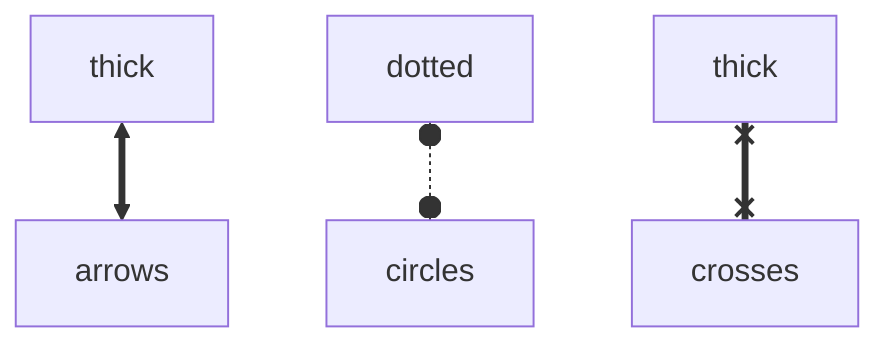

## Markers at both ends (left to right)

Expected: the same links turned on their side.

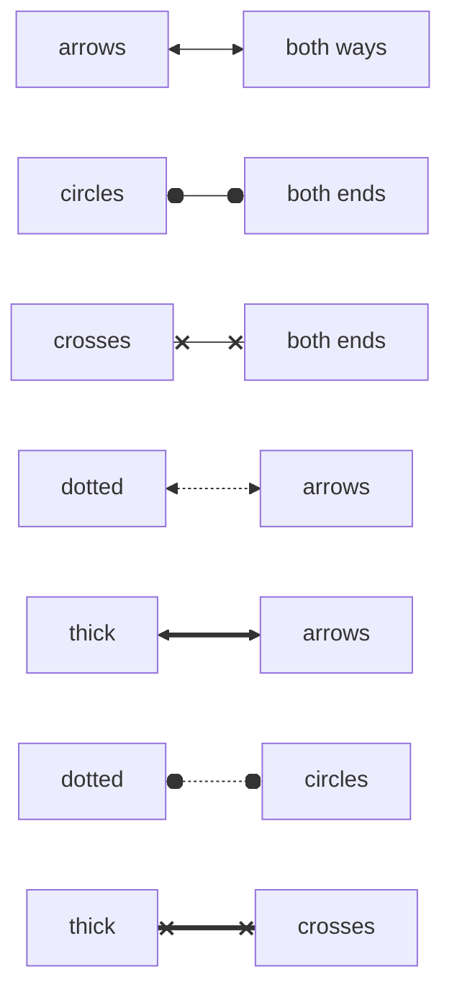

## Lengths

Expected: a link spans one rank more for each extra character. `-->` spans one
rank, `--->` and `-..->` and `===>` two, and `---->` three; the open link `----`
spans two. Each long link keeps its style, dashes or thickness, along the whole
way.

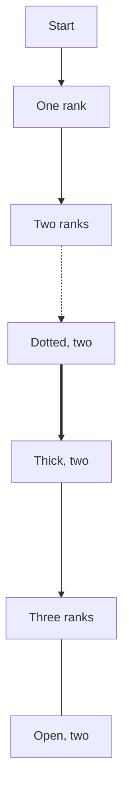

## Styles fanning out of one box

Expected: `Source` leaves through a port for each style, so a dotted, a thick and a
plain arrow do not share a bus, and no stroke joins two edges of different
styles. The two plain arrows do share one.

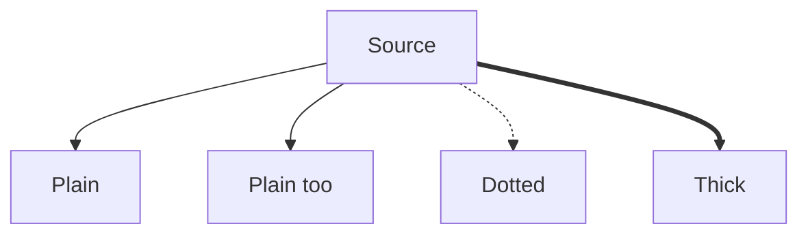

## Styles merging into one box

Expected: the same for a merge: each style arrives at `Sink` through its own
port, with its own arrowhead.

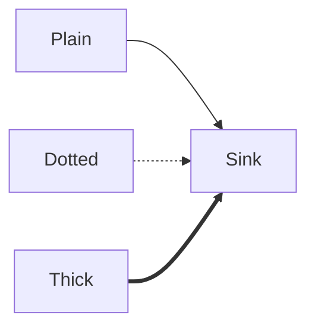

## An invisible link places boxes

Expected: `Left` and `Right` are linked by `~~~` alone, so they sit in two ranks,
`Right` below `Left`, with nothing drawn between them. `Right` also receives an
arrow from `Top`, which crosses the gap without touching anything.

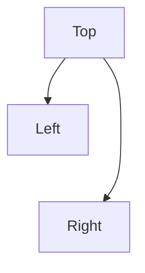

## An invisible link longer than one rank

Expected: `~~~~` makes `Far` sit two ranks below `Near`, and nothing joins them.

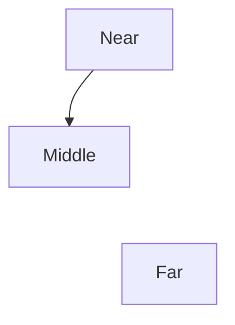

## Dotted links that bend and cross

Expected: dashes restart on every straight stretch, and a dashed edge passes over
a plain one on a bridge.

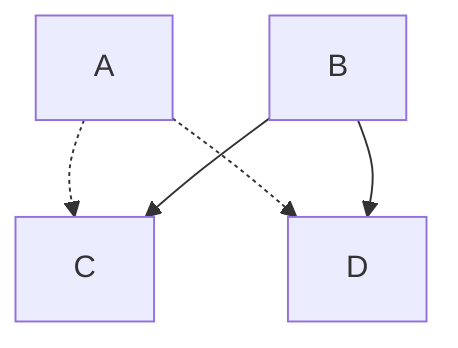
