# Mermaid label text

On a Kitty terminal, the built-in renderer writes every label as ordinary text over
the diagram's image, so the text keeps the terminal's font and colours. This fixture
covers what a label may hold: quoted text, entity codes, line breaks, and Markdown
strings. A node with a label of *n* lines is *n* + 2 rows tall, and its outline
follows it. Each line is centred in the box. Checked by `mermaid-kitty.sh` at width
80, with `--img kitty` and pinned cell sizes: the `.w80.txt` golden holds the
previewed text and quadrant blocks, the `.w80.ansi.txt` golden the text layer with
its styles (`\e` is ESC), and the `.err` golden names the diagrams that are declined
and so shown as source.

## Quoted labels

Expected: the quotes are not shown, and the brackets, parentheses and pipe inside
them are literal text instead of syntax. A quoted label on an edge is drawn on it,
in both spellings (`-- "text" -->` and `-->|"text"|`), and a `-->` inside the quotes
does not end the link.

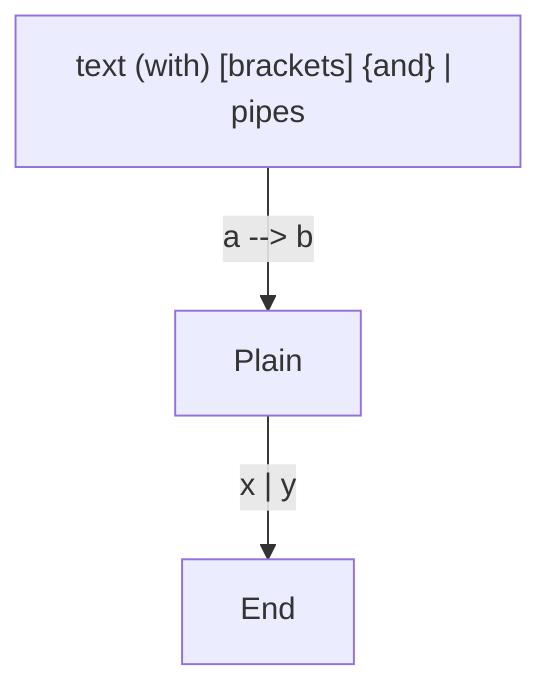

## Entity codes

Expected: `#quot;` is a double quote, `#35;` a hash sign, `#9829;` a heart and
`#amp;` an ampersand. A hash sign that does not start an entity code stays as it is.

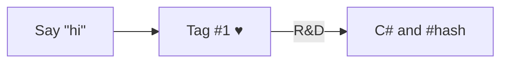

## Line breaks

Expected: `<br>`, `<br/>` and `<br />` end a line, in an unquoted label, a quoted
one, and an edge label. The boxes are three, four and five rows tall, each line
centred in its box. Left to right, an edge leaves a tall box at its vertical
middle, which is the line between two of its rows when it has an even number.

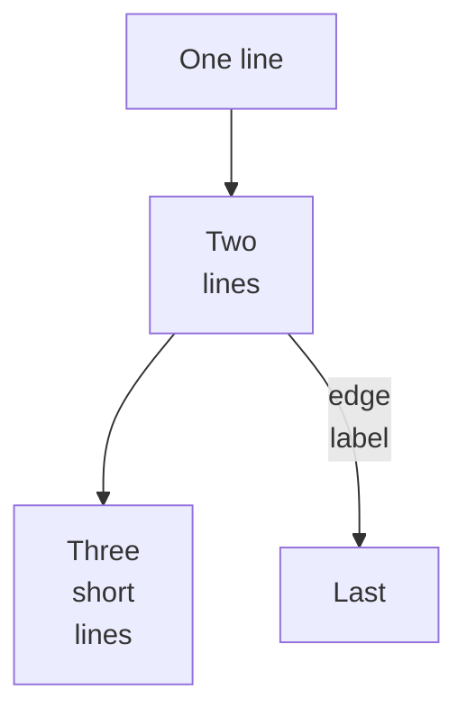

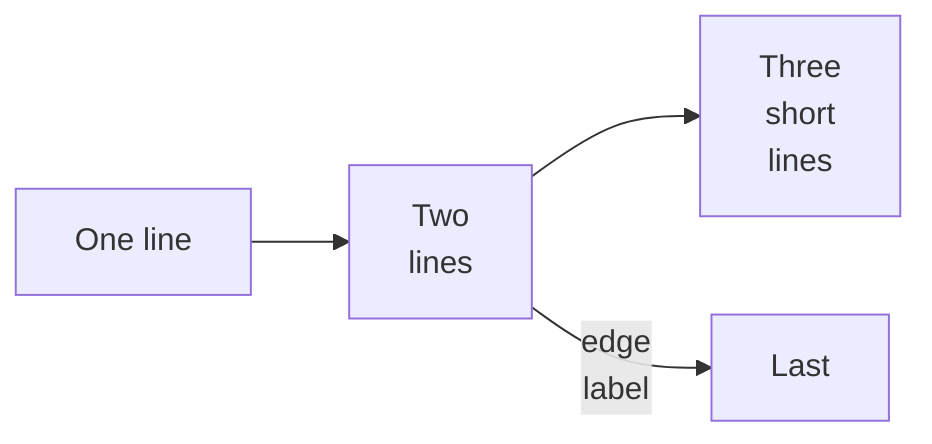

## Markdown strings

Expected: `**bold**`, `*italic*` and `` `code` `` are styled in the text layer, and
the markers are not shown. A newline inside the string is a hard break. An entity
code becomes its character and is never read as Markdown: `#42;` is a literal star.

```mermaid
graph TD
    a["`**Bold** and *italic*`"] --> b["`Some `code` here`"]
    b --> c["`first
    second line`"]
    c --> d["`#42;not italic#42;`"]
```

## A Markdown edge label

Expected: the label on the edge is bold, and it is drawn like any other.

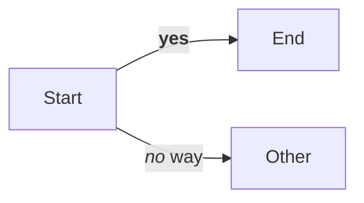

## A long Markdown string

Expected: the string wraps at 24 columns, and the box grows to hold the lines. A word
longer than 24 columns is cut. The style that is on where a line ends is closed
there and reopened on the next line, which the `.ansi.txt` golden shows.

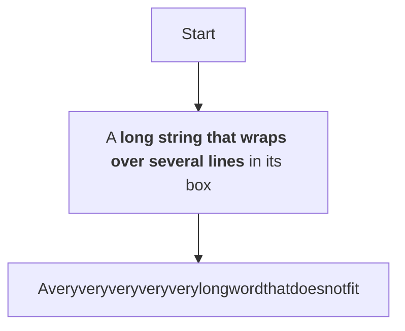

## Wrapping turned off

Expected: front matter turns wrapping off, so the same string stays on one line, as
wide as the diagram may be. (An edge label that wide is not drawn, so only a node
shows it.)

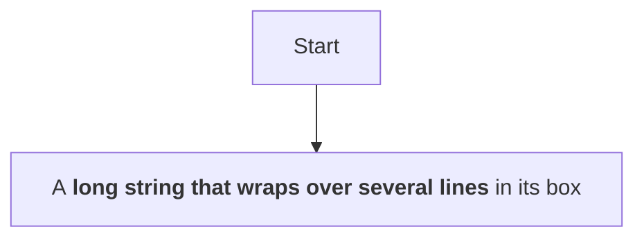

## Plain labels stay literal

Expected: the asterisks in `a*b*c` and the underscores in `x_y_z` are drawn as they
are, because only a Markdown string is interpreted. The quoted label is as literal.

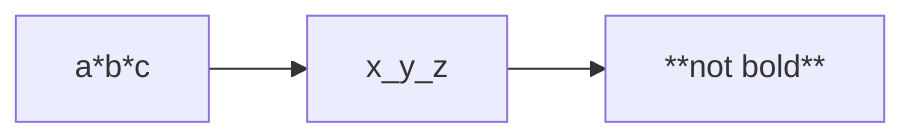

## Wide characters

Expected: CJK and emoji labels are measured in columns, so the boxes fit them, and
nothing is split in the middle of a character.

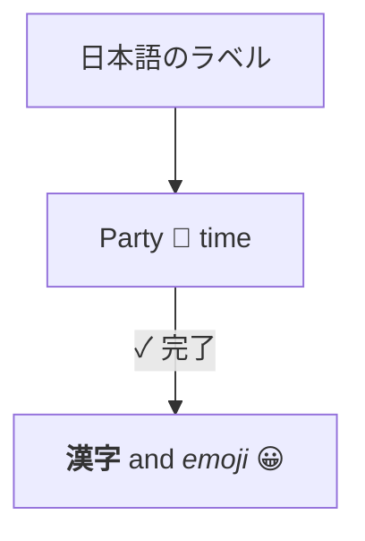

## Text after a quoted string

Expected: as in Mermaid, text after the closing quote joins the label, and a line
break there starts a new line. The first node is a bold title over a plain second
line, the second a plain title with a second line, the third one line, `a b`.

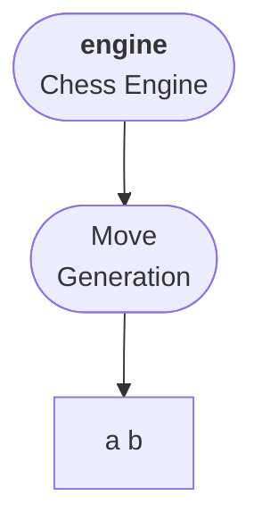

## Declined

Expected: shown as source, as the `.err` golden says, in this order. HTML other than
a line break; an entity code that is not known; a quote that never closes; a Markdown
string with HTML in it; a label with a quote inside the quotes.

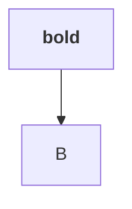

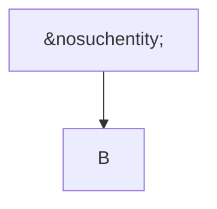

```mermaid
graph TD
    a["unclosed] --> b[B]
```

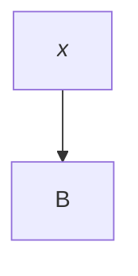

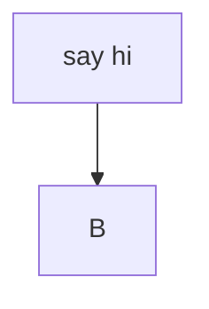
