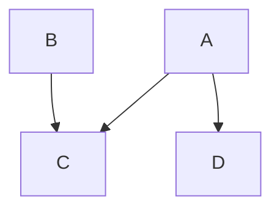
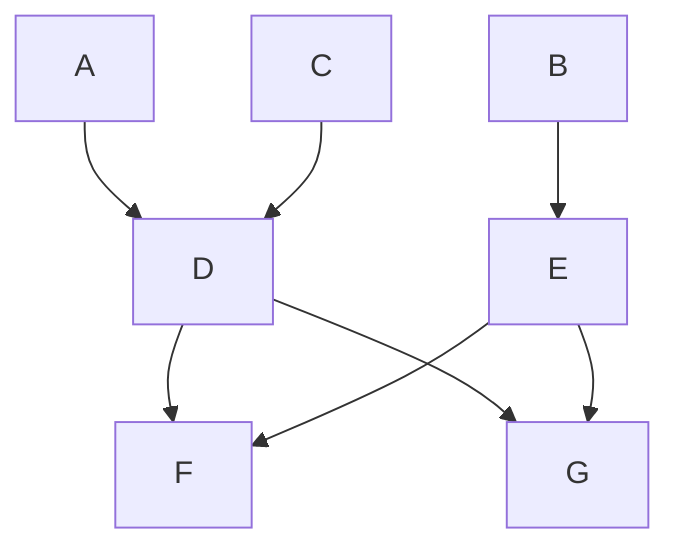
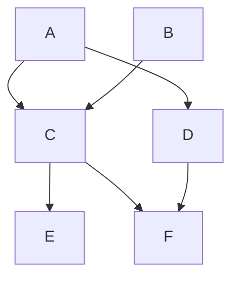
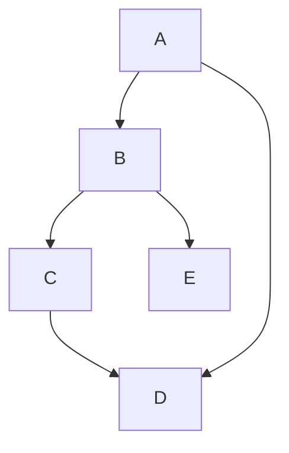
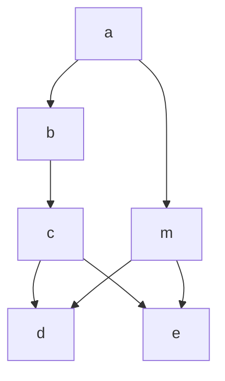
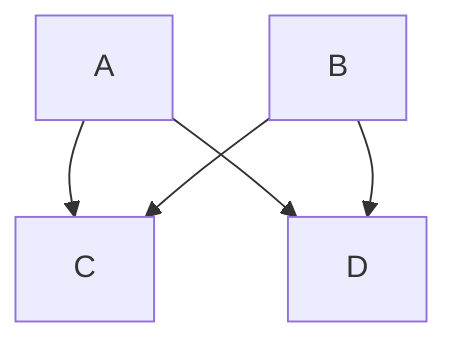

# Mermaid graphs that need their boxes reordered

On a Kitty terminal, the built-in renderer orders the boxes in each rank, and
places them across it, so that few edges cross and long edges run straight. The
graphs here are wired so that the order in which the boxes first appear would
cross edges; the sweeps put them right. Checked by `mermaid-kitty.sh` at width 80,
with `--img kitty` and pinned cell sizes.

## Untangled by the sweeps (top down)

Expected: `A` links to `C` and `D`, and `B` links to `C`. Declared in this order,
`C` would come first and `B`'s edge would have to cross the one into `D`. `D`
comes first instead, so `C` sits between `A` and `B` and no edge crosses another.

## Three ranks, sources reordered (top down)

Expected: `A` and `C` both link to `D`, and `B` links to `E`; `D` and `E` both link
to `F` and `G`. `B` ends up to the right of `C`, so that `B`'s edge does not cross
`C`'s, and none of the edges cross.

## Three ranks, two layers reordered (top down)

Expected: `A` and `B` link to `C`, `A` also links to `D`, `C` links to `E` and
`F`, and `D` links to `F`. `D` comes before `C`, and `F` before `E`, so that no
edge crosses another.

## Straight through the middle (top down)

Expected: `A` links to `D` over three ranks, passing to the right of `B`, `C` and
`E`. The long edge runs as one straight line through the ranks it passes, with a
single jog where it arrives.

## Short links (top down)

Expected: `m` is reached from `a`, and links to `d` and `e`, which sit two ranks
below `a`. `m` is moved down next to `c`, so that its edges to `d` and `e` are
short and the edge from `a` is the long one.

## From the Mermaid docs (top down)

The Mermaid documentation draws `A & B --> C & D`. Written out edge by edge:

Expected: both boxes in the first row link to both boxes in the second. As in
`mermaid-routing.md`, the buses are nested, so there is no bridge.

