# Mermaid cycles

On a Kitty terminal, the built-in renderer draws a graph with cycles. Like Dagre, it
finds the edges that close a cycle with a depth-first search, in order of first
appearance, and reverses them for the layout, so that the graph is laid out in ranks.
Each of those back edges is then drawn from its real source to its real target, against
the flow: it leaves the top of its source (top down), runs up, and arrives, with its
arrowhead, at the bottom of its target. It has ports of its own, one cell off the middle
of the side, so it never shares strokes with the edges that run the other way.
A self-loop is drawn beside its box, and each of several edges between the same pair of
boxes gets ports and a track of its own.
Checked by `mermaid-kitty.sh` at width 80, with `--img kitty` and pinned cell sizes. The
`.err` golden names the diagrams that are declined, and so are shown as source.

## A retry loop (top down)

Expected: `Try` and `Check` are in a chain below `Start`, and the arrow from `Check`
back to `Try` runs up beside the one from `Try` to `Check`, with its arrowhead at the
bottom of `Try`.

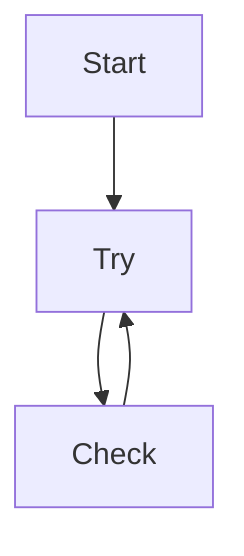

## A retry loop (left to right)

Expected: the same graph turned on its side. The arrow back runs left, below the one
that goes right, and its arrowhead touches the right side of `Try`.

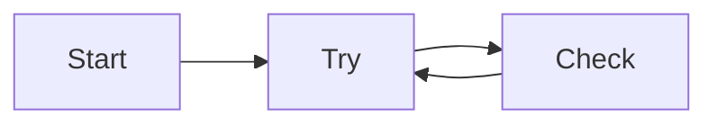

## Minimum length of a link, with a loop (top down)

This is the example from the Mermaid documentation. The arrow from `Rethink` back to
`Is it?` is a back edge. The two spellings of the label differ only in the way the label
is written, so the two diagrams are drawn exactly alike.

Expected: `End` is three ranks below `Is it?`, as `---->` says, while `Rethink` is two
ranks below it and loops up to the decision.

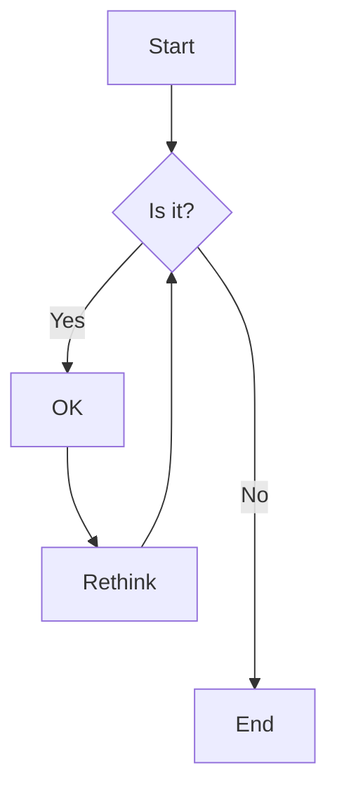


## A 2-cycle (top down and left to right)

Expected: two boxes joined by one arrow each way, side by side, each with an arrowhead.

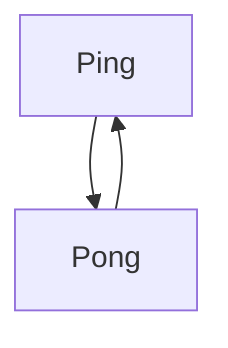

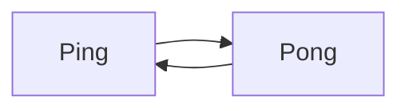

## A long loop (top down)

Expected: `Three` points back at `One`. The back edge runs up the side of the chain
through the ranks in between, and arrives at the bottom of `One`.

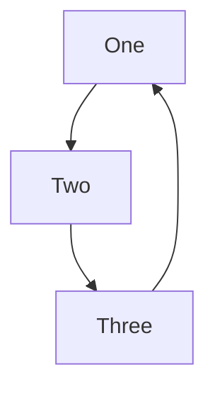

## A loop with a label (top down)

Expected: the label of the back edge sits on it, halfway up.

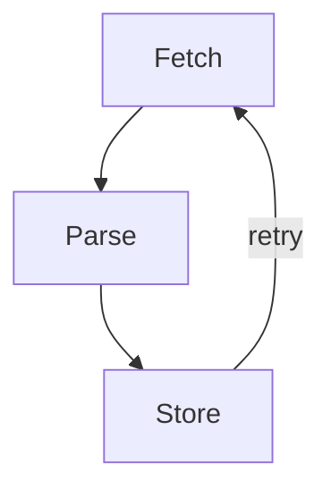

## A dotted back edge, and one loop in each direction (bottom up, right to left)

Expected: the dotted edge keeps its style, and its arrowhead is at the original target.
In the bottom-up graph the flow, and so the back edge, runs the other way.

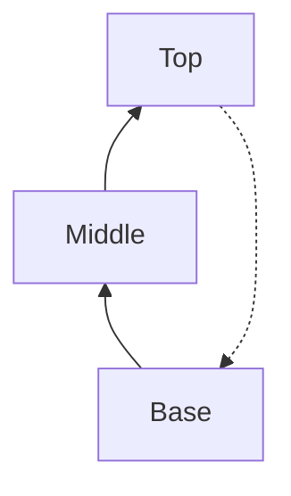

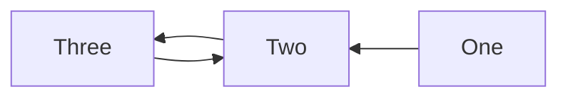

## Three back edges, and a node that grows to hold their ports (top down)

Expected: `D` points back at `A`, `B` and `C`, each arrow running up its own line to the
bottom of its target. `D` is wider than a one-letter box, because its four ports (three
back edges and the arrow in from `C`) need a cell each, clear of its corners.

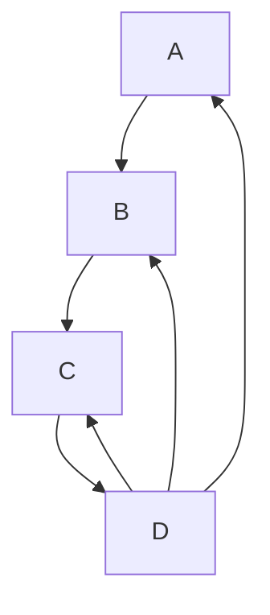

## Four nodes, each pointing back at every earlier one (top down)

Expected: six back edges, within the eight that fit 80 columns. The boxes widen to fit
their ports, and every arrowhead touches the box it points at.

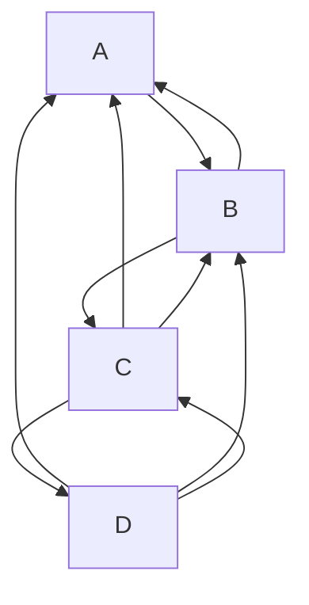

## Three back edges, left to right

Expected: a box with several ports grows taller instead.

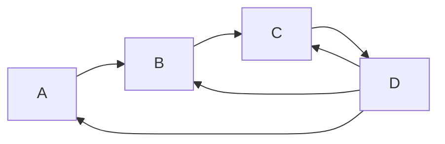

## Too many back edges (declined)

Expected: five nodes with an edge each way between every pair have ten back edges, more
than the eight that fit 80 columns (one per ten columns). The builtin declines with
`back edges: 10 > 8`, and the source is shown, without trying `mmdc`.

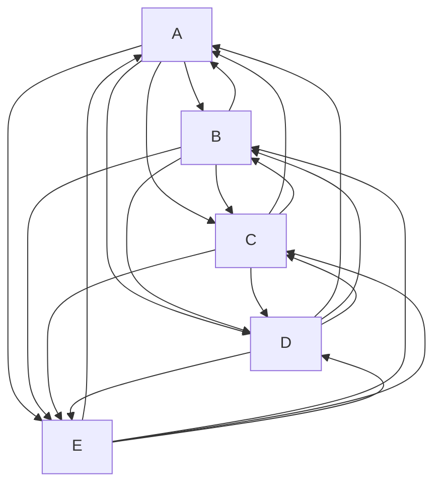

## A self-loop (top down and left to right)

Expected: the arrow from `Work` to itself is a small rounded loop beside the box (to its
right, top down; below it, left to right). It leaves the outline, turns, and comes back
in to end in an arrowhead on the outline. The loop is outside the box, so it moves
neighbouring boxes apart but changes no other edge.

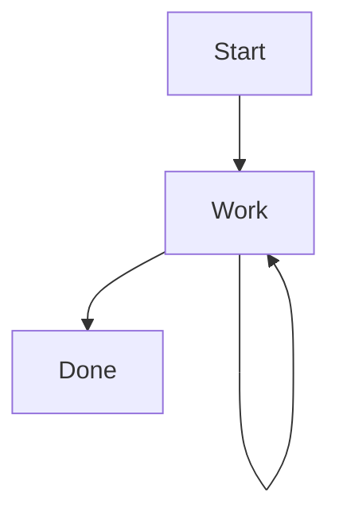

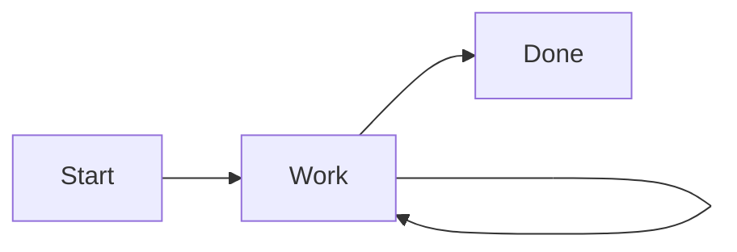

## A self-loop with a label

Expected: the label sits beyond the loop, to the right of it top down and under it left to
right, centred on the box. A label wider than the box makes room for itself in its rank.

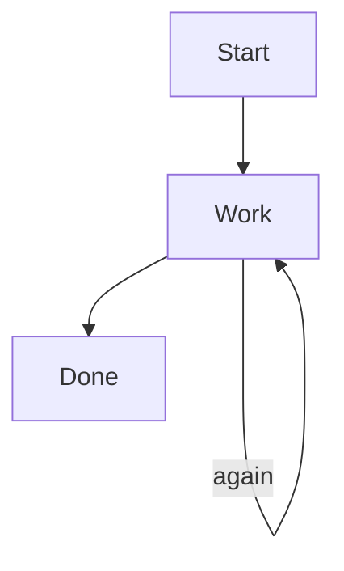

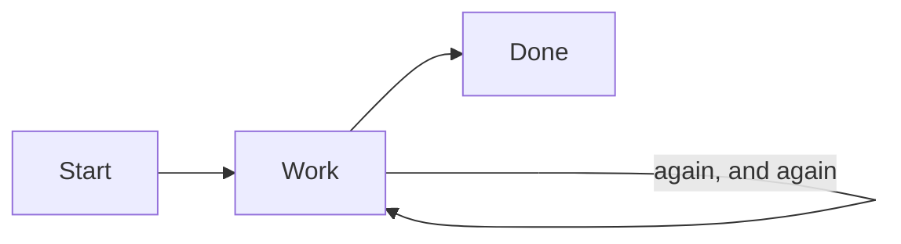

## Self-loops in other directions and styles, and on other shapes

Expected: a thick loop has its larger arrowhead; a dotted one is dotted; a loop with an
arrowhead at both ends has one at each. In the bottom-up graph the loop stays on the right,
and in the right-to-left one below. Every shape takes its loop on the outline.

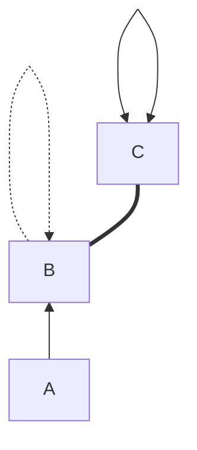

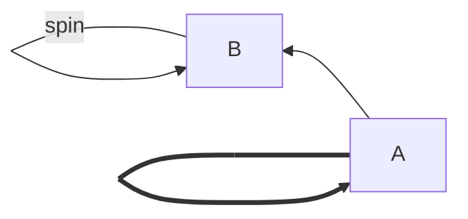

```mermaid
graph TD
    A{Decide} --> A
    A --> B((Circle))
    B --> B
    B --> C([Stadium])
    C --> C
    C --> D[(Database)]
    D --> D
    D --> E{{Hexagon}}
    E --> E
    E --> F[/Slanted/]
    F --> F
```

## Boxes with loops side by side, and a loop beside a back edge

Expected: each loop makes its own box wider by its cells, and the boxes keep their
separation.

```mermaid
graph TD
    A[Fork] --> B[Left]
    A --> C[Right]
    B --> B
    C -->|loop| C
    B --> D
    C --> D
    D --> A
```

## Parallel edges (top down and left to right)

Expected: two edges between the same pair of boxes each get a port of their own and run
side by side, each with an arrowhead.

```mermaid
graph TD
    A[Source] --> B[Target]
    A --> B
```

```mermaid
graph LR
    A[Source] --> B[Target]
    A --> B
```

## Parallel edges with labels

Expected: each label sits on its own edge, and the edges part to make room for them.

```mermaid
graph LR
    A[Ask] -->|yes| B[Answer]
    A -->|no| B
```

```mermaid
graph TD
    A[Ask] -->|yes| B[Answer]
    A -->|no| B
```

## An arrow each way (top down and left to right)

Expected: `A <--> B` is a single edge with an arrowhead at each end. Two separate edges
`A --> B` and `B --> A` are drawn as two arrows side by side, each with one arrowhead.

```mermaid
graph TD
    A[Ping] <--> B[Pong]
    C[Left] --> D[Right]
    D --> C
```

```mermaid
graph LR
    A[Ping] --> B[Pong]
    B --> A
    B --> C[Done]
```

## More than two edges between a pair

Expected: every edge gets a port and a track of its own, however many there are, each
with its own arrowhead. Below, `A --> B` twice with `B --> A` makes three between one
pair, and two edges from `Three` to `One` both run up the side of the chain.

```mermaid
graph TD
    A --> B
    A --> B
    B --> A
```

```mermaid
graph LR
    A[Source] --> B[Target]
    A --> B
    A --> B
    B --> A
    B --> A
```

```mermaid
graph TD
    A[One] --> B[Two]
    B --> C[Three]
    C --> A
    C --> A
```

## Repeated self-loops

Expected: as in `mmdc`, a self-loop repeated with the same label (or with none) is drawn
once, so the first diagram is a single plain loop on `A` and the second a single loop
labelled `x`.

```mermaid
graph TD
    A --> A
    A --> A
    A --> B
```

```mermaid
graph TD
    A -->|x| A
    A -->|x| A
    A --> B
```

## Two different self-loops on one node (declined)

Expected: a box has room for one loop. With different labels on several the builtin declines
with `parallel edges`, and the source is shown.

```mermaid
graph TD
    A --> A
    A -->|x| A
```
