# Mermaid graphs with branches and merges

On a Kitty terminal, the built-in renderer draws any acyclic graph of boxes joined
by `-->` links (`mermaid-cycles.md` covers the graphs with cycles). The graphs here
are trees and merges that need no more than one track between two ranks;
`mermaid-routing.md` covers the ones that need more.
Checked by `mermaid-kitty.sh` at widths 80 and 44, with `--img kitty` and pinned
cell sizes. The `.err` goldens name the diagrams that are declined, for now, and
so are shown as source.

Where several edges leave one box they share its port and split off a common bus;
where several arrive they merge into one arrowhead. A dot marks each split or
merge, and a bend is rounded.

## Tree (top down)

Expected: `Root` above two children, `Left` and `Right`, with the bus splitting
under `Root`. `Left` has one child of its own, `Leaf`, directly below it.

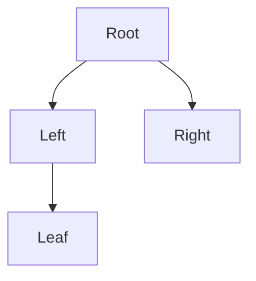

## Tree (left to right)

Expected: the same tree turned on its side. `Root` on the left, two children
stacked in a column, `Leaf` to the right of `Left`.

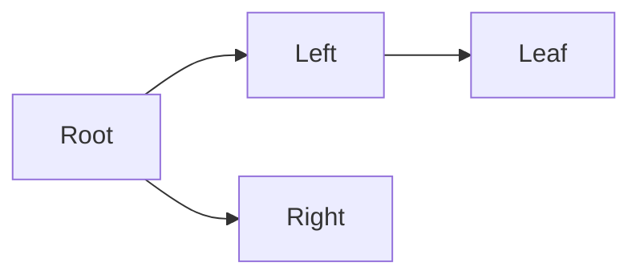

## Fan-in (top down)

Expected: three boxes at the top merge into one arrowhead on `Done`.

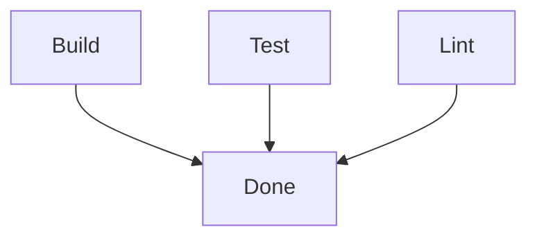

## Fan-in (left to right)

Expected: two sources merge into one arrowhead on `Sink`.

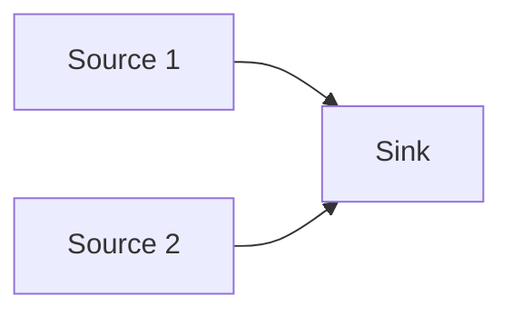

## Diamond (top down)

Expected: `A` splits into `B` and `C`, which merge again into `D`; `D` sits
directly below `A`.

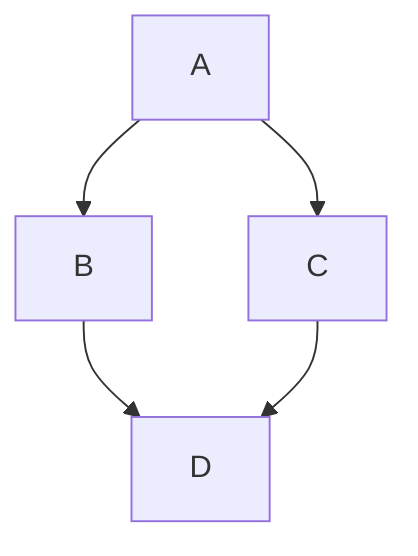

## Diamond (left to right)

Expected: the same diamond, with `D` directly to the right of `A`.

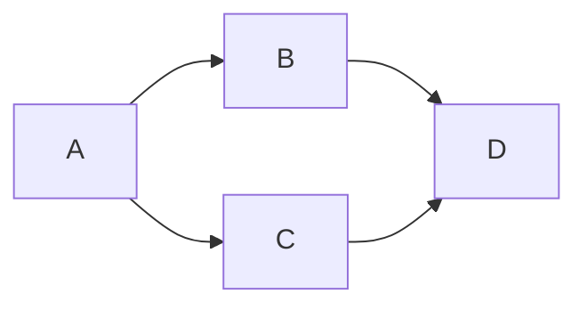

## Skip edge (top down)

Expected: `A --> C` skips a rank, so it runs beside `B` through a dummy position
and comes back to `C`. It splits off `A`'s bus but arrives at `C` through its own
arrowhead: merging it with the one from `B` would show a path from `B` back up
into `B`.

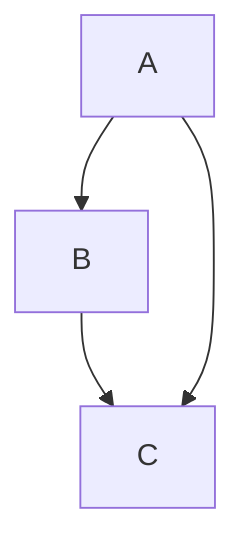

## Skip edge (left to right)

Expected: the same, with the long edge passing under `B` and arriving at `C`
below the arrow from `B`.

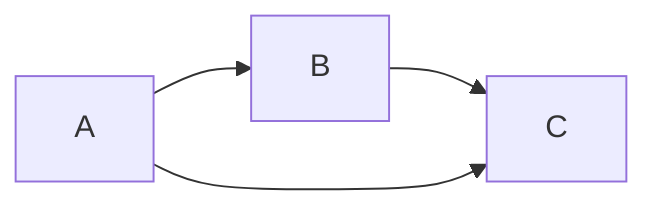

## Long links (top down)

Expected: each extra dash makes a link span one more rank. `Short` is one rank
below `Top`, `Mid` two, `Far` three, and `Top` stays the only box in its rank.

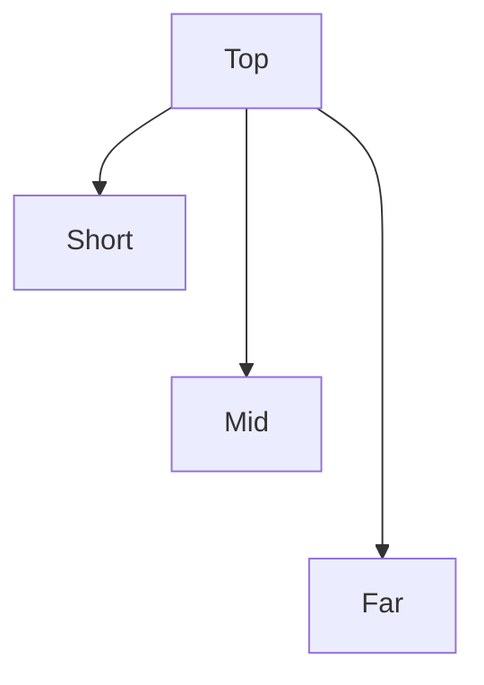

## Long links (left to right)

Expected: the same graph turned on its side. The long edges pass through the empty
ranks as straight lines.

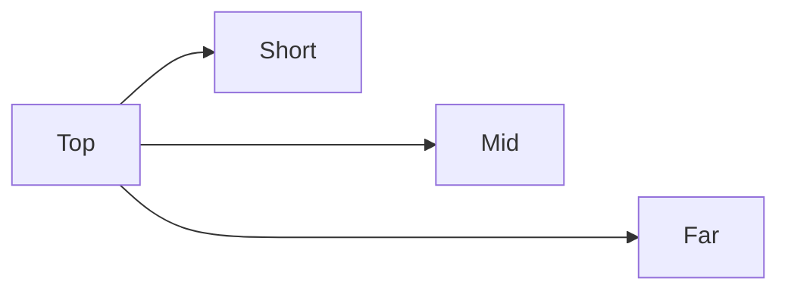

## Two components (top down)

Expected: two unrelated graphs side by side, each with its own arrows. A box
declared after the first graph's boxes still sits with its own graph.

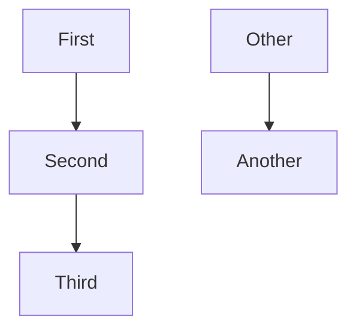

## Two components (left to right)

Expected: the graphs are stacked, one above the other.

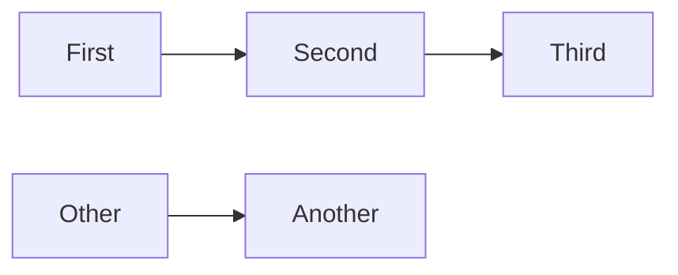

## A source that starts late (top down)

Expected: `Late` starts at the rank just above `End` rather than at the top, so its
arrow is as short as it can be.

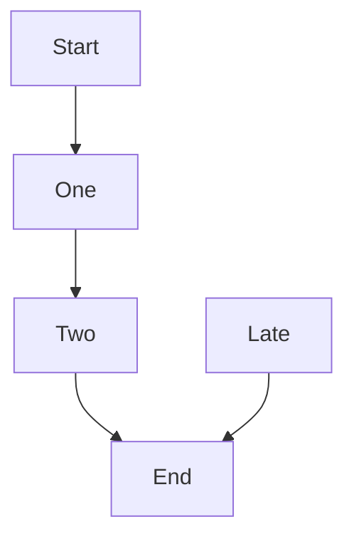

## Parallel edges (declined for now)

Expected: two edges between the same boxes. The builtin declines with
`parallel edges`, and the source is shown.

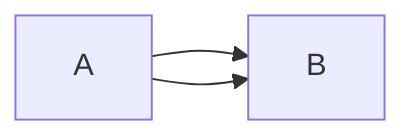
