# Mermaid edge labels

On a Kitty terminal, the built-in renderer writes an edge's label as ordinary text
on the edge, which stops a little short of it on either side. The label is a node
of its own in the layout, halfway along the edge, so it gets room like any other
box. Every rank is twice as far apart in a diagram with labels, so a label always
has a rank to sit in. A label doesn't stop its edge from sharing a port: edges with different labels, or
none, still split from one box or merge into one on a single bus.
Checked by `mermaid-kitty.sh` at widths 80 and 44, with `--img kitty` and pinned
cell sizes. The `.err` golden names the diagrams that are declined, and so are
shown as source: at width 44, those too wide for it.

## Every syntax (top down)

Expected: each pair is joined as its label says, and the label sits on the edge
midway between the two boxes. `-- text -->` and `-->|text|` draw the same arrow,
and `---` and `-- text ---` the same open link. The dotted link is dashed, the
thick one is thick with a larger arrowhead, and `--o` and `--x` end in a circle and
an X. A space between `-->` and `|` makes no difference.

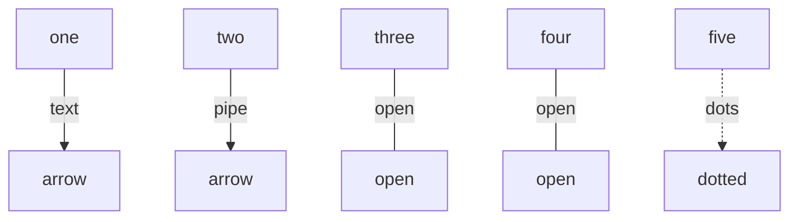

## Every syntax, continued (top down)

Expected: the remaining spellings. `== text ==>` and `==>|text|` are thick, `-.->|text|`
is dotted, and the marker on the left of `<-- text -->` is an arrowhead at the source.

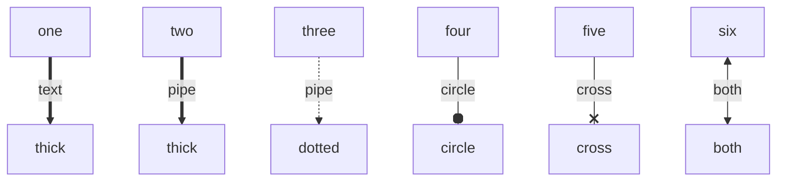

## A decision (top down)

Expected: `Valid?` has two labelled branches, `yes` and `no`, both leaving it through
one port and carrying their labels in a rank of their own halfway down. Both
branches then meet at `Done`.

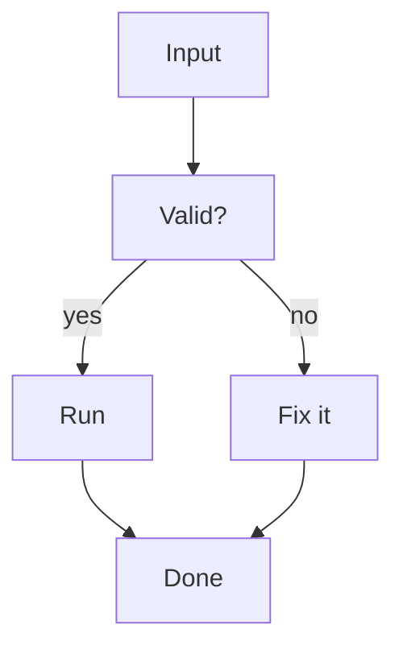

## A decision (left to right)

Expected: the same graph turned on its side. Each label sits on its edge in a
column of its own between the boxes, and the edge is cut a little before it and a
little after.

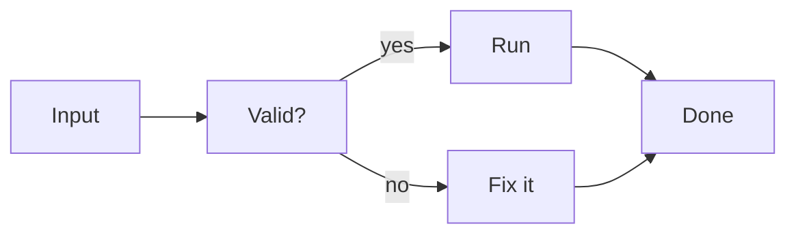

## A label on a long link (top down)

Expected: `a -- skip ---> c` is two steps long, so its label sits beside `Middle`, the
box halfway down, and the edge runs straight past it. The edge `a -->|one| d` is one
step long, so its label sits one step down, beside nothing.

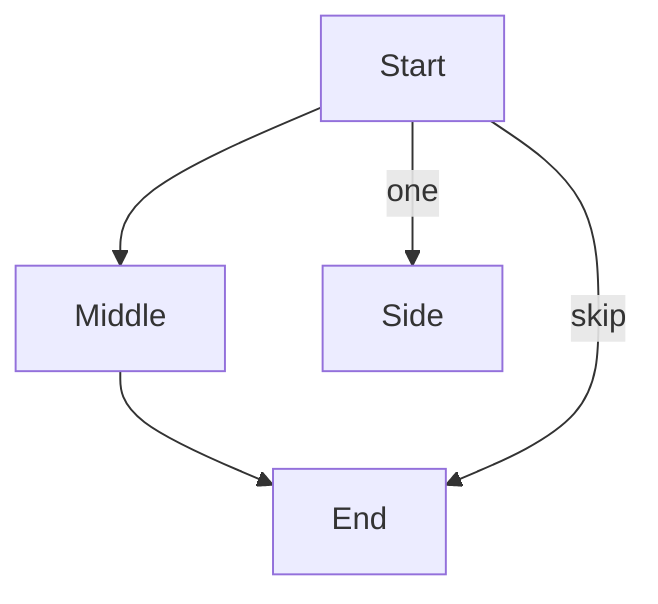

## Other directions (bottom to top, right to left)

Expected: labels are never mirrored, and the arrowheads still point the true way.

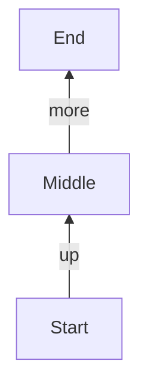

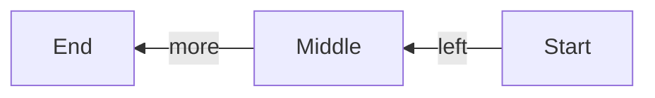

## Two labelled edges into one target (top down)

Expected: the two labelled edges and the unlabelled one from `C` all arrive at
`Target` through one port, on one bus, with one arrowhead.

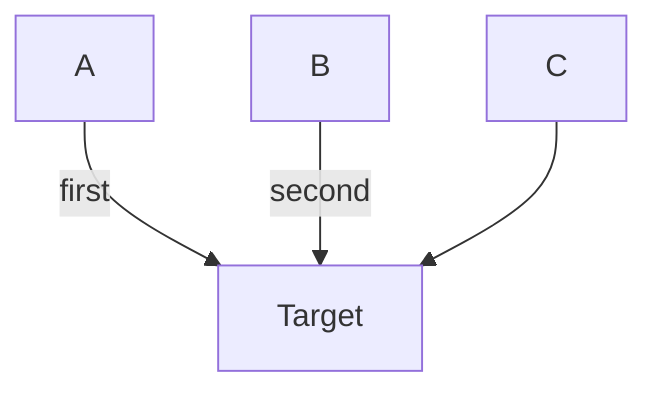

## Two labelled edges into one target (left to right)

Expected: as above, turned on its side.

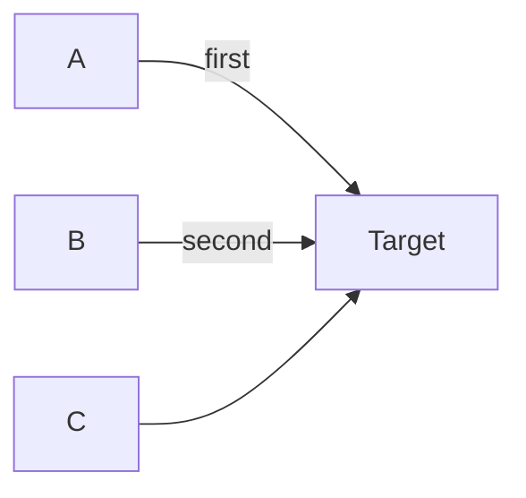

## Chains and groups

Expected: a label belongs to the link it is written on, so in a chain only the
second link has one, and `&` gives the same label to each edge.

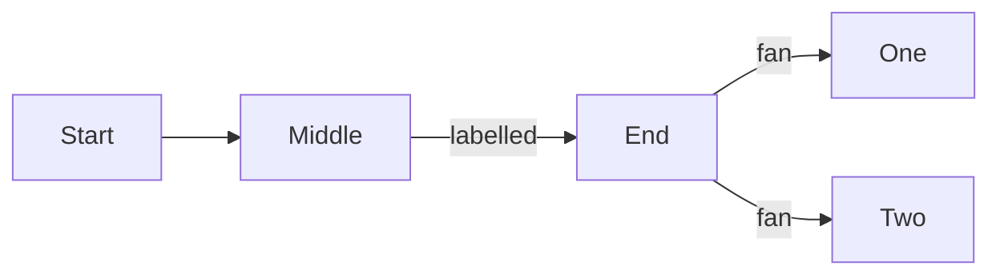

## Declined

Expected: shown as source, as the `.err` golden says. A label over 24 columns is too
wide; a label with markup, or an invisible link with a label, is not plain text.

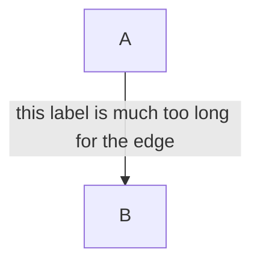

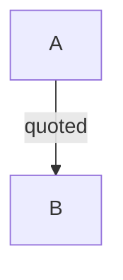

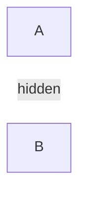
