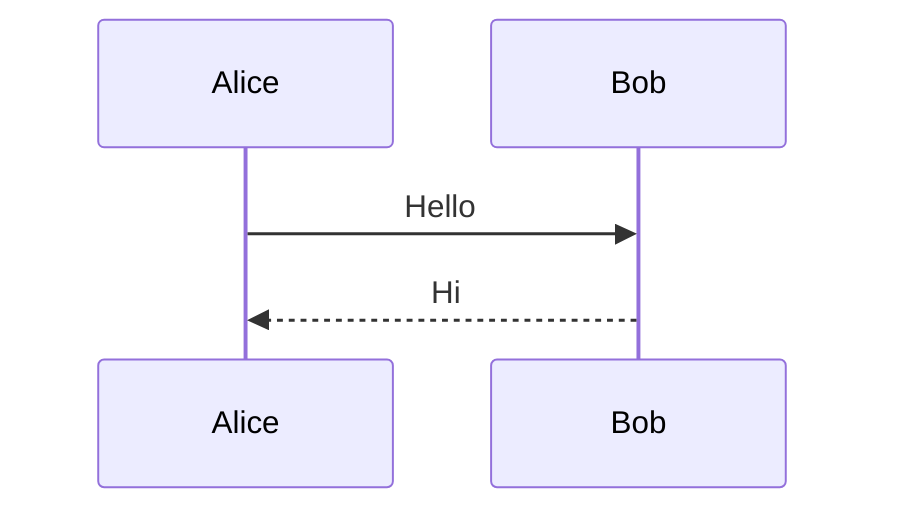
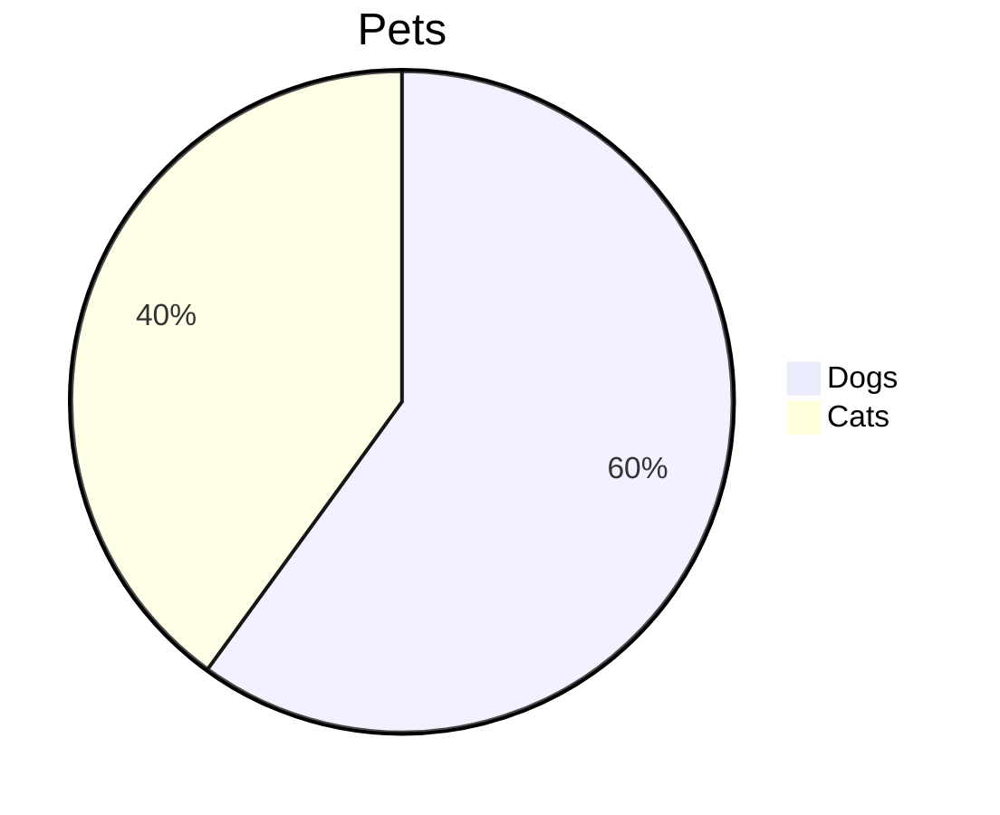
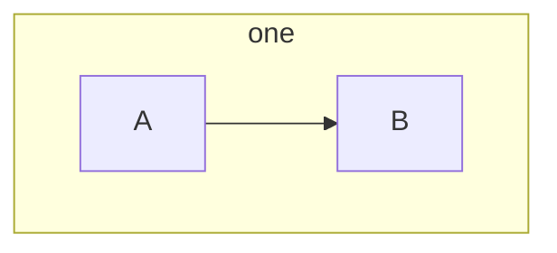
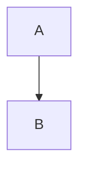
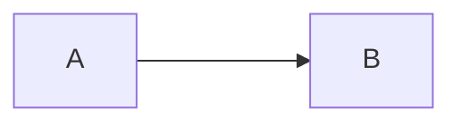

# Mermaid diagrams the built-in renderer declines

With `--mermaid builtin`, each of these shows its source as a code panel, and
`MDCAT_MERMAID_DEBUG=1` names the reason on stderr. Checked by `mermaid-kitty.sh`.

## Sequence diagram



## Pie chart



## Subgraph



## Subgraph with a direction


## Direction statement



## Reserved word as an id

```mermaid
graph TD
    A --> end
```

## Mismatched link ends



## Unknown direction

```mermaid
graph XY
    A --> B
```
