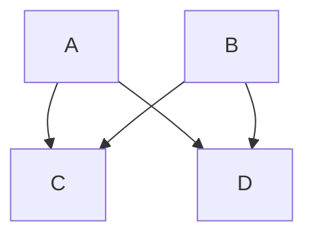
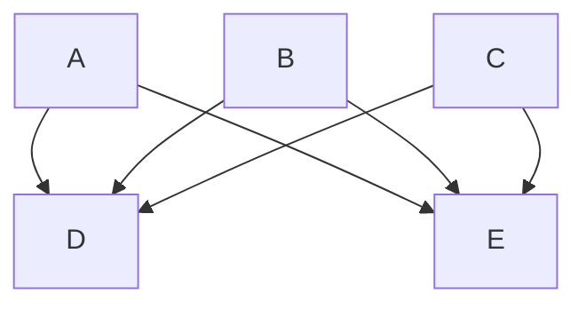
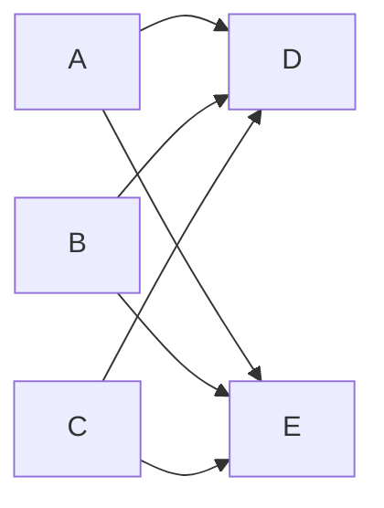
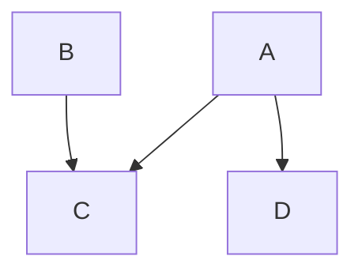
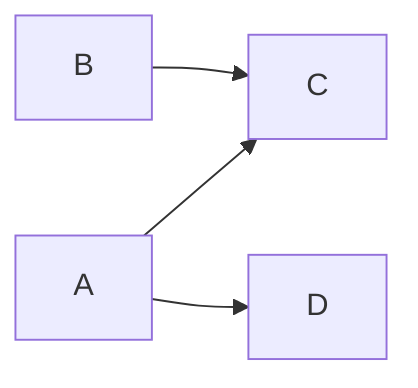
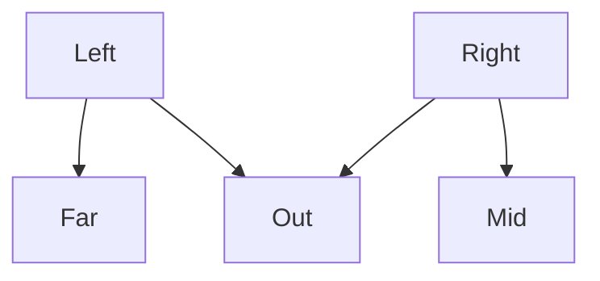
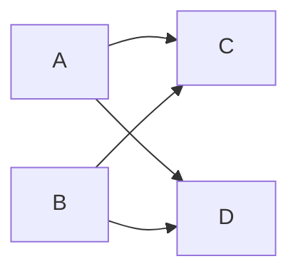
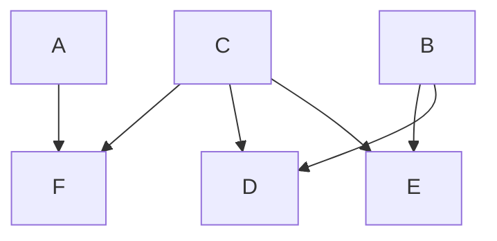

# Mermaid graphs that need several tracks

On a Kitty terminal, the built-in renderer gives each bus of edges between two
ranks a track of its own, so edges that interleave no longer need to share one.
Where one edge must cross another, the horizontal stroke breaks to make a bridge,
so a crossing never looks like a join. Checked by `mermaid-kitty.sh` at width 80,
with `--img kitty` and pinned cell sizes. The `.err` golden names the diagrams
that are declined, and so are shown as source.

A dot always marks a split or a merge. A bridge has no dot.

## Two tracks (top down)

Expected: both boxes in the first row link to both boxes in the second. `A` and
`B` each split a bus on their own track, and `C` and `D` each merge the two. No
bridge: the buses are nested so that no edge crosses another.

## Three tracks (top down)

Expected: three boxes link to the two below. Each of the three sources has its own
track, stacked between the rows, and `D` and `E` merge all three. No bridge.

## Three tracks (left to right)

Expected: the same graph turned on its side. Each source's bus runs along a column
of its own between the two ranks.

## One crossing (top down)

Expected: `A` fans out to `C` and `D`, and `B` links to `C`, so `B`'s edge has to
cross the edge into `D`. The crossing is one bridge: the horizontal run from `B`
breaks where the arrow into `D` passes, with no dot.

## One crossing (left to right)

Expected: the same graph turned on its side. The horizontal stroke into `C`
breaks where it crosses the vertical track that leads to `D`.

## Two buses with a bridge (top down)

Expected: `Left` fans out to `Out` and `Far`, and `Right` fans out to `Out` and
`Mid`, so `Out` merges two arrows. `Right`'s run to `Mid` has to pass over the
arrow into `Far`, and does so with one bridge.

## Aligned boxes (declined for now)

Expected: in this orientation `A` and `C`, and `B` and `D`, line up, so the
straight edges between them and the jogs between the two buses would meet. The
builtin declines with `edges touch`, and the source is shown.

## Too many crossings (declined for now)

Expected: three of these edges cross others, which is more than the builtin
allows. It declines with `crossings: 3 > 2`, and the source is shown.

