# Mermaid node shapes

On a Kitty terminal, the built-in renderer draws each node's outline as part of the
diagram's image, and its label as ordinary text over it. Besides the box, `[text]`,
it draws the rounded box `(text)`, the stadium `([text])`, the circle `((text))`, the
double circle `(((text)))`, the subroutine `[[text]]`, the cylinder `[(text)]`, the
rhombus `{text}` and the hexagon `{{text}}`. The curves and slants are drawn exactly,
so an arrowhead touches them exactly where an edge meets them, even off the middle
of a side. Each shape takes the room its outline needs to clear the label: the
stadium, subroutine and hexagon are 2 columns wider than a box, the cylinder is a row
taller (its label sits under the lid) and at least as wide as an 8-column label, so
that its lid looks equally deep whatever the label, the rhombus has the label's rows
+ 4 rows and
about twice its width, and a circle is widened until the label's box fits inside.
Checked by `mermaid-kitty.sh` at width 80, with `--img kitty` and pinned cell sizes.

## Every shape, top down

Expected: seven shapes in a column, joined by arrows that end exactly on each
outline: a box, a rounded box with corners of half a row, a stadium with semicircular
ends, a circle (really an ellipse), a double circle with two outlines a few pixels
apart, a subroutine with a vertical line half a cell inside each side, and a cylinder
with a lid. The label of each is centred; the cylinder's is below its lid.

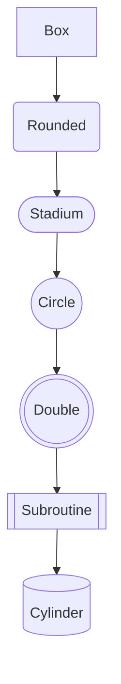

## Every shape, left to right

Expected: the same shapes in a row, plus the rhombus and the hexagon, which join
them in two rows. Arrows meet the outlines at their left and right points.

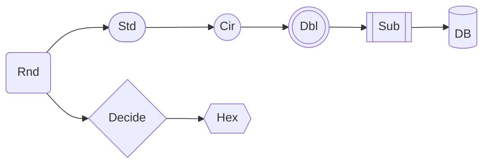

## A decision

Expected: a start and an end that are stadiums, and a rhombus whose two labelled
edges leave its bottom point on one bus, as they do from a box. The rhombus is
five rows tall and its label fits well inside it. The edge into the rhombus is
only a little longer than an edge between boxes, although the labelled edges
double the ranks. Below the rhombus, the cylinder and the circle sit in one rank
with their labels on one row, so the circle starts a row lower than a box would.

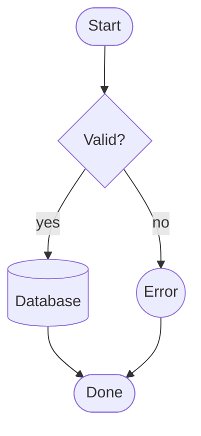

## Several lines

Expected: a label of several lines grows each shape the way it grows a box. The
circle and the rhombus widen until the lines fit inside, and the cylinder gets a
row for each line below its lid.

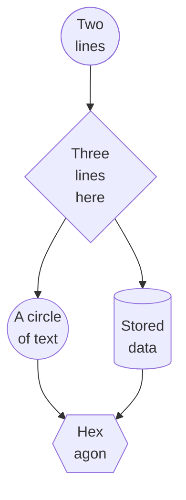

## Several edges at one node

Expected: edges leave and arrive off the middle of a side, at points that depend on
the shape: on the lid of the cylinder, the ellipse, the slanted sides of the
rhombus and the hexagon. Each arrowhead still touches its outline, and every stroke
that leaves a curve starts on it.

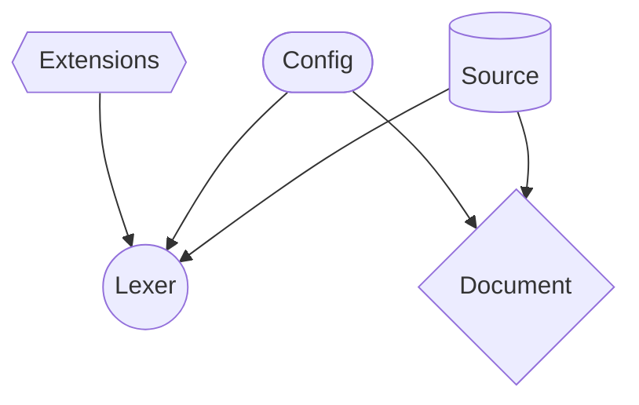

## Other directions

Expected: `BT` and `RL` keep every shape the right way up: the cylinder's lid stays
on top, with its label below it, in both. In the first `BT` diagram the labels of
the cylinder and the circle are still on one row. Left to right (above), the arrow
into the cylinder is level with its label, so it does not jog.

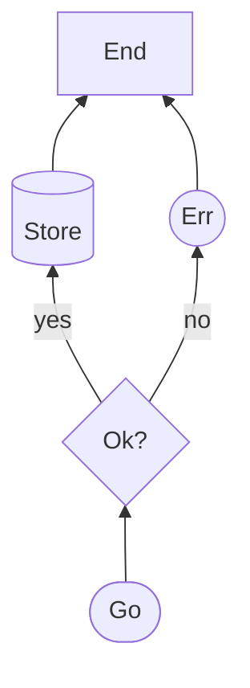

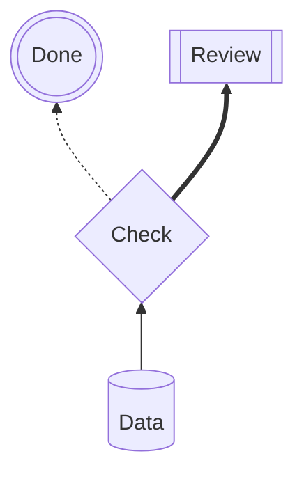

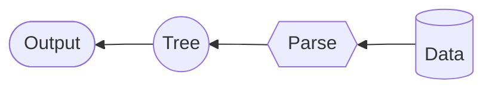

## Redefining a shape

Expected: a later definition of a node replaces its shape and label: `a` is a
stadium labelled "Second", not a box labelled "First".

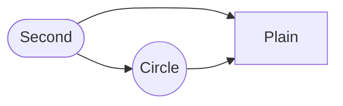

## Quotes and Markdown

Expected: a quoted label may hold the brackets that make the shapes, and a Markdown
string works in any shape.

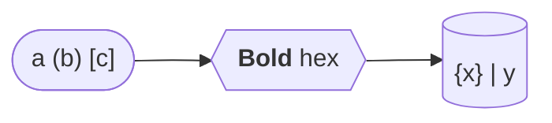

## Declined

Expected: shown as source, as the `.err` golden says, in this order. A slanted shape,
`[/text/]`, which is not drawn yet; a shape that is never closed.

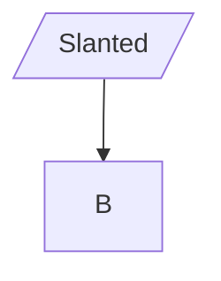

```mermaid
graph TD
    a((Open) --> b[B]
```
