# Mermaid syntax the built-in renderer reads

Directions, statement forms, and syntax that is understood but has no visual
effect. Checked by `mermaid-kitty.sh` at width 80, with the fallback reasons in
`expected/mermaid-syntax.w80.err`.

## Directions

Expected: the same three boxes in all four directions. Arrowheads follow the true
direction (up for `BT`, left for `RL`), and the labels are never mirrored.

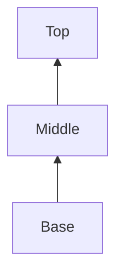

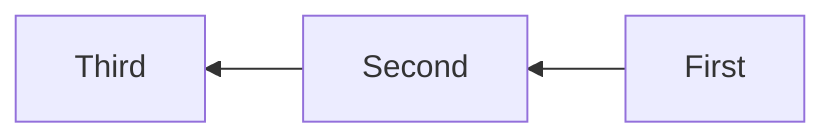

## Direction aliases

Expected: `>` is `LR`, `<` is `RL`, `^` is `BT` and `v` is `TB`.

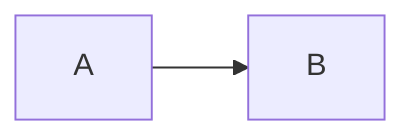

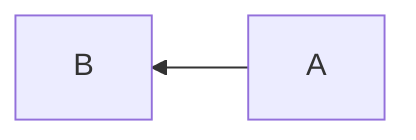

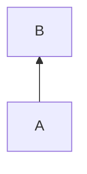

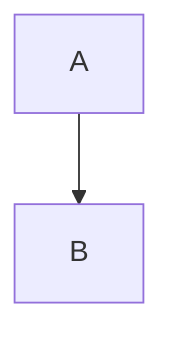

## No direction, and `flowchart-elk`

Expected: both read as top-down, as `flowchart-elk` reads as `flowchart`.


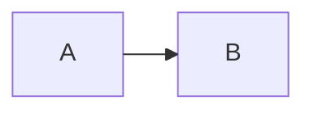

## Fan-out, bottom to top

Expected: a split drawn upward, one arrow from `A` to `B` and `C`, heads pointing up.

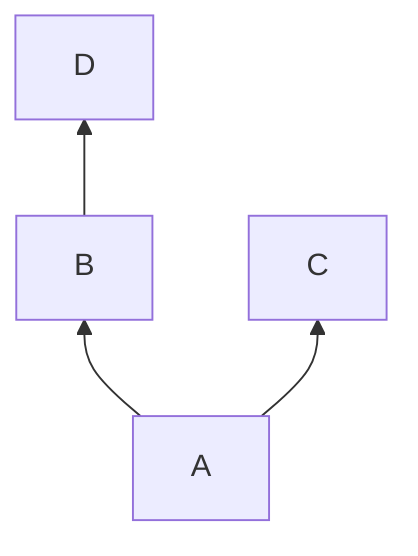

## Fan-in, right to left

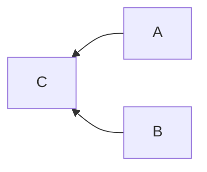

## Statements

Expected: `;` and newlines both separate statements. The chain makes `A --> B` and
`B --> C`.

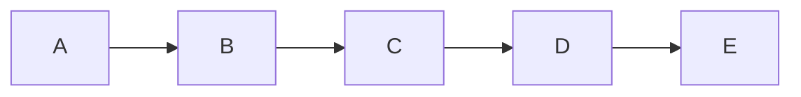

## Chains and `&`

Expected: `a --> b & c --> d` makes `a --> b`, `a --> c`, `b --> d` and `c --> d`.
(`A & B --> C & D` is in `mermaid-crossings.md`.)

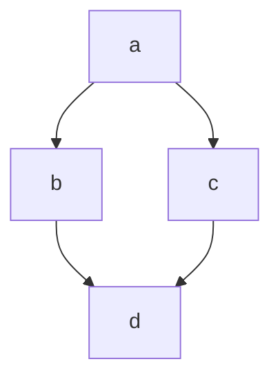

## Redefinition

Expected: the label is the last explicit text, `New`, and a bare `A` keeps it.

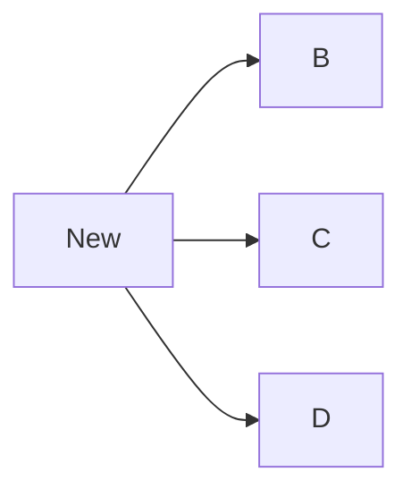

## Comments and directives

Expected: three boxes in a row. A `%%` line, a trailing `%%`, and a `%%{ }%%`
directive over several lines have no effect.

```mermaid
%%{init: {
  "theme": "dark"
}}%%
graph LR
    %% a comment
    A[One] --> B[Two] %% trailing
    B --> C[Three]
```

## Front matter

Expected: a bold, centred title above the diagram. `config:` has no effect.

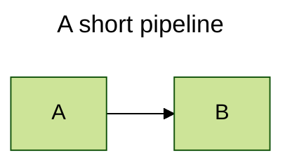

## Wide title

Expected: the title is wider than the diagram, which is centred under it.

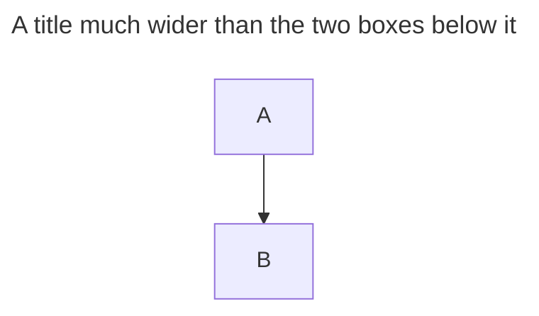

## Understood, but no visual effect

Expected: the diagram is just `A --> B` and `B --> C`. Styling, classes, links,
accessibility text, edge ids and edge properties are all read and dropped.

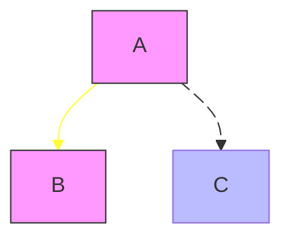

## Multi-line accessibility description


## Ids

Expected: ids may hold non-ASCII letters, `.` and `-`.

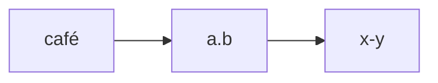
